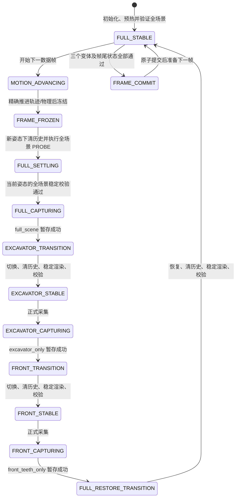
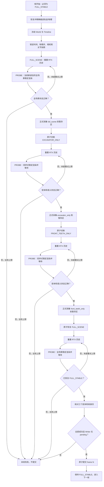

# Semantic World Module 单进程单帧采集链路改造方案

## 1. 文档目的

本文档定义 Semantic World Module 后续修改时必须遵守的单帧采集逻辑。

核心约束是：**整个采集任务只启动一个 Isaac Sim 进程，并在这个进程中逐帧切换 `full_scene`、`excavator_only` 和 `front_teeth_only` 三种场景状态。** 不拆分进程，不拆分轨迹，也不通过重新打开 USD 来完成场景切换。

本文档既是实现方案，也是当前单进程单帧链路的设计约束。相关本地代码已按本文档实现；是否能够用于正式长序列采集，仍须通过远端 Isaac Sim 短序列验收。

---

## 2. 本次改造要解决的问题

当前实现的单帧顺序大致是：

```text
推进物理状态并冻结
  -> 直接采集 full_scene
  -> 切换 excavator_only
  -> reset_render_history
  -> 采集 excavator_only
  -> restore
  -> reset_render_history
  -> 切换 front_teeth_only
  -> reset_render_history
  -> 采集 front_teeth_only
  -> restore
  -> reset_render_history
  -> 结束本帧
```

问题不在 CSV 轨迹、USD、相机位姿或物理时间，而在于“USD 可见性状态已经切换”和“RTX/Replicator/Annotator 已经产出与新状态一致的数据”不是同一件事。

当前每帧最后一次真正完成的渲染是 `front_teeth_only`。虽然随后调用了 `restore()` 和 `reset_render_history()`，但本帧结束前没有再做一次可等待、可验证的全场景渲染。因此下一帧的 `full_scene` 正式采集有机会读取到上一帧 `front_teeth_only` 的旧 Annotator 缓冲，RTX/DLSS 的时间历史也可能混合“上一时刻挖掘机主体不可见”和“当前时刻挖掘机主体重新可见”两种状态。

这会产生两类现象：

1. RGB 中挖掘机局部像透明一样透出草地或背景。PNG 文件本身的 Alpha 仍可能全部是 255；这里是时间历史残留造成的视觉鬼影，不是文件透明通道导致的透明。
2. 名义上的 `full_scene` 语义图实际只包含五个前侧斗齿标签，说明可见性状态或 Annotator 数据发生了跨变体串帧。

已有问题数据 `output0805_02` 中，1842 帧 `full_scene` 语义结果里只有 274 帧包含完整/非前侧挖掘机类别，1362 帧只包含五个前侧斗齿类别，206 帧不含目标类别。因此该目录不能作为改造后的正确性基线，也不应直接用于训练或阈值评估。

---

## 3. 核心目标

改造后的链路必须同时满足以下目标：

1. Isaac Sim 从开始到结束只运行一个进程。
2. USD、Stage、相机、RenderProduct、Replicator Orchestrator 和 Writer 在整段采集中持续存在，不按变体重新启动。
3. 每个数据帧只推进一次轨迹和物理状态。
4. 同一数据帧的三个变体共用完全相同的：
   - `frame_id`
   - `dataset_time`
   - `timeline_time`
   - `physics_step`
   - 相机世界位姿
   - 关节与运动状态
5. 三个变体之间只允许改变临时 USD 可见性，不允许推进物理、不允许改变关节、不允许改变相机位姿。
6. 每次改变可见性后，必须经过“切换、清理时间历史、丢弃式稳定渲染、状态校验”四步屏障，才允许正式采集。
7. 每帧结束前必须恢复并稳定在 `FULL_SCENE`，不能把 `FRONT_TEETH_ONLY` 作为帧尾状态留给下一帧。
8. 正式数据只有在本帧三个变体全部成功后才能提交，避免同一帧只留下部分变体文件。
9. 任一同步、语义状态、Writer 回执或帧身份检查失败时，本帧不得被当作成功数据。

---

## 4. 三种场景状态

统一使用一个场景变体控制器管理三种明确状态：

| 状态 | 含义 | 允许渲染的主要内容 |
| --- | --- | --- |
| `FULL_SCENE` | 完整场景 | 环境、挖掘机及场景中正常可见的几何体 |
| `EXCAVATOR_ONLY` | 挖掘机隔离场景 | 配置文件给出的挖掘机 Prim 及其子层级；必要的受保护 Prim |
| `FRONT_TEETH_ONLY` | 斗齿前侧隔离场景 | 用户明确配置的五个 `tooth_*_front_3DGS` Prim 及其子层级；必要的受保护 Prim |

`FULL_STABLE` 不是第四种 USD 场景，而是一个运行状态，表示：

```text
当前 USD 可见性 = FULL_SCENE
并且已经完成全场景的稳定渲染与校验
```

只有处于 `FULL_STABLE`，才允许推进到下一数据帧。

### 4.1 Front Teeth 的精确 Prim 范围

`FRONT_TEETH_ONLY` 只依据用户已提供的五个精确 Prim path 配置：

```text
/Fangshan_Excavator_01/bucket_with_teeth_prim/tooth_01_front_3DGS
/Fangshan_Excavator_01/bucket_with_teeth_prim/tooth_02_front_3DGS
/Fangshan_Excavator_01/bucket_with_teeth_prim/tooth_03_front_3DGS
/Fangshan_Excavator_01/bucket_with_teeth_prim/tooth_04_front_3DGS
/Fangshan_Excavator_01/bucket_with_teeth_prim/tooth_05_front_3DGS
```

每个路径代表该 Prim 本身及其全部子层级。为避免上层 Prim 的 `invisible` 继承到目标子树，控制器必须保护这些目标的祖先链，但“保护祖先不被隐藏”不等于主动把祖先自身的几何体加入目标集合。最终是否绘制某个祖先自身的几何体，要根据它自己的可见性、类型以及是否含可渲染几何判断；不能仅因为它是祖先就把整个祖先子树全部放行。

---

## 5. 总体状态机



任何状态发生不可恢复错误，都进入 `FRAME_FAILED`。进入失败状态后不得推进下一帧，也不得把本帧临时文件发布到正式数据目录。

---

## 6. 更新后的单帧完整逻辑链路

以下步骤组成一个数据帧的完整事务。步骤顺序不能交换。

### 6.1 帧开始前置条件

开始处理 `frame_id=N` 前必须断言：

1. `SceneVariantController.current_variant == FULL_SCENE`。
2. 控制器处于 `FULL_STABLE`。
3. Writer 没有待消费的 `CaptureContext`。
4. Replicator 上一次 step 已完成。
5. 上一帧已经正式提交，没有残留临时目录。
6. 当前可见性代次 `visibility_generation` 与最近一次全场景稳定回执一致。

若任一条件不满足，不允许推进物理。

### 6.2 推进轨迹和物理

1. 根据 `frame_id` 计算本帧目标 `dataset_step` 和 `dataset_time`。
2. 恢复物理/时间线运行状态。
3. 使用现有固定步长逻辑精确推进 `steps_to_advance`。
4. 在每个物理步前后继续调用现有关节运动回调。
5. 到达目标数据时刻后冻结 World/Timeline。
6. 保存不可变的本帧快照：
   - `FrozenWorldState`
   - 相机世界变换
   - 关节与运动状态
   - `dataset_time`
   - `timeline_time`
   - `physics_step`

从这里开始直到三个变体正式采集并恢复全场景完成，物理和时间线都必须保持冻结。

### 6.3 采集 `full_scene`

帧开始时本来就应处于上一帧留下的 `FULL_STABLE`，这只能证明全场景可见性没有被上一帧的隔离变体污染。物理推进后挖掘机已经处于新的姿态，因此正式采集前仍须针对当前姿态重新清理 RTX 时间历史并执行全场景 PROBE。

1. 断言当前变体为 `FULL_SCENE`。
2. 断言本帧快照中的时间、物理步、相机位姿和当前值一致。
3. 保持 USD 变体不变，调用 RTX 渲染历史重置。
4. 对当前新姿态执行一次丢弃式全场景稳定渲染；不写正式文件、不递增数据集帧号。
5. 等待 Render/Annotator 完成并校验返回数据属于 `FULL_SCENE` 和当前 `visibility_generation`。
6. 如未通过，在不推进物理的前提下按配置重试；超过上限则本帧失败。
7. 创建 `CaptureContext(frame_id=N, variant=FULL_SCENE, generation=当前代次)`。
8. 执行正式 Render/Annotator step，必须使用 `delta_time=0.0`，不得推进仿真。
9. 等待该次 Render 和 Writer 数据处理真正完成。
10. 对正式得到的 RGB、语义 ID、标签映射和回执再次校验。
11. 只写入本帧暂存区，不立即发布到最终目录。

### 6.4 切换并稳定 `excavator_only`

执行统一的 `transition_to(EXCAVATOR_ONLY)`：

1. 清除统一临时可见性层中的上一状态意见。
2. 在同一个临时层中一次性写入 `EXCAVATOR_ONLY` 所需的可见性意见。
3. 完成 USD ChangeBlock 后再提高 `visibility_generation`，不能在编辑到一半时暴露新状态。
4. 更新 `current_variant=EXCAVATOR_ONLY`。
5. 调用 RTX 渲染历史重置。
6. 执行一次丢弃式稳定渲染；本次渲染进入 Writer/Annotator，但绝不写正式数据，也不递增数据集 `frame_id`。
7. 显式等待 Render 和 Annotator 完成。
8. 校验返回数据确实属于 `EXCAVATOR_ONLY` 和当前 `visibility_generation`。
9. 如未通过，在不推进物理的前提下重复“重置历史 + 丢弃式稳定渲染”，最多达到配置的重试次数。
10. 重试仍不通过则本帧失败，禁止正式采集。

稳定通过后再正式采集：

1. 创建与原始帧快照相同、仅 `variant` 不同的 `CaptureContext`。
2. 执行正式 Render/Annotator step，`delta_time=0.0`。
3. 等待完成。
4. 校验正式数据和回执。
5. 写入本帧暂存区。

### 6.5 切换并稳定 `front_teeth_only`

执行 `transition_to(FRONT_TEETH_ONLY)`，过程与上一节一致：

1. 在统一可见性层中原子切换到 `FRONT_TEETH_ONLY`。
2. 增加 `visibility_generation`。
3. 重置 RTX 时间历史。
4. 执行不写盘、不增加 `frame_id` 的丢弃式稳定渲染。
5. 等待并验证当前场景状态。
6. 必要时按配置重试。
7. 稳定后正式采集 `front_teeth_only`。
8. 等待、校验并暂存本变体结果。

如果配置规定 `front_teeth_only` 不输出 RGB，则正式采集仍可让 RGB Annotator 参与同步或诊断，但 Writer 不应把该 RGB 发布到数据集目录。其语义 ID 和语义彩色图仍按现有规则输出。`semantic_runtime_id` 默认继续为 `false`。

### 6.6 恢复并稳定 `full_scene`

这是解决跨帧串帧问题的关键步骤，不能只调用 `restore()` 后直接结束本帧。

1. 执行 `transition_to(FULL_SCENE)`。
2. 清除统一临时可见性层中的隔离意见，使完整 Stage 重新生效。
3. 增加 `visibility_generation`。
4. 重置 RTX 时间历史。
5. 执行全场景丢弃式稳定渲染，不写任何数据，不改变数据集帧号。
6. 等待 Render 和 Annotator 完成。
7. 验证当前返回数据属于 `FULL_SCENE`，并验证不存在 Writer 未完成上下文。
8. 必要时重试；超过上限则本帧失败。
9. 通过后设置运行状态为 `FULL_STABLE`。

此时下一帧开始前，GPU 上最近完成的 Render/Annotator 数据已经是完整场景，而不是 `front_teeth_only`。

### 6.7 原子提交本帧

只有以下条件全部满足，才允许发布 `frame_id=N`：

1. `full_scene` 正式数据校验通过。
2. `excavator_only` 正式数据校验通过。
3. `front_teeth_only` 正式数据校验通过。
4. 三个回执的 `frame_id`、时间、物理步和相机位姿一致。
5. 三个回执分别绑定了正确的 `variant` 和可见性代次。
6. 帧尾已经恢复并稳定为 `FULL_SCENE`。
7. Writer 无 pending context。

提交时，将本帧暂存区的各个文件移动/发布到现有正式输出目录，并在最后写入本帧完成标记或 manifest 记录。若提交前失败，只清理本帧暂存数据，不影响已经完成的历史帧。

### 6.8 进入下一帧

原子提交完成后仍保持：

```text
current_variant = FULL_SCENE
runtime_state = FULL_STABLE
timeline/world = frozen
writer_pending = 0
```

下一帧只能从这个状态恢复物理推进。

---

## 7. 单帧流程图



---

## 8. 场景切换实现方案

### 8.1 使用统一控制器

将当前两个相互独立的 `SceneVisibilityController` 收敛为一个 `SceneVariantController`。它只创建一个匿名 Session 子层，并独占本任务所有临时可见性意见。

建议的核心状态：

```text
current_variant
visibility_generation
visibility_layer
variant_definitions
last_transition_report
```

使用统一层的原因是避免两个匿名可见性层同时保留意见、先后顺序不明确或一个控制器恢复时另一个控制器仍然影响 Stage。

### 8.2 原子切换规则

`transition_to(target_variant)` 应遵循：

1. 验证目标变体配置中的所有精确 Prim path 都存在。
2. 预先计算目标变体的保留集合、祖先保护集合和待隐藏根集合。
3. 在一个 USD 变更块内，先清除旧意见，再写入完整的新意见。
4. 只有整个变更块成功后才修改 `current_variant` 和增加 `visibility_generation`。
5. 中途异常时回滚为已知的 `FULL_SCENE`，不能留下半切换状态。

### 8.3 `visibility_generation` 的作用

每完成一次场景切换就把代次加一，例如：

```text
frame 0 起点 FULL_SCENE         generation=0
切到 EXCAVATOR_ONLY             generation=1
切到 FRONT_TEETH_ONLY           generation=2
恢复 FULL_SCENE                 generation=3
frame 1 切到 EXCAVATOR_ONLY     generation=4
```

每个 PROBE、正式 `CaptureContext`、Writer 回执和 metadata 都记录该值。这样能够识别“请求属于新场景，但返回数据仍来自旧场景”的串帧问题。

---

## 9. 渲染同步屏障

一次合格的场景切换屏障必须包含：

```text
USD 原子切换完成
  -> reset_render_history()
  -> Replicator 丢弃式 step(delta_time=0)
  -> 等待 Render/Annotator 完成
  -> 校验变体、generation 和语义内容
```

仅增加 `/rtx/externalFrameCounter` 不等于完成一次新状态渲染；它只是让 RTX 历史失效。仅调用若干次 `simulation_app.update()` 也不能证明 Replicator Writer 所消费的 Annotator 缓冲已经更新。因此稳定渲染应经过与正式采集相同的 RenderProduct/Replicator 数据通道。

Replicator step 必须显式使用：

```text
delta_time = 0.0
wait_for_render = true（若当前 Isaac Sim API 暴露此参数）
rt_subframes = 配置值
```

随后仍调用完成等待，并检查 Writer/Probe 回执。`rt_subframes` 用于同一静态状态内的 RTX 收敛和历史清理，但不能代替场景状态校验。

---

## 10. Writer 的 PROBE 与 CAPTURE 两种模式

### 10.1 PROBE 模式

PROBE 是可丢弃的稳定渲染：

- 接收 RGB/语义 Annotator 数据；
- 消费专用 `ProbeContext`；
- 检查变体、generation、分辨率、语义标签和必要的像素状态；
- 返回 `ProbeReceipt`；
- 不写 RGB、NPY、彩色语义图或 metadata；
- 不递增数据集 `frame_id`；
- 不计入正式 `completed_by_variant`。

### 10.2 CAPTURE 模式

CAPTURE 只在对应变体的 PROBE 通过后执行：

- 消费正式 `CaptureContext`；
- 校验正式 Render 得到的数据，而不是直接相信前一次 PROBE；
- 先写本帧暂存区；
- 返回包含文件清单、变体、generation 和校验摘要的 `CaptureReceipt`；
- 等到本帧三个变体及帧尾恢复全部成功后再发布。

### 10.3 上下文不能混用

Ledger 中的队列项必须明确区分：

```text
operation = PROBE | CAPTURE
frame_id
variant
visibility_generation
attempt
```

Writer 每次只能消费一个与当前 Render step 对应的上下文。出现空队列写入、消费到错误变体、错误 generation 或积压多个 pending context 时，应立即停止采集。

---

## 11. 场景状态校验策略

校验分为两层，二者都要通过。

### 11.1 USD 可见性层校验

由 `SceneVariantController` 校验：

- 当前匿名层是否只包含目标变体的意见；
- 目标 Prim 和必要祖先是否没有被不可见祖先阻断；
- 非目标可渲染子树是否已按配置隐藏；
- `current_variant`、`visibility_generation` 和切换报告是否一致。

### 11.2 Annotator 内容校验

通过稳定 dataset semantic ID 或 `idToLabels` 检查实际 Render 结果。

建议把每个变体的规则放入配置文件，不在 Python 中猜测具体标签：

- `allowed_labels`：允许出现的目标标签集合；
- `forbidden_labels`：出现任意一个就表示串入其他变体；
- `required_any_labels`：至少出现一个才可通过；
- `allow_empty_target`：目标完全离开画面时是否允许空结果。

规则原则如下：

| 变体 | 核心规则 |
| --- | --- |
| `FULL_SCENE` | 当前轨迹预期挖掘机在画面内时，必须出现至少一个配置的非前侧挖掘机标签；不能只出现五个前侧斗齿标签 |
| `EXCAVATOR_ONLY` | 不能出现环境或其他非挖掘机目标标签；应出现配置的挖掘机目标标签 |
| `FRONT_TEETH_ONLY` | 目标标签只允许来自五个前侧斗齿；任一非前侧挖掘机目标标签出现都判定失败 |

如果五个前侧斗齿全部在画面外，`FRONT_TEETH_ONLY` 的目标像素可能为空。此时能否通过由 `allow_empty_target` 决定，但 USD 层状态校验仍必须通过。

正式采集的数据也必须重复内容校验，不能只校验 PROBE。

---

## 12. 建议新增配置

配置名可在实现时按现有 schema 风格微调，但语义应保持如下：

```json
{
  "variant_transition": {
    "settle_render_count": 1,
    "settle_rt_subframes": 16,
    "maximum_settle_attempts": 3,
    "restore_full_scene_after_each_frame": true
  },
  "variant_validation": {
    "full_scene": {
      "required_any_labels": ["由现有 semantic mapping 精确配置"],
      "forbidden_labels": [],
      "allow_empty_target": false
    },
    "excavator_only": {
      "required_any_labels": ["由现有 semantic mapping 精确配置"],
      "forbidden_labels": ["环境及其他禁止标签，由配置精确给出"],
      "allow_empty_target": false
    },
    "front_teeth_only": {
      "allowed_labels": ["五个前侧斗齿对应的精确标签"],
      "forbidden_labels": ["所有非前侧挖掘机目标标签"],
      "allow_empty_target": true
    }
  }
}
```

初始建议值为一次稳定渲染、每次 16 个 `rt_subframes`、最多三次尝试。它们是可配置的起始值，不应理解为未经测试即可永久固定的最优值。

`restore_full_scene_after_each_frame` 在本方案中必须为 `true`。即使保留为配置项，生产配置也不能关闭它。

Writer 在切换前必须为空闲是代码级不变量，不提供可关闭的配置项。`WriterSyncGate` 警告继续作为远端验收失败条件；在完成实际同步图排查前，不把它实现为启动后立即终止进程的运行参数，以免丢失诊断信息。

---

## 13. 单帧伪代码

```python
for frame_id in range(frame_count):
    assert runtime_state is FULL_STABLE
    assert variant_controller.current_variant is FULL_SCENE
    assert writer.pending_count == 0

    resume_world()
    advance_motion_and_physics_to_frame(frame_id)
    frozen = freeze_world()
    frame_snapshot = snapshot_frame_identity(frame_id, frozen)
    staging = begin_frame_staging(frame_id)

    try:
        assert_frame_unchanged(frame_snapshot)
        settle_current_variant(
            target=FULL_SCENE,
            snapshot=frame_snapshot,
        )
        full_receipt = capture_to_staging(
            snapshot=frame_snapshot,
            variant=FULL_SCENE,
            generation=variant_controller.visibility_generation,
            staging=staging,
        )

        transition_and_settle(
            target=EXCAVATOR_ONLY,
            snapshot=frame_snapshot,
        )
        excavator_receipt = capture_to_staging(
            snapshot=frame_snapshot,
            variant=EXCAVATOR_ONLY,
            generation=variant_controller.visibility_generation,
            staging=staging,
        )

        transition_and_settle(
            target=FRONT_TEETH_ONLY,
            snapshot=frame_snapshot,
        )
        front_receipt = capture_to_staging(
            snapshot=frame_snapshot,
            variant=FRONT_TEETH_ONLY,
            generation=variant_controller.visibility_generation,
            staging=staging,
        )

        transition_and_settle(
            target=FULL_SCENE,
            snapshot=frame_snapshot,
        )
        runtime_state = FULL_STABLE

        assert_frame_unchanged(frame_snapshot)
        assert_receipts_match_frame(
            full_receipt,
            excavator_receipt,
            front_receipt,
        )
        assert writer.pending_count == 0
        commit_frame_staging(staging)

    except Exception:
        discard_frame_staging(staging)
        recover_and_settle_full_scene_without_advancing_world()
        raise
```

`transition_and_settle()` 的逻辑为：

```python
def transition_and_settle(target, snapshot):
    variant_controller.transition_to(target)

    for attempt in range(1, maximum_settle_attempts + 1):
        assert_frame_unchanged(snapshot)
        camera_scheduler.reset_render_history()
        probe_receipt = camera_scheduler.probe(
            frame_id=snapshot.frame_id,
            variant=target,
            generation=variant_controller.visibility_generation,
            attempt=attempt,
            rt_subframes=settle_rt_subframes,
        )
        assert_frame_unchanged(snapshot)

        if validate_probe(probe_receipt, target):
            return

    raise VariantSettleError(target, snapshot.frame_id)
```

---

## 14. 异常处理原则

### 14.1 稳定渲染失败

在当前冻结帧内重试，不得推进物理。超过 `maximum_settle_attempts` 后停止任务，保留诊断日志，但不提交本帧。

### 14.2 正式采集校验失败

不直接使用 PROBE 的结果替代正式数据。正式数据失败时，本帧事务失败；先丢弃暂存区，再尝试恢复并稳定 `FULL_SCENE`，然后终止运行并报告具体变体、帧号和 generation。

### 14.3 恢复全场景失败

即使三个变体都已采集，也不得提交。因为下一帧的起点不可信，必须停止任务。

### 14.4 Writer 或同步图异常

出现以下情况应视为阻断性错误：

- Writer 存在无法清空的 pending context；
- 回执的变体或 generation 与请求不一致；
- 同一个上下文被消费两次；
- 未 arm 的 Render step 被当作正式采集；
- 日志持续出现 `WriterSyncGate` cycle connection 警告。

不能仅因为文件数量最终等于帧数就忽略同步图警告；文件齐全不能证明每个文件属于正确的场景状态。

---

## 15. Metadata 与诊断字段

每个正式变体回执至少新增或确认以下字段：

```text
operation = CAPTURE
frame_id
variant
visibility_generation
dataset_time
timeline_time
physics_step
camera_world_transform
semantic_labels_present
validation_passed
settle_attempts_before_capture
staged_files
```

每个 PROBE 回执至少记录到运行日志或诊断流：

```text
operation = PROBE
frame_id
variant
visibility_generation
attempt
semantic_labels_present
validation_result
render_wait_completed
```

帧级 metadata 还应记录帧尾状态：

```text
end_variant = FULL_SCENE
end_state = FULL_STABLE
writer_pending = 0
frame_committed = true
```

---

## 16. 需要修改的代码模块

| 文件 | 修改重点 |
| --- | --- |
| `scene_visibility_controller.py` | 将两个独立控制器重构为统一 `SceneVariantController`；支持三状态、原子切换和 generation |
| `semantic_capture_custom.py` | 增加 PROBE/丢弃式 Render 接口；显式 Render 等待；把 generation 带入回执；保留正式 capture |
| `semantic_dataset_writer.py` | 区分 PROBE 与 CAPTURE；PROBE 不写盘；正式数据先写帧暂存区；增加正式数据校验和原子提交支持 |
| `simulation_orchestrator.py` | 按本文档重排完整单帧事务；帧尾强制恢复并稳定全场景；异常时禁止提交 |
| `capture_launch_config.py` | 增加并严格校验 `variant_transition` 与 `variant_validation` 配置 |
| `frame_transaction.py` | 管理每帧暂存路径、正式发布、覆盖回滚和失败丢弃 |
| `semantic_content_validation.py` | 对三种变体执行配置驱动的语义内容检查，识别跨变体串帧 |
| `configs/*.json` | 为实际运行配置补充稳定渲染和各变体标签规则 |
| `tests/` | 增加状态机、generation、PROBE 不写盘、帧尾恢复、错误不提交和三变体身份一致性测试 |

改造不应重新创建相机 Prim，也不应把可见性意见写回原始 USD/USDA。场景切换继续只存在于匿名 Session Layer 中，因此不会覆盖相机位置、旋转或镜头参数。

---

## 17. 测试和验收顺序

### 17.1 本地单元测试

至少覆盖：

1. 状态只能按允许的方向迁移。
2. 每次场景切换只增加一次 generation。
3. 统一可见性层不会同时保留两个隔离变体的意见。
4. PROBE 不生成任何正式文件且不增加正式帧计数。
5. 正式 capture 绑定正确的 `frame_id + variant + generation`。
6. 三个变体任一失败时本帧不提交。
7. 帧尾未达到 `FULL_STABLE` 时本帧不提交。
8. 异常恢复不会推进 physics step 或 dataset time。

### 17.2 远端短序列验证

先使用原 USD 和原 CSV 采集 20 至 50 帧，不直接运行完整 1842 帧。

验收条件：

1. 每一帧的 `full_scene` 都满足配置的完整挖掘机语义规则。
2. 每一帧 `front_teeth_only` 都不含禁止的非前侧目标标签。
3. `excavator_only` 不混入环境目标。
4. `full_scene` RGB 的 Alpha 全为 255，且肉眼检查不再出现挖掘机透出背景的鬼影。
5. 同一帧三个变体的相机位姿、时间和物理步完全一致。
6. 每帧 metadata 的结束状态都是 `FULL_SCENE + FULL_STABLE`。
7. 每帧结束时 Writer pending 数为 0。
8. 没有变体错配、generation 错配或部分提交。
9. 不再出现 `WriterSyncGate` cycle connection 警告；若仍出现，短序列验收不通过并继续排查同步图。

### 17.3 完整轨迹验证

短序列全部通过后，才复用原 USD 和原 CSV 运行完整 1842 帧。完整运行结束后除文件数检查外，还要逐帧统计三个变体的语义类别集合，不能只抽样观察 RGB。

---

## 18. 最终必须保持的不变量

后续实现和代码评审应围绕以下不变量进行：

```text
一条轨迹 = 一个 Isaac Sim 进程
一个 frame_id = 一次物理/轨迹推进
同一 frame_id 的三个变体 = 同一个冻结世界状态
每次可见性切换 = 原子切换 + 清历史 + 丢弃式稳定渲染 + 校验
正式采集 = 经过稳定屏障后单独执行并再次校验
每帧结束 = FULL_SCENE + FULL_STABLE + writer_pending=0
任一变体失败 = 整帧不提交
```

最关键的变化不是简单增加等待时间，而是把“场景状态已经切换”和“当前 Render/Annotator 数据已经与该状态一致”变成可以验证的两个独立阶段。这样才能在保持单进程逐帧切换的同时，消除 `front_teeth_only` 状态向下一帧 `full_scene` 泄漏以及由此产生的 RGB 透明鬼影。
