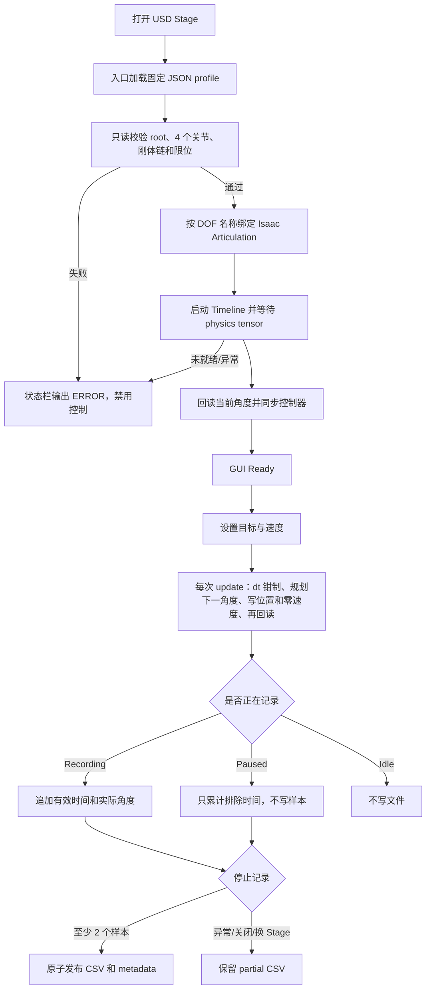

# 260720_01JointPositionRecorder 项目说明

## 0. 文档信息与阅读指引

| 项目 | 内容 |
|---|---|
| 项目名称 | `260720_01JointPositionRecorder` / `isaacsim-joint-position-recorder` |
| 项目作用 | 在 Isaac Sim 当前打开的兼容挖掘机 USD 场景中，按独立恒定角速度直接控制 4 个旋转关节，并把每次更新后的实际回读角度记录为 CSV 和 metadata JSON。 |
| Python 包版本 | `0.1.0`（来自 `pyproject.toml`） |
| 文档适用代码 | 2026-08-02 当前工作树；Git 基准提交 `d9d7d0edbb90b994f6f58966d3f36b437dfcc069`，当前项目源码含未提交修改。远端部署与本地共有的 20 个源码、配置、入口和测试文件 SHA-256 一致。 |
| 最后更新 | 2026-08-02 |
| 技术状态 | 已在远端真实 Isaac Sim 环境完成单元测试和 `Combine_Scene_02` GUI 烟雾验收。 |
| 业务发布状态 | **待确认：**试验、内部使用或正式运行。 |
| 维护人 | **待填写** |
| 业务负责人 | **待填写** |
| 问题反馈渠道 | **待填写** |

本文只依据当前源码、配置、入口、测试和实际运行环境编写，没有读取或引用本项目此前的 README 或 `docs` 下既有文档。

不同读者建议按以下顺序阅读：

- 首次使用者：先看“项目概述”“五分钟快速开始”“成功标准”和“常见问题”。
- 日常使用者：重点看“功能边界”“配置说明”“使用指南”“输入与输出”。
- 维护者：继续看“工作原理”“测试与变更验证”“部署、升级与回滚”“已知限制”。

文中信息状态分为：

- **已验证：**本次在本地或远端实际执行并观察到结果。
- **代码确认：**当前代码明确实现，但本次没有逐项人工点击验证。
- **待确认：**无法从代码或运行环境可靠判断，需要负责人补充。

---

## 1. 项目概述

### 1.1 一句话说明

这是一个嵌入 Isaac Sim GUI 的四关节挖掘机控制与轨迹记录面板：操作者设置目标角度和角速度后，程序直接写入 Articulation 的关节位置，同时将 Articulation 实际回读的角度按更新时间记录下来。

### 1.2 面向谁、什么时候使用

主要使用者从代码无法确认，合理的技术使用场景是：

- 在兼容的固定基座四关节挖掘机 USD 场景中，人工控制驾驶室、动臂、小臂和铲斗到指定角度。
- 记录实际关节角轨迹，供后续数据检查、回放准备或其他离线处理使用；本项目自身不负责回放和后处理。
- 在修改 USD 物理结构、profile 或控制逻辑后，验证 4-DOF Articulation 是否仍能正确绑定和运动。

**待业务负责人补充：**轨迹数据最终用于什么业务流程、主要用户岗位、允许使用的场景范围。

### 1.3 输入、处理、输出

| 阶段 | 内容 |
|---|---|
| 输入 | Isaac Sim 当前打开的 USD Stage、一个 UTF-8 JSON profile、4 个目标角度、4 个正数角速度、输出目录和 CSV 文件名。 |
| 校验 | 检查 Articulation root、4 个旋转关节、刚体链、质量/惯量、关节限位、Angular Drive 冲突和运行时 DOF。 |
| 控制 | 以每关节独立的恒定角速度靠近目标；单次更新使用的 `dt` 不超过 `0.05 s`；到达时钳制为精确目标，避免越过。 |
| 记录 | 记录 Articulation 实际回读角度，不记录规划插值值；暂停期间不写样本，轨迹时间也不增加。 |
| 输出 | 一个正式 CSV 和一个同名 `.metadata.json`；完成前先写 `.partial` 文件，异常中止时保留部分 CSV。 |

### 1.4 成功标准

一次正常使用至少应满足：

1. 控制台出现 `Ready: 4-DOF Articulation is initialized`。
2. 移动后各关节状态最终显示 `Reached`，当前角度与目标角度差不超过 profile 的到达容差；当前 profile 为 `0.01°`。
3. 停止记录后出现 `Recording complete: <CSV路径>`。
4. 输出目录中同时存在 `<名称>.csv` 和 `<名称>.metadata.json`，不存在对应的 `.partial.csv` 或 `.metadata.partial.json`。
5. CSV 表头为 `time,cab,boom,small_arm,bucket`；数据行数等于 metadata 的 `sample_count`，且 `completed` 为 `true`。

---

## 2. 背景与前因后果

### 2.1 可以由代码确认的目标

项目包描述和实现共同表明，直接目标是为固定基座四关节挖掘机提供独立关节位置控制，并可靠记录实际角度。代码针对以下技术问题给出了明确处理：

- USD 中关节名称和路径可能随场景变化，因此用 profile 提供候选名称和候选路径。
- 场景物理结构不满足控制前提时，先只读校验并拒绝控制，避免在错误 Articulation 上写位置。
- 大帧间隔可能造成过大位置跳变，因此将参与规划和记录的更新步长钳制为 `max_update_dt`。
- 直接写最终文件可能留下看似完整的损坏结果，因此先写 partial 文件，完成校验后再原子发布。
- 指令角度不一定等于真实关节状态，因此记录器只保存适配层的实际回读值。
- 暂停记录时仍允许机构继续运动，但暂停段不计入轨迹时间，也不写入样本。

### 2.2 无法确认的业务历史

以下信息不能从当前代码和环境证明，均为**待业务负责人补充**：

- 项目出现之前的人工或自动化流程。
- 原流程的时间成本、数据质量问题或业务风险。
- 立项人、需求提出时间和直接业务目标。
- 需求变更历史和验收指标。
- 曾评估但未采用的其他产品或技术方案。

### 2.3 当前方案的收益、代价和剩余问题

收益包括严格的场景前置校验、按名称绑定 DOF、目标限位、实际角度记录、暂停/恢复以及防覆盖发布。代价是适用面较窄：只接受恰好 4 个旋转 DOF 的 Articulation，并通过直接写位置实现运动，不模拟真实液压、驱动力矩或负载响应。当前也没有正式部署工具、任务 ID、文件日志、批处理接口或版本迁移机制。

---

## 3. 功能范围与使用边界

### 3.1 可以完成

- 绑定当前 USD Stage 中由 profile 指定的一个固定基座 Articulation。
- 校验由 4 个 `RevoluteJoint` 组成的连续关节链及其刚体属性。
- 同时设置 4 个关节的目标角度和独立角速度。
- 执行“全部移动”“立即停止并保持当前位置”“目标值设为当前位置”“回到 profile 中的 home 角度”。
- 开始、暂停、恢复和停止实际角度记录。
- 生成防覆盖、完成态可识别的 CSV 和 metadata JSON。
- Stage 被替换、窗口关闭或控制器报错时中止记录并保留 partial CSV。

### 3.2 不能完成

- 不支持关节数不是 4 的 Articulation；运行时还要求该 Articulation 的总 DOF 数恰好为 4。
- 不支持移动关节、棱柱关节或其他非旋转 DOF。
- 不提供力矩、速度、动力学或液压控制；也不使用 Angular Drive。
- 不生成 USD、不修改或保存 USD 文件，不导入/回放 CSV。
- 不提供命令行批处理、定时任务、服务进程、REST API、数据库或消息通知。
- 不将多次记录追加到同一 CSV，也不覆盖已有正式或 partial 文件。
- 不提供轨迹降采样、插值、质量分析、可视化或数据清理。

### 3.3 推荐场景

- 使用已匹配 profile 的内部仿真场景进行人工四关节定位和短时轨迹采集。
- 在没有其他控制器同时写同一 Articulation 时执行验证或采集。
- 使用唯一输出文件名，并在操作后立即核对 CSV 和 metadata。

### 3.4 不推荐或禁止场景

> **危险：控制会直接改变当前仿真中 4 个关节的位置，并把对应 DOF 速度清零。开始前必须确认目标 Stage、profile、关节安全范围和场景中没有其他控制器。**

- 不要用于要求真实动力学响应、碰撞作用下自然运动或设备安全认证的任务。
- 不要在同一 Articulation 上同时运行其他位置、速度或力矩控制逻辑。
- 不要绕过安全限位或减小 margin 后直接用于未经人工确认的场景。
- 不要使用已有 CSV、metadata 或 partial 文件名；程序会拒绝覆盖。
- 不要把退出码 `0` 当作 Isaac 测试成功的唯一依据。真实环境中 `/root/isaacsim/python.sh` 曾在 Python 脚本打印 `FAIL:` 和 traceback 后仍返回 `0`，必须同时检查语义日志。

### 3.5 副作用与数据保留

- 面板绑定时会自动启动 Timeline。
- 移动操作会写 Articulation 位置并将选定 DOF 的速度写为 0。
- 记录会创建目录及文件；正常停止发布正式 CSV/JSON，异常中止保留 partial CSV。
- 默认输出位于项目的 `trajectories` 目录。远端该目录已有多份历史结果，重复使用旧名称会被拒绝。
- 实际部署位于 `/root/gpufree-data`。环境登录提示明确说明：实例关机时数据保留，但释放实例或制作镜像时该数据盘内容不保留。

---

## 4. 五分钟快速开始

以下是本次真实环境中确认可用的 `Combine_Scene_02` 路径。默认入口 `show_panel.py` **不适用于当前已验证场景**，请使用场景专用入口。

### 4.1 前提

- 能进入远端 `gpufree-container`，并能使用其 Isaac Sim 图形界面/远程桌面。
- 远端项目目录存在：`/root/gpufree-data/repositories/260720_01JointPositionRecorder`。
- 场景存在：`/root/gpufree-data/stage_material_set/combine_stage/Combine_Scene_02.usda`。
- 使用 Isaac Sim `6.0.1-rc.7+release.42383.32955d8d.gl`，GPU 为 RTX 4090。
- 输出目录可写，且准备一个从未使用过的 CSV 文件名。

### 4.2 快速步骤

1. 使用带 PTY 的登录会话进入远端：

   ```powershell
   ssh -tt -o BatchMode=yes isaacsim-gpufree
   ```

2. 先确认代码测试通过：

   ```bash
   cd /root/gpufree-data/repositories/260720_01JointPositionRecorder
   pytest -q
   ```

   **预期：**24 个测试全部通过，结尾包含 `[100%]`。

3. 确认没有另一个 Isaac Sim/Kit 正在控制同一场景：

   ```bash
   pgrep -af '[/]root/[i]saacsim|[S]imulationApp|[i]saac-sim|kit/[k]it'
   ```

   无输出表示没有匹配进程。如果已有会话，先确认其用途，不要直接结束他人的进程。

4. 在平台提供的图形桌面中启动或进入 Isaac Sim。远端启动器已确认存在：

   ```bash
   /root/isaacsim/isaac-sim.sh
   ```

   **验证状态：**启动器文件存在；本次完整功能验收使用 headless `SimulationApp` 完成，没有人工验证远程桌面的启动和访问步骤。远程桌面入口由环境负责人补充。

5. 在 Isaac Sim 中打开：

   ```text
   /root/gpufree-data/stage_material_set/combine_stage/Combine_Scene_02.usda
   ```

6. 在 Isaac Sim Script Editor 中以“打开文件并运行”的方式执行：

   ```text
   /root/gpufree-data/repositories/260720_01JointPositionRecorder/entrypoints/show_panel_combine_scene_02.py
   ```

   不建议只粘贴文件正文，因为入口通过 `__file__` 推导项目目录。

7. 等待面板状态依次出现：

   ```text
   Stage validated; waiting for the Articulation physics tensor
   Ready: 4-DOF Articulation is initialized
   ```

8. 在面板中填写一个新文件名，例如：

   ```text
   combine_scene_02_joint_angles_YYYYMMDD_HHMMSS.csv
   ```

9. 点击 `Start recording`，按需要设置 Target 和 Speed 后点击 `Move all`。结束时点击 `Stop recording`。

10. 确认控制台出现 `Recording complete:`，并按“成功标准”核对 CSV 和 metadata。

---

## 5. 安装与环境准备

### 5.1 已验证环境

| 项目 | 本地开发检查环境 | 远端运行环境 |
|---|---|---|
| 操作系统 | Windows NT 10.0.26200.0 | Ubuntu 24.04.3 LTS，Linux 5.15.0-168-generic x86_64 |
| Python | 3.9.18；24 项纯 Python 测试通过，但低于项目声明版本 | 登录 venv Python 3.12.13，路径 `/etc/isaac_alias/bin/python`；24 项测试通过 |
| Isaac Sim | 未验证 | `6.0.1-rc.7+release.42383.32955d8d.gl` |
| GPU | 不适用 | NVIDIA GeForce RTX 4090，24564 MiB，驱动 580.126.09 |
| CPU / 内存 | 未记录 | 14 核 / 50 GB |
| DISPLAY | 不适用 | `:20` |

项目元数据要求 Python `>=3.10`。虽然当前 Windows Python 3.9.18 能运行纯逻辑测试，但它不属于项目声明的支持范围，不应作为新部署基线。

### 5.2 依赖

- 构建后端：`setuptools.build_meta`。
- 构建依赖：`setuptools>=68`。
- 测试依赖：`pytest`；当前 `pyproject.toml` 没有声明它。
- GUI/运行时依赖：Isaac Sim 提供的 `isaacsim`、`omni.*`、`pxr`、`numpy` 等模块。
- 项目没有 `requirements.txt`、锁文件或已声明的普通运行依赖列表。

### 5.3 从空环境准备

#### 仅运行纯 Python 单元测试

以下安装方式来自项目元数据，**本次未在全新环境实际执行**：

```bash
cd <260720_01JointPositionRecorder目录>
python -m pip install -e .
python -m pip install pytest
pytest -q
```

#### 在 Isaac Sim 中使用面板

入口脚本会把 `<项目目录>/src` 插入 `sys.path`，因此当前部署不依赖 `pip install`。需要：

1. 安装包含 `isaacsim.core.experimental.prims.Articulation` API 的兼容 Isaac Sim。
2. 将完整项目目录和所需 USD 放到运行机可读位置。
3. 给输出目录授予运行用户写权限。
4. 打开目标 USD 后，从 Script Editor 运行与场景匹配的入口文件。

### 5.4 权限、网络和账号

- 项目本身不调用外部 API、数据库或网络服务。
- 运行时需要读取项目、profile 和 USD，并写入输出目录。
- 远端实际使用 `root`，项目及默认轨迹目录为 `root:root`、模式 `755`；这是环境现状，不是代码要求。原则上应使用能读 Stage、写输出且能启动 Isaac Sim 的最低权限账号。
- 从本地访问远端仍需要 SSH 和图形桌面/流式界面权限；具体账号发放和远程桌面入口待确认。
- 项目不读取自定义环境变量，也没有代理设置。

### 5.5 环境自检

```bash
cd /root/gpufree-data/repositories/260720_01JointPositionRecorder
python --version
cat /root/isaacsim/VERSION
nvidia-smi --query-gpu=name,memory.total,driver_version --format=csv,noheader
pytest -q
test -r profiles/combine_scene_02.json
test -r /root/gpufree-data/stage_material_set/combine_stage/Combine_Scene_02.usda
test -w trajectories
```

---

## 6. 配置说明

### 6.1 配置选择和优先级

配置没有环境变量、命令行参数或多层覆盖机制。每个入口文件中的 `PROFILE_PATH` 是唯一 profile 来源：

| 入口 | 固定 profile | 当前实际结论 |
|---|---|---|
| `entrypoints/show_panel_combine_scene_02.py` | `profiles/combine_scene_02.json` | **推荐且已验证：**与远端 `Combine_Scene_02.usda` 完整 GUI 烟雾验收通过。 |
| `entrypoints/show_panel.py` | `profiles/excavator_four_joint_default.json` | **已验证不匹配现有 Sim_Fangshan_07：**报 `INVALID_ROOT_HINT` 和多个 `MISSING_JOINT`。不要把该组合当作成功路径。 |

远端部署目录还存在本地当前项目中没有的 `excavator_fangshan_01` profile/入口。它属于远端额外文件，不应在没有纳入本地版本管理并复核前作为本项目标准发布内容。

### 6.2 项目级配置

| 配置项 | 文件/位置 | 必填 | 代码默认值 | 安全示例 | 作用、错误表现与范围 | 敏感 |
|---|---|---:|---|---|---|---:|
| `profile_name` | profile JSON | 是 | 无 | `combine_scene_02_fangshan_excavator_four_joint_fixed_base` | 记录到界面和 metadata；空值报配置错误。 | 否 |
| `articulation_root_path` | profile JSON | 否 | `null` | `/Fangshan_Excavator_01/Joints/world_track_fixed_joint` | 指定唯一 Articulation root；无效时报 `INVALID_ROOT_HINT`。不指定时 Stage 必须恰好只有一个 root。 | 否 |
| `require_fixed_base` | profile JSON | 否 | `true` | `true` | 为真时拒绝 floating root。注意 `bool(value)` 会把非空字符串也视为真，应使用 JSON 布尔值。 | 否 |
| `arrival_tolerance_degrees` | profile JSON | 否 | `0.01` | `0.01` | 判断关节到达目标的角度容差；必须是有限正数。 | 否 |
| `max_update_dt` | profile JSON | 否 | `0.05` | `0.05` | 单次规划和记录最多累计的秒数；必须是有限正数。 | 否 |
| `default_csv_directory` | profile JSON | 否 | `trajectories` | `trajectories` | 面板初始输出目录。相对路径按项目根目录解析为绝对路径；空值报错。 | 可能包含内部路径 |
| `default_csv_filename` | profile JSON | 否 | `excavator_actual_angles.csv` | `combine_scene_02_joint_angles_20260802_01.csv` | 面板初始文件名；必须是无目录成分的 `.csv` 文件名。 | 否 |
| `joints` | profile JSON | 是 | 无 | 见下表 | 必须恰好 4 项，`logical_name` 不得重复。 | 否 |

### 6.3 单关节配置

| 配置项 | 必填 | 代码默认值 | 作用与错误表现 | 敏感 |
|---|---:|---|---|---:|
| `logical_name` | 是 | 无 | 内部名称、CSV 列名和控制器键；不能为空或重复。 | 否 |
| `display_name` | 否 | `logical_name` | GUI 显示名；不能为空。 | 否 |
| `candidate_names` | 条件必填 | 无 | 按 USD prim 名称查找旋转关节。与 `candidate_paths` 至少一个非空。 | 否 |
| `candidate_paths` | 否 | 空数组 | 按完整 USD prim path 查找旋转关节。多个候选同时命中会报 `AMBIGUOUS_JOINT`。 | 可能包含内部结构 |
| `default_speed_degrees` | 否 | `5.0` | GUI 默认角速度，单位度/秒；必须是有限正数。 | 否 |
| `home_degrees` | 否 | `0.0` | `Move home` 的目标角度；配置加载时不与 USD 限位交叉校验，实际移动时才检查安全范围。 | 否 |
| `safety_margin_degrees` | 否 | `2.0` | 从 USD lower/upper limit 两端各缩进的安全余量；必须非负，缩进后必须仍有有效范围。 | 否 |

### 6.4 已验证的 Combine_Scene_02 映射

| 逻辑关节 | USD DOF/prim 名称 | USD prim path | 默认速度 | Home | 安全余量 |
|---|---|---|---:|---:|---:|
| `cab` | `track_operator_cab_joint` | `/Fangshan_Excavator_01/Joints/track_operator_cab_joint` | `8°/s` | `0°` | `2°` |
| `boom` | `platform_boom_joint` | `/Fangshan_Excavator_01/Joints/platform_boom_joint` | `5°/s` | `0°` | `2°` |
| `small_arm` | `boom_small_arm_joint` | `/Fangshan_Excavator_01/Joints/boom_small_arm_joint` | `5°/s` | `0°` | `2°` |
| `bucket` | `small_arm_bucket_joint` | `/Fangshan_Excavator_01/Joints/small_arm_bucket_joint` | `5°/s` | `0°` | `2°` |

运行时可输入范围不是上表固定值，而是从当前 USD 的每个关节限位动态计算：

```text
安全下限 = physics:lowerLimit + safety_margin_degrees
安全上限 = physics:upperLimit - safety_margin_degrees
```

---

## 7. 使用指南

### 7.1 场景一：移动四个关节并记录完整轨迹

**适用场景：**需要从当前姿态移动到一组目标角度，同时保存实际关节角。

**准备条件：**

- 已按快速开始绑定 `Combine_Scene_02`，状态为 `Ready`。
- 已确认所有目标在 USD 动态安全范围内。
- 输出 CSV、metadata 和 partial 名称均不存在。

**步骤：**

1. 在 `CSV directory` 和 `CSV filename` 填写目标位置和唯一名称。
2. 点击 `Start recording`。
3. 为 `Cab`、`Boom`、`Small arm`、`Bucket` 填写 Target 和正数 Speed。
4. 点击 `Move all`。
5. 等待四行状态均为 `Reached`。
6. 点击 `Stop recording`。

**预期结果：**

- 控制台依次出现 `Recording actual articulation angles:`、`Motion started...`、`Recording complete:`。
- 输出 CSV 至少有两条数据记录，metadata 的 `completed` 为 `true`。

**注意事项：**

- 4 个关节同时开始、各自按设置速度移动，因此会在不同时间到达。
- 大帧间隔被钳制为 `0.05 s`，渲染卡顿时实际墙钟耗时可能比理论时间长。
- 记录值来自每次写位置后的 Articulation 回读，不是 planner 的理想插值值。

### 7.2 场景二：排除不希望写入轨迹的运动区间

**适用场景：**记录已经开始，但希望机构继续移动而暂停段不进入 CSV。

**准备条件：**记录状态为 `Recording`。

**步骤：**

1. 点击 `Pause recording`。
2. 执行 `Move all`、`Stop`、`Targets = current` 或 `Move home` 等运动操作。
3. 需要继续采样时点击 `Resume recording`。
4. 等至少一个有效 update 后，点击 `Stop recording`。

**预期结果：**

- 暂停期间样本数和 `trajectory time` 不增加，但 Current 角度继续变化。
- 恢复后的第一段数据直接记录新的实际位置，不补插暂停区间。
- metadata 中 `pause_count` 增加，`recording_time_policy` 为 `exclude_paused_intervals`。

**注意事项：**暂停不是停止运动，也不是冻结 Timeline。轨迹时间会被压缩，因此 CSV 时间轴不能代表真实墙钟时间。

### 7.3 场景三：立即停止运动

**适用场景：**目标设置错误或需要保持当前姿态。

**准备条件：**面板已完成绑定。

**步骤：**点击 `Stop`。

**预期结果：**适配器回读当前位置并立即写回，目标值被重置为当前位置，运动状态变为 `IDLE`。

**注意事项：**`Stop` 不等于 `Stop recording`；如果正在记录，记录仍继续。

### 7.4 重复执行与覆盖规则

- 对同一 Stage 重复打开面板时，新的窗口会先关闭旧窗口；旧窗口如在记录，会留下 partial CSV。
- 同一输出基名对应的 CSV、partial CSV、metadata JSON、metadata partial JSON 中任一个已存在，开始记录都会失败。
- 程序没有追加和自动递增文件名功能。每次任务应显式使用新名称。
- 当前代码没有批量、定时或无人值守模式。

---

## 8. 输入与输出说明

### 8.1 USD Stage 输入契约

Stage 校验要求：

- profile 指定的 prim 必须带 `PhysicsArticulationRootAPI`。
- 固定根关节必须启用，且 `physics:body0` 只引用一个根刚体。
- 4 个逻辑关节各自必须唯一匹配一个 `RevoluteJoint`。
- 关节必须启用，`body0`/`body1` 各有一个目标，不得应用 `PhysicsDriveAPI:angular`。
- lower/upper limit 必须有限；扣除 safety margin 后下限必须小于上限。
- 4 个关节必须按 profile 顺序形成从根刚体开始的连续无环链。
- 每个刚体必须有 `RigidBodyAPI` 和 `MassAPI`，处于 enabled、非 kinematic 状态，质量及三个对角惯量都为有限正数。
- 运行时 Articulation 物理 tensor 必须初始化，DOF 名称可解析，且总 DOF 数恰好为 4。

无效输入会停止绑定，状态栏和控制台打印 `ERROR:`，不会进入可操作状态。

### 8.2 控制输入

| 输入 | 格式 | 校验 | 无效时处理 |
|---|---|---|---|
| Target | 每关节浮点数，单位度 | 有限，且位于动态安全范围内 | 拒绝整组移动并显示 `outside safe range` |
| Speed | 每关节浮点数，单位度/秒 | 有限且大于 0 | 拒绝整组移动并显示 `speed must be positive and finite` |
| CSV directory | 路径字符串 | 创建时由文件系统验证 | 无权限或路径错误时显示异常 |
| CSV filename | 单个文件名 | 非空、无目录成分、以 `.csv` 结尾 | 拒绝开始记录 |

GUI 初始目录是按项目根目录解析出的绝对 `trajectories`。如果用户手工输入相对目录，`resolve_csv_path()` 会按 Isaac Sim 进程当前工作目录解析，而不是再次按项目根目录解析；建议始终使用绝对路径。

### 8.3 CSV 输出

- 编码：UTF-8。
- 换行符：LF。
- 第一列：`time`，单位秒，9 位小数。
- 后续列：按 profile 顺序排列的逻辑关节名，单位度，9 位小数。
- 开始记录时立即写 `time=0` 的初始实际角度。
- 后续时间必须严格递增。
- 至少 2 个样本才能发布正式 CSV。

脱敏示例；字段格式已由测试验证，具体数值为说明用途：

```csv
time,cab,boom,small_arm,bucket
0.000000000,0.000000000,10.000000000,-20.000000000,5.000000000
0.016666667,0.133333333,10.083333333,-19.916666667,5.083333333
```

### 8.4 Metadata 输出

正式文件名为 `<CSV stem>.metadata.json`，UTF-8、缩进 2 空格。主要字段如下：

| 字段 | 含义 |
|---|---|
| `profile` | profile 名称 |
| `stage` | Stage 根 layer 标识符，通常是绝对路径 |
| `articulation_root` | Articulation root prim path |
| `joint_paths` / `dof_names` | 逻辑关节到 USD path/DOF 名称的映射 |
| `control_mode` | 固定为 `articulation_direct_position` |
| `angle_unit` / `speed_unit` | `degree` / `degree_per_second` |
| `joint_order` | CSV 关节列顺序 |
| `sample_count` | CSV 数据样本数，不含表头 |
| `duration_seconds` | 最后一个 CSV 样本的轨迹时间 |
| `trajectory_duration_seconds` | 控制器累计的有效记录时间 |
| `pause_count` | 暂停次数 |
| `excluded_pause_duration_seconds` | 被排除的暂停 update 时间总量，也受 `max_update_dt` 钳制 |
| `recording_time_policy` | 固定为 `exclude_paused_intervals` |
| `position_priority` | 固定为 `actual_readback_no_interpolation` |
| `final_motion_state` | 停止记录前的运动状态 |
| `final_targets_degrees` | 停止记录前的目标角度 |
| `commanded_speeds_degrees_per_second` | 停止记录前的指令速度 |
| `csv` | 正式 CSV 的绝对路径 |
| `completed` | 成功发布时为 `true` |

示例节选：

```json
{
  "angle_unit": "degree",
  "completed": true,
  "control_mode": "articulation_direct_position",
  "joint_order": ["cab", "boom", "small_arm", "bucket"],
  "pause_count": 1,
  "position_priority": "actual_readback_no_interpolation",
  "recording_time_policy": "exclude_paused_intervals",
  "sample_count": 120,
  "speed_unit": "degree_per_second"
}
```

### 8.5 Partial 文件和失败状态

- 记录中：`<stem>.partial.csv` 存在，正式 CSV 不存在。
- 正常停止：partial CSV 原子重命名为正式 CSV；metadata 也先写 partial 再原子发布。
- 异常、Stage 变化或面板关闭：关闭流并保留 partial CSV，不生成 `completed: true` 的正式 metadata。
- 如果只录到 1 个样本就停止，程序拒绝发布并保持记录会话；等待至少一个有效 update 后再停止，或关闭窗口保留 partial 文件。

---

## 9. 工作原理

### 9.1 执行流程



### 9.2 主要目录和模块

| 路径 | 职责 |
|---|---|
| `entrypoints/show_panel*.py` | 选择固定 profile，把 `src` 加入 `sys.path`，创建 GUI 面板。 |
| `profiles/*.json` | 定义场景 root、四关节映射、速度、home、容差和输出默认值。 |
| `src/joint_position_recorder/config.py` | 读取并校验 profile。 |
| `stage_validator.py` | 只读遍历 USD，验证和发现 Articulation 结构、限位及 DOF 名称。 |
| `articulation_adapter.py` | 调用 Isaac Sim experimental Articulation API，在弧度和度之间转换，读写 DOF 并清零速度。 |
| `motion_planner.py` | 实现独立、恒角速度、无越过的确定性位置步进。 |
| `controller.py` | 管理 `UNBOUND/IDLE/MOVING/REACHED/ERROR` 状态，协调运动和记录。 |
| `trajectory_recorder.py` | 防覆盖地写 partial CSV，校验样本并原子发布 CSV/metadata。 |
| `gui.py` | 构建面板、监听 Kit update、自动启动 Timeline、处理按钮和状态输出。 |
| `tests/test_*.py` | 不依赖 Isaac Sim 的配置、规划、控制器和记录器测试。 |
| `tests/isaac_*_smoke_test.py` | 需要真实 Isaac Sim 和兼容 USD 的运行时烟雾测试。 |

### 9.3 关键规则和失败路径

- 目标、速度必须一次性包含且只包含 4 个逻辑关节。
- 每次 update 先回读当前位置，再规划并写下一位置，再次回读；记录发生在第二次回读之后。
- 实际 `dt <= 0` 时本次 update 不移动、不记录。
- 运动到达后再写一次精确目标并回读，状态转为 `REACHED`。
- `Stop` 回读并保持当前位置，状态变为 `IDLE`。
- 任一 GUI update 异常会把控制器置为 `ERROR` 并中止记录。
- Stage 对象发生替换时释放绑定、保留 partial，并要求人工重新绑定。

### 9.4 外部系统

唯一运行时平台是 Isaac Sim/Kit/USD/PhysX 及其 Python 环境。项目没有外部 HTTP API、数据库、消息队列、云存储 SDK 或遥测服务。

---

## 10. 日志、监控与结果核对

### 10.1 日志

- 项目日志通过 `print()` 输出到 Isaac Sim 控制台，前缀为 `[joint-position-recorder]`。
- 项目不创建独立日志文件，没有日志级别、滚动、集中采集或告警机制。
- 一次记录没有自动 task ID；建议用唯一 CSV 文件名作为任务标识。

正常关键信息：

```text
[joint-position-recorder] Ready: 4-DOF Articulation is initialized
[joint-position-recorder] Motion started with independent constant joint speeds
[joint-position-recorder] Recording complete: <输出路径>
[joint-position-recorder] Panel shut down
```

失败时应收集：

- 从 `Stage validated` 或首个 `ERROR:` 开始的完整控制台文本。
- Isaac Sim 完整版本、GPU/驱动信息。
- 使用的入口、profile 和 Stage 绝对路径。
- 4 个 Target/Speed、输出目录和文件名。
- 面板状态截图。
- 是否存在其他 Isaac/Kit 进程，以及是否在记录中更换 Stage 或关闭窗口。

### 10.2 结果核对

1. 正式 CSV 和 metadata JSON 成对存在，且没有同基名 partial 文件。
2. metadata `completed == true`。
3. CSV 表头顺序与 `joint_order` 一致。
4. CSV 数据行数等于 `sample_count`；总行数应为 `sample_count + 1`。
5. `time` 从 `0.000000000` 开始且严格递增。
6. 所有关节角和时间都可解析为有限数。
7. 最后时间应与 metadata `duration_seconds` 一致。
8. 如果使用暂停，检查 `pause_count`、`excluded_pause_duration_seconds` 和压缩后的时间轴是否符合预期。

项目没有输入数量、成功数量和失败数量监控。最接近的运行指标只有 GUI 中的 `recorded_samples`、轨迹时间和每关节状态。

---

## 11. 常见问题与故障排查

| 现象或错误信息 | 可能原因 | 验证方法 | 解决办法 | 需要升级给谁 |
|---|---|---|---|---|
| 面板未出现，提示 `__file__` 未定义 | 把入口正文直接粘贴运行，Script Editor 没有文件上下文 | 查看 traceback 是否指向 `Path(__file__)` | 在 Script Editor 中打开并运行入口文件；或由维护者改造入口以显式接收项目路径 | 技术维护人 |
| `INVALID_ROOT_HINT`、`MISSING_JOINT` | Stage 与 profile 不匹配 | 核对入口中的 `PROFILE_PATH`、Stage prim path 和错误列出的候选名 | 当前 `Combine_Scene_02` 使用 `show_panel_combine_scene_02.py`；不要使用默认入口 | USD/profile 维护人 |
| `AMBIGUOUS_ROOT` 或 `AMBIGUOUS_JOINT` | Stage 中有多个 root，或同一逻辑关节多个候选同时命中 | 查看错误列出的匹配 path | 在 profile 指定唯一 root，并收窄候选 path/name | USD/profile 维护人 |
| `DRIVE_CONFLICT` | 目标 RevoluteJoint 应用了 angular drive | 在 USD 属性或 applied schemas 中确认 `PhysicsDriveAPI:angular` | 不要绕过校验；先决定由 Drive 还是本工具唯一控制，再由 USD 维护者处理 | USD/控制负责人 |
| `BROKEN_CHAIN`、`INVALID_BODY_RELATION` | 四关节顺序或 body0/body1 关系与 profile 不一致 | 对照错误中的 expected/actual path | 修正 USD 关节链或 profile 顺序 | USD 维护人 |
| `INVALID_MASS`、`INVALID_INERTIA`、`KINEMATIC_BODY` | 刚体质量/惯量无效或被设为 kinematic | 检查错误 prim 的 Physics 属性 | 在副本中修正 USD 物理属性并重新验证，不要直接改生产资产 | USD 维护人 |
| 一直显示 waiting for physics tensor | Timeline 未产生有效物理帧、绑定失败或 Isaac API 不兼容 | 确认 Timeline 播放；查看后续异常；核对 Isaac 版本 | 点击重新绑定；确认场景物理可启动；用已验证版本复现 | Isaac 环境维护人 |
| `Expected 4 DOFs, got ...` | Articulation 总 DOF 数不是 4 | 查看错误中列出的 available DOFs | 使用恰好 4-DOF 的 Articulation；当前代码不能只控制多 DOF Articulation 的子集 | 技术维护人 |
| `outside safe range` | Target 超出 USD 限位扣除 margin 后的范围 | 根据当前 USD limit 和 profile margin 计算范围 | 把目标调回安全范围；不要通过改代码绕过 | 操作人；必要时 USD 维护人 |
| `speed must be positive and finite` | Speed 为 0、负数、NaN 或无限值 | 检查四个 Speed 输入 | 填写有限正数 | 操作人 |
| `Refusing to overwrite existing output` | 正式或 partial 文件已存在 | 检查同基名的 4 种输出文件 | 改用新文件名；旧数据是否删除或归档由负责人决定，程序不自动删除 | 操作人/数据负责人 |
| 停止记录时报 `At least two samples are required` | 只有开始时的初始样本 | 查看样本计数是否为 1 | 等待至少一个有效 update 后再停止；不需要的数据可关闭窗口并按 partial 流程处理 | 操作人 |
| 只留下 `.partial.csv` | Stage 被换、窗口关闭、发生异常或记录被中止 | 查看最后一段控制台日志 | 保留文件用于诊断；不要手工改名冒充完成结果。确认问题后使用新名称重录 | 技术维护人/数据负责人 |
| 输出目录为空 | 未成功开始记录、路径解析到其他工作目录、无写权限 | 看 `Recording actual...` 中的绝对路径；检查权限 | 使用绝对目录并确保可写 | 环境维护人 |
| 运动或轨迹时间比预期慢 | 单帧 `dt` 被钳制到 `0.05 s`，或渲染/GPU 更新慢 | 观察帧率，并比较目标差/速度的理论时间 | 降低场景负载；需要墙钟时间时应扩展 recorder，而不是解释现有 `time` 为墙钟 | 技术维护人 |
| 音频设备、Fabric 版本或 `DOF types mismatch` 告警 | 当前 headless 环境的音频为空、组件接口版本提示或 experimental API 的类型告警 | 看最终是否有项目 `ERROR:` 或测试 `PASS:` | 本次真实 GUI smoke 在这些告警存在时仍通过；保留日志并观察版本升级后的变化，不要单凭告警判失败 | Isaac 环境维护人 |
| 测试有 traceback，但 shell 退出码仍为 0 | 当前 `/root/isaacsim/python.sh` 未可靠传播脚本失败状态 | 搜索日志中的 `PASS:`、`FAIL:`、`Traceback` | CI/脚本必须做语义日志检查；维护者应另行修复启动器或包装脚本 | 环境维护人 |
| 程序无法导入 `isaacsim`/`omni`/`pxr` | 使用普通 Python 运行 GUI/烟雾测试 | `command -v python`，检查是否在 Isaac 环境 | GUI 入口在 Isaac Sim Script Editor 中运行；headless 测试使用 `/root/isaacsim/python.sh` | 环境维护人 |

---

## 12. 测试与变更验证

### 12.1 自动化单元测试

```bash
cd /root/gpufree-data/repositories/260720_01JointPositionRecorder
pytest -q
```

本次结果：本地 Windows/Python 3.9.18 和远端 Ubuntu/Python 3.12.13 均为 24/24 通过。覆盖配置、恒速规划、`dt` 钳制、目标限位、停止保持、实际回读记录、原子发布、防覆盖、暂停/恢复和 partial 保留。

单元测试没有真实验证 USD 遍历器 `validate_stage()` 的各种错误分支，也没有直接覆盖 `IsaacArticulationAdapter` 和 GUI 控件。

### 12.2 真实 Isaac Sim 验收结果

2026-08-02 在远端完成：

- `Combine_Scene_02.usda` + `combine_scene_02.json` + `show_panel_combine_scene_02.py`：完整 GUI smoke **通过**。
- 验收内容：自动 Stage 绑定、4-DOF tensor 就绪、开始记录、暂停、暂停期间移动、恢复、发布 CSV/metadata、实际角度核对、恢复初始角度和关闭应用。
- `Sim_Fangshan_07.usda` + `excavator_four_joint_default.json`：Stage 校验**失败，且这是正确的保护行为**；实际错误包括 `INVALID_ROOT_HINT` 以及 `cab/small_arm/bucket` 的 `MISSING_JOINT`。

现有两个 smoke 脚本都把默认 profile/入口写死，不能通过参数选择 `combine_scene_02`。本次 Combine 验收采用仅存在于测试进程内的入口替换，没有修改项目文件。维护者应考虑把 `--profile` 或 `--entrypoint` 参数正式加入测试脚本。

### 12.3 最小人工验收

1. 使用目标入口打开面板并看到 `Ready`。
2. 记录初始角度。
3. 为每个关节选择安全范围内约 `0.25°` 的小偏移，速度设为 `5°/s`。
4. 开始记录并移动，确认全部 `Reached`。
5. 暂停记录后再做一次小幅移动，确认样本数不增加。
6. 恢复并等待数帧，停止记录。
7. 核对 CSV/metadata 后把四关节移回初始角度。
8. 不保存对 USD 的任何改动。

### 12.4 配置或版本变更后的检查

- profile 能被 `load_project_config()` 加载。
- Stage validator 无 error，动态安全范围正确。
- DOF 名称和顺序与 CSV 列一致。
- 目标写入后实际回读误差不超过验收阈值；现有 smoke 使用 `0.05°`。
- 暂停段不产生样本，恢复后第一条为真实新位置。
- 正常停止不留 partial，异常关闭保留 partial。
- Isaac Sim 升级后重点检查 experimental Articulation API、Fabric/DOF 类型告警和 tensor 初始化。

### 12.5 发布前最低检查清单

- [ ] 24 项纯 Python 测试通过。
- [ ] 目标场景/profile 的真实 Stage 校验通过。
- [ ] 没有其他控制器同时写目标 Articulation。
- [ ] 小角度移动、回读和恢复通过。
- [ ] 记录、暂停、恢复、发布和防覆盖通过。
- [ ] 输出 schema 与 metadata 一致。
- [ ] 失败日志判定不只依赖 `python.sh` 退出码。
- [ ] 版本号、提交号、部署文件 hash 和变更说明已记录。

---

## 13. 部署、定时执行、升级与回滚

### 13.1 当前实际部署

- 远端目录：`/root/gpufree-data/repositories/260720_01JointPositionRecorder`。
- 远端目录不是 Git worktree。
- 当前与本地共有的 20 个代码、配置、入口和测试文件内容完全一致。
- 远端另有本地没有的两个 `excavator_fangshan_01` 文件，存在部署漂移。
- 没有安装脚本、容器定义、服务单元、CI 配置、定时任务或发布清单。
- 启动方式是人工打开 Isaac Sim、打开 Stage、从 Script Editor 执行入口。

### 13.2 启动、停止和状态检查

- 启动面板：执行匹配 Stage 的 `entrypoints/show_panel*.py`。
- 停止面板：关闭面板窗口；`shutdown()` 会释放绑定并在必要时保留 partial。
- 停止 Isaac Sim：使用 Isaac Sim 正常关闭流程，避免在写文件时强制终止进程。
- 状态检查：查看面板状态、控制台 `[joint-position-recorder]` 日志和输出文件对。

### 13.3 定时执行

当前不支持。GUI 操作和目标输入需要人工参与，不能直接作为 cron 或后台服务部署。

### 13.4 升级与回滚

项目没有可由代码确认的正式升级/回滚流程。最低安全原则是：

1. 停止面板并确认没有活动 recording。
2. 单独备份当前部署代码、profiles 和未完成 partial；不要覆盖 `trajectories`。
3. 记录新旧文件 hash 和项目版本。
4. 更新代码后先跑单元测试，再对目标 Stage 做小角度 smoke。
5. 如果失败，恢复完整旧代码和匹配的 profile，不要只回滚单个模块。
6. 回滚后重复单元测试、Stage 绑定、运动和记录验收。

**待确认：**代码从本地同步到远端的正式命令、备份目录、保留周期、发布审批人和回滚负责人。

---

## 14. 安全与合规注意事项

- 项目代码和 profile 不包含密码、Token、Cookie 或连接字符串，也不需要这些信息。
- metadata 会记录 Stage、CSV 和关节 prim 的绝对路径；CSV 会记录设备姿态轨迹。按内部数据分级要求保存和分享，外发前脱敏路径和业务相关运动数据。
- 远端当前以 `root` 运行，但代码只需要读取项目/USD、启动 Isaac Sim 和写输出。新环境应遵循最小权限原则。
- 默认 `.gitignore` 忽略 `trajectories/*.csv`、`trajectories/*.json` 和 `trajectories/*.partial.csv`。如果把输出写到其他目录，这些文件可能被 Git 发现；`.metadata.partial.json` 在默认 `trajectories` 中会被 `*.json` 覆盖，但其他目录不受保护。
- 不要提交真实轨迹、客户场景、绝对内部路径或故障日志中的敏感信息。
- 程序主动拒绝覆盖，删除、归档或重命名旧结果必须由人工按数据保留规则执行。
- 不要通过删除校验、扩大限位或关闭安全 margin 来处理 Stage 不兼容。
- 项目没有网络外发和遥测逻辑；若未来增加，需补充授权、数据保留和审计要求。

---

## 15. 已知限制、风险与后续计划

| 类别 | 当前限制或风险 | 影响 | 临时处理/建议 |
|---|---|---|---|
| 兼容性 | 只支持恰好 4 个旋转 DOF 的 Articulation | 不能控制更多关节或其他关节类型 | 为其他结构建立独立适配和测试，不要只改 profile 数量 |
| 控制真实性 | 直接设置位置并清零速度，不经过 Drive/力矩控制 | 轨迹不代表真实机械动力学 | 只用于定位和数据采集；动力学任务使用专用控制器 |
| 时间语义 | `dt` 最大为 `0.05 s`，暂停时间被压缩 | CSV 时间不是严格墙钟时间 | metadata 已标明策略；需要墙钟时间时扩展 schema |
| 采样性能 | 每个有效 update 写一行 CSV，没有频率上限和轮转 | 长时间运行会生成大文件并产生频繁 I/O | 使用短任务和唯一文件；采样频率控制待开发 |
| 场景匹配 | profile 与 USD 强耦合；默认 profile 已与现有 Sim_Fangshan_07 验证不匹配 | 误选入口无法绑定 | 使用场景专用入口；把 profile 参数化加入 smoke 测试 |
| API 稳定性 | 使用 `isaacsim.core.experimental.prims.Articulation` | Isaac Sim 升级可能破坏接口 | 固定已验证版本，升级前执行真实 smoke |
| 运行判定 | `python.sh` 可能吞掉 Python 异常退出码 | 自动化可能误报成功 | 同时匹配明确 `PASS:`/`FAIL:` 和 traceback |
| 告警 | 实测有无音频设备、Fabric 版本、DOF 类型 mismatch 告警 | 目前未影响 smoke，但升级后风险未知 | 保留基线日志，按最终项目状态和语义测试判定 |
| 部署 | 远端不是 Git worktree且有额外文件 | 版本追踪和回滚困难 | 建立 manifest/hash 清单和受控发布流程 |
| 依赖 | 没有 requirements/lock，pytest 未声明 | 新环境难以复现 | 补充开发依赖和已验证 Isaac 版本矩阵 |
| 可观测性 | 只有控制台日志，无 task ID、文件日志和监控 | 故障关联和长期运行困难 | 将唯一输出名作为临时任务标识；后续增加结构化日志 |
| 测试覆盖 | Stage validator/adapter/GUI 缺少常规自动单测，smoke 硬编码默认入口 | 场景变化可能晚发现 | 参数化 smoke，并补充 USD fixture/错误分支测试 |

当前代码中没有可确认的正式后续计划。上表“建议”不是已承诺排期，优先级和负责人均待确认。

---

## 16. 维护与反馈

### 16.1 代码和运行位置

- 本地仓库：`D:\learning\IntelligentDepartment\CodesSet\Self\260707IsaacSIm`
- 本地项目：`scripts\260720_01JointPositionRecorder`
- 当前分支：`main`
- Git 基准提交：`d9d7d0edbb90b994f6f58966d3f36b437dfcc069`
- 远端部署：`/root/gpufree-data/repositories/260720_01JointPositionRecorder`
- 已验证 Stage：`/root/gpufree-data/stage_material_set/combine_stage/Combine_Scene_02.usda`
- 已验证入口：`entrypoints/show_panel_combine_scene_02.py`
- Isaac 启动器：`/root/isaacsim/isaac-sim.sh`、`/root/isaacsim/python.sh`

### 16.2 报告问题时提供

1. 问题发生时间和操作步骤。
2. 本地提交号、是否有未提交修改、远端部署文件 hash。
3. Isaac Sim、Python、GPU 和驱动版本。
4. Stage、入口和 profile 路径。
5. 4 个目标角度和速度。
6. 完整 `[joint-position-recorder]` 日志、traceback 和关键运行时告警。
7. 面板截图和最终状态。
8. CSV/metadata/partial 的文件名、大小和是否成对存在；分享内容前先脱敏。
9. 是否有其他 Isaac/Kit 或控制器进程。

### 16.3 待补充的维护信息

- 技术负责人：**待填写**
- 业务负责人：**待填写**
- 备用联系人：**待填写**
- 问题跟踪系统/群组：**待填写**
- 正式代码仓库 URL 和发布分支：**待填写**
- 版本变更记录位置：当前未发现代码内可确认的 changelog，**待填写**

---

## 17. 文档生成时已实际验证的内容

- [x] 完整读取当前 `src` 下全部模块、两个本地入口、两个本地 profile、`pyproject.toml`、`.gitignore` 和全部测试代码。
- [x] 按要求未读取或引用本项目既有 README 和 `docs` 文档内容。
- [x] 本地 Windows、Python 3.9.18：`pytest -q`，24/24 通过。
- [x] 远端 Ubuntu、Python 3.12.13：`pytest -q`，24/24 通过。
- [x] 远端 Isaac Sim 版本、CPU、内存、GPU、驱动、DISPLAY、部署目录和权限已核对。
- [x] 本地与远端共有的 20 个源码/配置/入口/测试文件 SHA-256 完全一致。
- [x] 远端存在已验证的 `Combine_Scene_02.usda` 和项目部署目录。
- [x] 完整 GUI smoke 通过：Stage 校验、4-DOF 绑定、移动、实际回读、暂停/恢复压缩时间记录、CSV/metadata 发布和恢复初始角度。
- [x] 默认 profile 与现有 `Sim_Fangshan_07.usda` 的不匹配已真实复现，验证器正确拒绝控制。
- [x] 实测确认 `/root/isaacsim/python.sh` 的进程退出码不能单独代表脚本成功，必须核对 `PASS:`/`FAIL:` 日志。
- [x] 实测记录了不影响当前 GUI smoke 的音频、Fabric 和 DOF 类型告警。

---

## 18. 需要项目负责人或业务负责人确认和补充的内容

- [ ] 项目立项背景、原流程、业务收益和最终数据用途。
- [ ] 主要使用者、正式使用场景和禁止使用的生产范围。
- [ ] 当前业务状态：试验、内部使用还是正式运行。
- [ ] 技术负责人、业务负责人、备用联系人和反馈渠道。
- [ ] 正式仓库 URL、发布分支、版本命名和 changelog 位置。
- [ ] 本地未提交源码修改应对应哪个正式版本。
- [ ] 远端额外 `excavator_fangshan_01` 文件是否应回收到本地版本管理。
- [ ] 默认 profile/入口对应的正确 USD；若已废弃，是否删除或改名以避免误用。
- [ ] 远程桌面或 Isaac Sim streaming 的标准进入方式。
- [ ] 正式部署、备份、数据保留、升级审批和回滚流程。
- [ ] `/root/gpufree-data` 在释放实例前的迁移责任和保存位置。
- [ ] 轨迹和绝对路径信息的数据分级、保存周期和外发规则。
- [ ] 是否需要墙钟时间、固定采样频率、批处理、回放或长期运行能力。
- [ ] 是否修复 `python.sh` 失败退出码传播，或提供统一的语义日志包装器。
- [ ] 对实测 Fabric/DOF 类型告警的长期兼容性结论。
