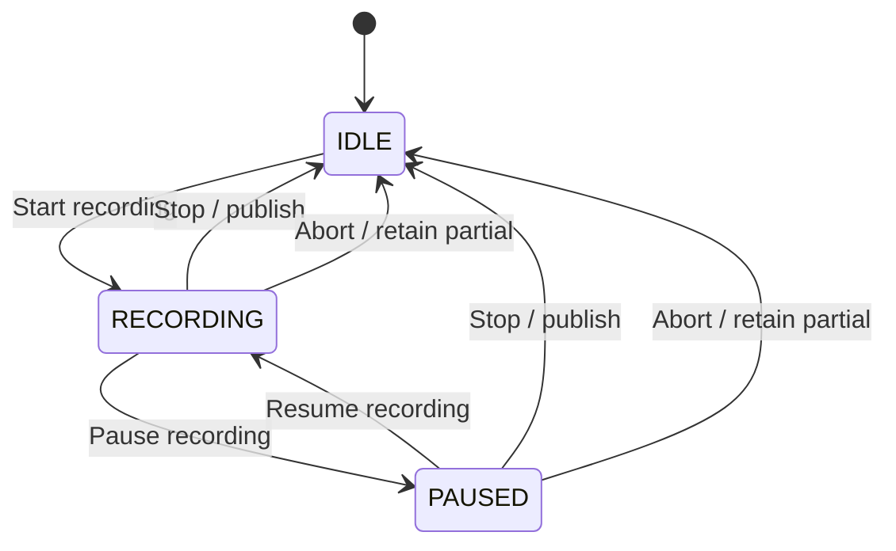

# JointPositionRecorder 暂停与恢复记录实现方案 V02

## 1. 文档目的

本文规划 `260720_01JointPositionRecorder` 的“暂停记录”和“恢复记录”功能。
本文只定义需求、状态、数据语义、修改范围和验收标准，不包含功能实现代码。

## 2. 已确认的核心需求

本次功能采用“剪掉暂停区间”的轨迹语义：

- 暂停期间不向 CSV 追加样本。
- 暂停期间不推进 CSV 的轨迹时间。
- 恢复后继续写入同一个记录会话和同一个 `.partial.csv`。
- 恢复后的动作在 CSV 时间轴上紧接暂停前的动作。
- 暂停持续 1 秒或数分钟，都不会在 CSV 中形成对应的静止时间或时间空洞。
- 角度位置真实性优先于拼接点的速度连续性。
- 恢复后必须记录 Articulation 实际回读角度。
- 不对暂停前后的角度做插值、平滑、修正或伪造过渡样本。
- 如果机械在暂停期间发生运动，CSV 中允许出现真实的位置跳变。
- 拼接点根据相邻样本推导出的速度可能偏大，本功能不保证该处速度连续。

## 3. 暂停功能的边界

“暂停记录”只控制数据采样，不默认控制机械和仿真：

- 不调用 `stop_motion()`。
- 不暂停 Isaac Sim Timeline。
- 不阻止用户下发新的关节目标。
- 不阻止当前运动继续执行。
- Controller 仍然每帧回读真实关节位置并刷新 GUI。

如果未来需要“暂停记录时同时冻结机械”，应作为独立功能设计，不能隐式加入本次实现。

## 4. 当前实现基础

项目当前的数据流为：

```text
Kit App update
→ GUI 提取 dt
→ MotionController.update(dt)
→ 读取 Articulation 当前角度
→ 必要时规划并写入下一步位置
→ 再次回读实际角度
→ 累加 _record_elapsed
→ ActualAngleRecorder.record(...)
```

当前记录状态只有一个布尔语义：

- `_recorder is None`：没有记录会话。
- `_recorder.active is True`：记录器文件流已打开并持续接收样本。

为了区分“正在采样”和“文件会话仍存在但采样已暂停”，需要引入独立的记录状态。

## 5. 记录状态模型

新增 `RecordingState`：

```text
IDLE
RECORDING
PAUSED
```

状态含义：

| 状态 | 文件会话 | 是否追加样本 | CSV 时间是否推进 |
|---|---|---:|---:|
| `IDLE` | 不存在 | 否 | 否 |
| `RECORDING` | 已打开 | 是 | 是 |
| `PAUSED` | 仍然打开 | 否 | 否 |

状态转换：



非法转换必须被拒绝：

- `IDLE` 时不能 Pause、Resume 或 Stop。
- `RECORDING` 时不能重复 Start、重复 Resume。
- `PAUSED` 时不能重复 Start、重复 Pause。

GUI 应通过按钮启用状态减少误操作，Controller 和 Recorder 仍需保留状态校验，不能只依赖 GUI。

## 6. CSV 时间轴设计

### 6.1 时间定义

CSV 的 `time` 继续使用现有的累计控制更新时间：

- 来源为 Kit update 事件中的 `dt`。
- 只接受有限正数。
- 继续受 `ProjectConfig.max_update_dt` 限制。
- 不是墙钟时间。
- 不是 USD Timeline 的绝对时间码。

新增暂停后，累计规则调整为：

```text
RECORDING:
    record_elapsed += valid_clamped_dt
    写入实际回读角度

PAUSED:
    record_elapsed 不变
    不写入样本
```

### 6.2 恢复后的第一条样本

点击 Resume 时只改变记录状态，不立即写入 CSV。

恢复后的下一个有效 update：

1. 正常完成 Articulation 读取或运动更新。
2. 将一个有效、截断后的 `dt` 加到 `_record_elapsed`。
3. 将当前实际回读角度写入 CSV。

这样可以同时保证：

- 时间戳严格递增。
- 不会和暂停前最后一条样本产生重复时间戳。
- 暂停时长不会进入 CSV。
- 恢复样本仍来自正常的每帧实际回读流程。

示例：

```text
暂停前最后样本：time = 3.000
真实暂停时长：  120 秒
恢复后首帧 dt：0.020
恢复后首个样本：time = 3.020
```

### 6.3 位置优先原则

假设暂停前最后记录角度为 `10°`，暂停期间机械运动到 `35°`，恢复后的实际回读角度为 `35.2°`：

```csv
3.000000000,10.000000000,...
3.020000000,35.200000000,...
```

这段数据保留真实角度位置，不进行以下处理：

- 不修改恢复后的 `35.2°`。
- 不在两行之间生成虚拟角度。
- 不为了限制速度而扩大时间差。
- 不为了视觉连续而复制暂停前角度。
- 不自动将机械移回暂停前位置。

因此拼接点的推导速度可能很大，这是明确接受的数据特征。

## 7. Recorder 层修改方案

目标文件：

```text
src/joint_position_recorder/trajectory_recorder.py
```

### 7.1 状态所有权

`ActualAngleRecorder` 作为文件生命周期所有者，保存 `RecordingState`，并提供：

- `state`
- `active`
- `accepting_samples`
- `pause()`
- `resume()`

属性语义：

- `active`：状态为 `RECORDING` 或 `PAUSED`，表示记录会话和文件流仍存在。
- `accepting_samples`：只有状态为 `RECORDING` 时为真。

保留 `active` 的会话语义，可以避免暂停状态被错误识别为“允许重新 Start”。

### 7.2 Start

`start()` 保持现有安全规则：

- 拒绝覆盖正式 CSV、partial CSV、正式 metadata 和 partial metadata。
- 独占创建 partial CSV。
- 写入稳定表头。
- 写入 `time=0` 的实际初始角度。
- 状态切换为 `RECORDING`。

### 7.3 Pause

`pause()` 只允许从 `RECORDING` 进入 `PAUSED`。

暂停时：

- 刷新 CSV 文件缓冲。
- 建议执行 `os.fsync()`，将暂停点作为显式数据安全检查点。
- 不关闭文件流。
- 不发布正式 CSV。
- 不创建新文件。

### 7.4 Resume

`resume()` 只允许从 `PAUSED` 进入 `RECORDING`。

恢复时：

- 不重写表头。
- 不重新写入 `time=0`。
- 不创建第二个 Recorder。
- 不立即写入位置样本。

### 7.5 Record

`record()` 只有在 `accepting_samples` 为真时才能执行。

现有校验全部保留：

- 时间有限且非负。
- 时间严格递增。
- 角度数量与关节数一致。
- 所有角度均为有限数。

如果暂停状态下错误调用 `record()`，应抛出明确的 `RecorderError`。

### 7.6 Stop 和 Abort

`stop()` 应允许从 `RECORDING` 或 `PAUSED` 调用：

- 保持至少两条样本才能发布的规则。
- flush、fsync 并关闭文件。
- 生成 metadata。
- 原子发布正式 CSV 和 metadata。
- 返回 `IDLE`。

`abort()` 同样支持两个活动状态：

- 关闭文件流。
- 保留 `.partial.csv`。
- 返回 `IDLE`。

## 8. Controller 层修改方案

目标文件：

```text
src/joint_position_recorder/controller.py
```

### 8.1 新增接口

新增：

- `pause_recording()`
- `resume_recording()`
- `recording_state`

现有 `recording` 属性保留，但定义为“当前存在未结束的记录会话”：

- `RECORDING` 时为真。
- `PAUSED` 时也为真。
- `IDLE` 时为假。

这样可以保持已有的防重复 Start 逻辑，并减少外部兼容性破坏。

### 8.2 Update

`update(dt)` 的运动部分保持不变：

1. 校验 Controller 和 Adapter。
2. 校验并截断 `dt`。
3. 回读当前角度。
4. 如果处于 `MOVING`，规划、写入并再次回读。
5. 更新 reached 和运动状态。

记录部分改为：

| RecordingState | `_record_elapsed` | 写 CSV |
|---|---:|---:|
| `IDLE` | 不变 | 否 |
| `RECORDING` | 增加有效 `dt` | 是 |
| `PAUSED` | 不变 | 否 |

任何情况下写入 CSV 的位置都必须使用 `_current` 中的实际回读角度。

### 8.3 Snapshot

`ControllerSnapshot` 增加：

- `recording_state`
- `record_elapsed_seconds`
- `recorded_samples`

保留现有：

- `recording`
- 运动状态和四关节状态字段。

其中：

- `recording=True` 表示会话尚未结束，可能处于记录或暂停。
- `recording_state` 用于精确区分 `RECORDING` 和 `PAUSED`。

### 8.4 暂停统计

Controller 可维护：

- `_pause_count`
- `_excluded_pause_elapsed`

`_excluded_pause_elapsed` 在 `PAUSED` 状态下按有效、截断后的 `dt` 累加，但不进入 `_record_elapsed`。

它只用于 metadata 和诊断，不写入 CSV 时间列。字段含义必须说明它是被排除的累计控制更新时间，不是精确墙钟暂停时长。

### 8.5 生命周期保护

以下路径必须同时覆盖 `RECORDING` 和 `PAUSED`：

- `stop_recording()`
- `abort_recording()`
- `fail()`
- Stage 被替换。
- 重新绑定 Stage。
- 窗口关闭。
- 重复运行入口导致旧窗口 shutdown。

暂停不能削弱现有 partial 文件保护机制。

## 9. GUI 层修改方案

目标文件：

```text
src/joint_position_recorder/gui.py
```

### 9.1 按钮

记录操作区调整为：

```text
Start recording | Pause recording | Resume recording | Stop recording
```

按钮启用规则：

| 状态 | Start | Pause | Resume | Stop |
|---|---:|---:|---:|---:|
| `IDLE` | 启用 | 禁用 | 禁用 | 禁用 |
| `RECORDING` | 禁用 | 启用 | 禁用 | 启用 |
| `PAUSED` | 禁用 | 禁用 | 启用 | 启用 |

即使按钮已禁用，对应回调和 Controller 仍必须执行状态校验。

### 9.2 状态显示

增加独立记录状态标签，避免通用 `_status_label` 被运动操作消息覆盖。

建议显示：

```text
Idle | 0 samples | trajectory time 0.000 s
Recording | 350 samples | trajectory time 7.420 s
Paused | 350 samples | trajectory time 7.420 s
```

暂停期间：

- `samples` 不增加。
- `trajectory time` 不增加。
- 当前关节角标签继续刷新。
- 运动状态继续正常刷新。

### 9.3 回调行为

`pause_recording()`：

- 获取已就绪 Controller。
- 调用 Controller 的暂停接口。
- 刷新 Snapshot 和按钮。
- 显示 partial 文件仍被保留的信息。

`resume_recording()`：

- 调用 Controller 的恢复接口。
- 不立即写样本。
- 刷新 Snapshot 和按钮。
- 提示下一有效 update 将继续记录。

`stop_recording()`：

- 在 `RECORDING` 和 `PAUSED` 状态都可以调用。
- metadata 记录最终运动状态、目标、速度和暂停统计。

## 10. Metadata 方案

正式 metadata 建议新增：

```text
pause_count
excluded_pause_duration_seconds
trajectory_duration_seconds
recording_time_policy
position_priority
```

推荐语义：

| 字段 | 含义 |
|---|---|
| `pause_count` | 本次记录的暂停次数 |
| `excluded_pause_duration_seconds` | 未进入 CSV 的暂停控制更新时间累计值 |
| `trajectory_duration_seconds` | 压缩暂停区间后的 CSV 轨迹时长 |
| `recording_time_policy` | 固定标识为 `exclude_paused_intervals` |
| `position_priority` | 固定标识为 `actual_readback_no_interpolation` |

现有 `duration_seconds` 可继续表示最后一条 CSV 样本的时间，与压缩后的轨迹时长一致。

不要求在 CSV 中增加额外列，以保持现有下游读取兼容性：

```csv
time,cab,boom,small_arm,bucket
```

## 11. 公共接口与兼容性

目标文件：

```text
src/joint_position_recorder/__init__.py
```

需要导出 `RecordingState`。

兼容性原则：

- 不改变 CSV 表头和关节顺序。
- 不改变角度单位。
- 不改变正常 Start/Stop 的基础行为。
- 不改变现有防覆盖规则。
- 不改变运动状态机。
- 不改变 Articulation Adapter。
- 不改变 Profile 格式。
- 保留 `ControllerSnapshot.recording`。

## 12. 不需要修改的模块

本次功能原则上不修改：

- `motion_planner.py`
- `articulation_adapter.py`
- `stage_validator.py`
- `config.py`
- `profiles/excavator_four_joint_default.json`

暂停记录不应影响运动规划、安全限位、DOF 映射或 Stage 校验。

## 13. 单元测试计划

### 13.1 Recorder 测试

目标文件：

```text
tests/test_trajectory_recorder.py
```

新增测试：

1. `start → pause → resume → stop` 能发布同一个 CSV。
2. Pause 后 Recorder 仍然 active，但不接受样本。
3. Pause 时已写数据被 flush。
4. PAUSED 状态直接调用 `record()` 被拒绝。
5. 重复 Pause 被拒绝。
6. 未暂停时 Resume 被拒绝。
7. PAUSED 状态可以直接 Stop。
8. PAUSED 状态 Abort 会保留 partial。
9. Resume 不产生额外表头或重复 `time=0` 样本。
10. 所有正式样本时间严格递增。

### 13.2 Controller 测试

目标文件：

```text
tests/test_controller.py
```

新增测试：

1. 暂停期间连续多次 `update()`，sample count 不增加。
2. 暂停期间 `_record_elapsed` 不增加。
3. 暂停期间机械运动仍继续，Adapter 实际角度可以变化。
4. 恢复后第一条样本使用恢复时的实际回读角度。
5. 恢复后时间只增加一个有效 `dt`，不包含暂停区间。
6. 恢复后的实际位置跳变不被插值或修改。
7. Start 在 PAUSED 状态下被拒绝。
8. PAUSED 状态 Stop 能正常发布。
9. PAUSED 状态 fail/abort 保留 partial。
10. Snapshot 正确报告记录状态、样本数和压缩后的轨迹时间。

关键验收示例：

```text
暂停前：
time = 1.000
cab = 10.0

暂停期间：
执行若干 update
cab 实际运动到 35.0

恢复后首个有效 update：
dt = 0.020
cab 实际回读 = 35.2

预期 CSV：
1.000000000,10.000000000,...
1.020000000,35.200000000,...
```

测试必须断言 `35.2` 被原样记录，不生成中间角度。

## 14. Isaac Sim GUI 集成测试

目标文件：

```text
tests/isaac_gui_smoke_test.py
```

建议增加完整操作路径：

1. 打开 Stage 并等待绑定完成。
2. 设置临时 CSV 输出路径。
3. Start recording。
4. 运行若干帧并记录样本。
5. Pause recording。
6. 暂停期间执行机械运动或修改实际关节位置。
7. 确认样本数和轨迹时间保持不变。
8. Resume recording。
9. 运行一个或多个有效 update。
10. Stop recording。
11. 校验正式 CSV 和 metadata。
12. 将机械恢复到测试前位置。

GUI smoke test 重点验证：

- 按钮状态转换正确。
- 暂停不阻止运动。
- 恢复后写入真实角度。
- CSV 不包含暂停时长。
- 窗口关闭时没有遗留活动文件句柄。

## 15. 文档更新范围

实现完成后同步更新：

- `README.md`
- `docs/tutorial/04_运动规划器与控制状态机.md`
- `docs/tutorial/05_Isaac适配层与GUI生命周期.md`
- `docs/tutorial/06_轨迹记录器与数据格式.md`
- `docs/tutorial/07_测试调试与常见问题.md`

必须明确写出：

- 暂停区间从 CSV 时间轴中移除。
- Pause 不会停止机械或 Timeline。
- 恢复样本采用实际角度。
- 暂停期间发生运动可能导致拼接点位置跳变和推导速度偏大。

## 16. 推荐实施顺序

1. 增加 `RecordingState` 和 Recorder 状态转换。
2. 为 Recorder 增加单元测试。
3. 修改 Controller 的暂停、恢复和时间累计逻辑。
4. 为 Controller 增加位置优先和压缩时间测试。
5. 修改 Snapshot 和公共导出。
6. 增加 GUI 按钮、状态显示及按钮启用规则。
7. 扩展 Isaac GUI smoke test。
8. 更新 README 和教程。
9. 运行全部纯 Python 测试。
10. 在远端 Isaac Sim 环境执行 Articulation 和 GUI 集成验证。

## 17. 最终验收标准

功能只有在同时满足以下条件时才算完成：

- Start、Pause、Resume、Stop 状态转换正确。
- Pause 不创建新文件、不关闭当前记录会话。
- Resume 继续写入原来的 partial 文件。
- 暂停期间 CSV 样本数保持不变。
- 暂停期间 CSV 轨迹时间保持不变。
- 恢复后的首条时间戳严格大于暂停前最后时间戳。
- 恢复后的时间差只包含恢复后的有效 update `dt`。
- 恢复后记录的是实际 Articulation 回读角度。
- 任何位置跳变都不被插值、平滑或篡改。
- CSV 表头、列顺序、角度单位及防覆盖规则保持兼容。
- 暂停状态下 Stop 能发布有效记录。
- 暂停状态发生异常、Stage 变化或窗口关闭时保留 partial。
- 全部纯 Python 单元测试通过。
- 远端 Isaac Sim GUI smoke test 通过。

