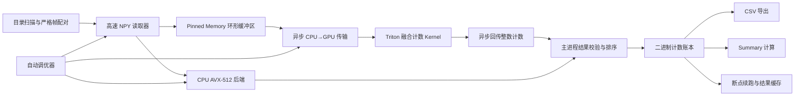

### Annotation 1

`917` 帧只作为样例。新版方案按任意规模 `N` 设计：

- 1 万帧两套 720p `uint16` 语义图约 36.9GB；
- 10 万帧约 369GB；
- 不假设数据能全部进入内存或显存；
- 内存和显存占用只由 batch 大小决定，即 `O(batch_size)`，不随总帧数增长。

### Annotation 2

删除“采集阶段直接统计”的方案。本版严格限定为离线后处理：

- 不修改 Isaac Sim Writer；
- 不修改采集流程；
- 不要求上游新增计数；
- 输入仍然是已经生成的 `.npy` 语义图和 mapping；
- 允许生成后处理缓存、检查点和最终报告。

# 极高速后处理链路

核心思想是把整个流程做成一条有背压的异步流水线：



理想情况下，总时间接近：

```text
T_total ≈ max(T_磁盘读取, T_CPU到GPU传输, T_GPU计算)
          + 初始化
          + 报告写出
```

而不是三段时间相加，因为读取、传输和计算会同时进行。

## 一、逻辑分层

### 1. 数据契约层

输入：

```text
whole_scene_semantic_dir/
    semantic_id_<frame_id>.npy

excavator_only_semantic_dir/
    semantic_id_<frame_id>.npy

semantic_mapping.json
```

约束：

- 两边 frame ID 必须完全一致；
- shape、dtype 必须一致；
- 数组必须为二维整数数组；
- mapping 必须包含五个目标标签；
- 默认严格模式，任何缺帧或损坏均停止最终提交。

目录扫描使用 `os.scandir()`，只建立：

```text
frame_id -> whole_path, reference_path
```

不在预检阶段打开所有数组，避免重复 I/O。

### 2. 高速读取层

当前主要问题之一是万级数据会产生数万个 `.npy` 文件打开操作。

读取层建议分三级：

#### 普通模式

- Python I/O 线程池；
- 8～16 个读取线程；
- 按 frame ID 顺序读取；
- 使用有界任务队列；
- 不同时 mmap 数万个文件。

#### 高速模式

实现原生 C++/Rust/pybind 读取器：

- `io_uring` 批量提交读取请求；
- 固定注册缓冲区；
- 多文件异步 `read`；
- 直接读取到 pinned host memory；
- 解析 NPY header 后将 payload 放到预定位置；
- 使用 `posix_fadvise(SEQUENTIAL)`；
- 消费完成后可使用 `DONTNEED` 降低 page cache 污染。

#### 连续缓存模式

第一次处理时可以选择生成派生缓存：

```text
packed/
├── whole_scene.uint16.bin
├── excavator_only.uint16.bin
├── frame_index.json
└── cache_manifest.json
```

后续读取由数万个小文件变成两个大文件的顺序读取。

对于单次任务，打包可能不划算；对于重复分析、切换标签或反复调整 summary 时，收益很大。

## 二、Pinned Memory 环形缓冲

使用固定大小的环形缓冲槽：

```text
Slot 0: CPU 正在填充
Slot 1: 正在 H2D
Slot 2: GPU 正在计算
Slot 3: 等待回收
```

每个 slot 包含：

```text
frame_ids[batch]
whole[batch, 720, 1280] uint16
reference[batch, 720, 1280] uint16
```

状态机：

```text
FREE
  → FILLING
  → READY
  → COPYING
  → COMPUTING
  → RESULT_READY
  → FREE
```

推荐初始搜索范围：

- `batch_frames`: 32、64、128、256；
- `ring_slots`: 3 或 4；
- `reader_threads`: 4、8、16、32；
- `cuda_streams`: 2 或 3。

例如 batch=128 时，两套语义数组约占 450MiB。即使使用多个缓冲槽，也远低于服务器内存和4090显存容量。

有界环形缓冲可以保证：

- 万级或十万级数据不会撑爆内存；
- GPU 慢时读取器自动等待；
- 磁盘慢时 GPU 不会积累无用任务；
- 失败后最多损失少量未提交 batch。

## 三、GPU 核心算法

### 不推荐的算法

以下写法虽然简单，但不是最高速方案：

```python
semantic[..., None] == target_ids
```

它会生成五通道布尔张量。对于万级帧，虽然按 batch 执行不会爆显存，但会产生大量临时内存流量。

也不应：

- 每个标签单独启动一次 kernel；
- 每个像素执行全局 atomic；
- 把完整布尔 mask 传回 CPU；
- 在 GPU 上计算最终浮点 summary。

### Triton 融合 Kernel

输入：

```text
whole[batch, height, width] uint16
reference[batch, height, width] uint16
target_ids[5] uint16
```

输出：

```text
counts[batch, 2, 5] uint32
```

处理方式：

1. 每个语义像素只从显存读取一次；
2. 一次读取同时与五个 ID 比较；
3. 线程维护寄存器局部计数；
4. block 内进行树形归约；
5. 每个 block 写一个 partial count；
6. 第二个小 kernel 合并 partial counts。

推荐 grid：

```text
(frame_in_batch, tile_index)
```

一个 tile 处理同一帧的一段连续像素。这样既能保证显存访问合并，也能让一帧由多个 GPU block 并行处理。

输出规模极小。即使一万帧：

```text
10000 × 2 × 5 × 4 bytes = 400KB
```

### 为什么使用整数

单帧最大像素数为：

```text
1280 × 720 = 921600
```

因此单帧计数使用 `uint32` 足够。全局累计时转为 CPU `uint64` 或 Python 整数。

GPU 不计算 ratio，只输出精确计数。这能保证：

- CPU 与 GPU 结果可以逐整数比较；
- 不受浮点归约顺序影响；
- batch 大小和 stream 数量不会改变结果；
- summary 始终由统一逻辑计算。

## 四、CUDA 流水化

使用多个 CUDA stream：

```text
时间 →
Stream Copy 0: [H2D batch 0]       [H2D batch 2]
Stream Exec 0:       [kernel 0]              [kernel 2]

Stream Copy 1:       [H2D batch 1]       [H2D batch 3]
Stream Exec 1:             [kernel 1]              [kernel 3]
```

每个 batch 通过 CUDA Event 建立依赖：

```text
读取完成
  → H2D 完成事件
  → kernel
  → counts D2H
  → 结果队列
```

CPU 不执行全局 `cuda.synchronize()`，只等待对应 batch 的事件，否则会破坏流水线并行。

如果 batch 大小固定，可以进一步尝试 CUDA Graph，减少重复 kernel launch 和调度开销。

## 五、CPU 极速后端

GPU 不一定永远是端到端最快，因为语义数据首先从磁盘进入 CPU 内存，而服务器有64个物理核。

建议同时实现一个原生 CPU 后端：

```text
C++ + OpenMP + AVX-512
```

算法同样只扫描一次：

1. 一次向量加载多个 `uint16`；
2. 同时与五个 ID 比较；
3. 每个线程维护局部计数；
4. 线程结束后一次归约；
5. 不使用共享 atomic。

它特别适合：

- 数据已经进入 page cache；
- PCIe 传输成为瓶颈；
- GPU 正被 Isaac Sim 或其他程序占用；
- 磁盘吞吐低于 GPU 消费能力。

## 六、自动调优和异构调度

程序首次运行时用前 64～256 对帧进行短基准：

```text
候选后端：
- NumPy reference
- CPU AVX-512
- Torch compiled CUDA
- Triton CUDA
```

测量：

- 文件读取吞吐；
- CPU 计数吞吐；
- pinned memory H2D；
- GPU kernel；
- 每个 batch 的端到端延迟；
- READY 队列和 GPU 空闲比例。

然后选择最快组合：

```text
backend
reader_threads
batch_frames
ring_slots
cuda_streams
tile_pixels
```

更激进时，可以使用异构 work stealing：

- GPU 处理主要 batch；
- CPU AVX-512 后端处理溢出 batch；
- 调度器根据预测完成时间分配；
- 两种后端都只返回相同格式的整数计数。

但是否启用混合调度必须由基准决定。如果磁盘已饱和，同时启用 CPU 和 GPU不会再提速。

## 七、结果账本与 CSV 隔离

高性能执行链不直接写最终 CSV。

先产生规范化二进制计数账本：

```text
counts/
├── part-000000-000999.bin
├── part-001000-001999.bin
├── ...
└── counts_manifest.json
```

每条记录只包含：

```text
frame_id
whole_counts[5]
reference_counts[5]
status
```

每个 part：

1. 写入临时文件；
2. 校验记录数和 checksum；
3. 原子替换正式 part；
4. 更新 checkpoint manifest。

优势：

- CSV 写入速度不影响 GPU；
- 崩溃后可以从最后一个完整 part 继续；
- 已完成 batch 不需要重新扫描；
- summary 和 CSV 都来自同一份整数账本；
- 可以重新生成不同格式的报告。

最终流程：

```text
二进制账本
   ├── per_frame.csv
   ├── summary.csv
   ├── summary.json
   └── anomalies.csv
```

CSV 仍然只能由主进程写。

## 八、Summary 的确定性

主进程统一执行：

```text
whole_group = sum(whole_counts[0:5])
reference_group = sum(reference_counts[0:5])
```

单帧比值：

```text
whole_count / reference_count
```

数据集主指标：

```text
sum(all whole_count) / sum(all reference_count)
```

保证方式：

- 按输入序号恢复 frame ID 顺序；
- 检查 frame ID 无重复；
- 检查所有 count 为非负整数；
- 检查单齿 count 不超过图像总像素数；
- group 必须等于五个单齿之和；
- 分母为零写 `null`，不写 `NaN`；
- `summary.json` 使用 `allow_nan=False`；
- CSV 和 summary 从同一个账本生成；
- 正式文件全部采用临时文件加原子替换。

并行完成顺序完全不会影响输出。

## 九、断点续跑与缓存

万级数据必须支持断点续跑。

缓存键至少包括：

- whole/reference 文件清单；
- 文件大小和修改时间；
- mapping SHA256；
- 五个 semantic ID；
-算法版本；
-计数后端版本；
- shape 和 dtype。

如果需要强内容校验，可以在第一次读取 payload 时顺便计算快速 checksum，不能为了 hash 再读一遍全部输入。

第一次成功扫描后保存：

```text
counts_cache/
├── counts.npy
├── frame_ids.txt
└── manifest.json
```

五标签计数缓存非常小：

```text
N × 2 × 5 × 8 bytes
```

一万帧也只有约 800KB。之后修改：

- ratio 展示精度；
- group 定义；
-异常阈值；
- summary 统计项；
- CSV 列顺序；

都不需要重新读取几十 GB 的语义图。

## 十、项目内部结构

```text
260727SemanticPixelRatio/
├── run_compare.py
├── configs/
├── semantic_pixel_ratio/
│   ├── config.py
│   ├── models.py
│   ├── discovery.py
│   ├── validation.py
│   ├── backends/
│   │   ├── base.py
│   │   ├── numpy_backend.py
│   │   ├── cpu_avx512_backend.py
│   │   ├── torch_cuda_backend.py
│   │   └── triton_cuda_backend.py
│   ├── io/
│   │   ├── npy_reader.py
│   │   ├── pinned_ring.py
│   │   └── packed_reader.py
│   ├── runtime/
│   │   ├── scheduler.py
│   │   ├── autotuner.py
│   │   └── pipeline.py
│   ├── results/
│   │   ├── ledger.py
│   │   ├── checkpoint.py
│   │   ├── summary.py
│   │   └── csv_exporter.py
│   └── kernels/
│       └── semantic_count_triton.py
└── tests/
```

## 十一、为什么这条链路快

核心原因可以归纳为八点：

1. 每个语义像素只读一次，而不是五个标签扫描五次。
2. 不生成五张完整 bool mask，减少显存分配和带宽。
3. 磁盘读取、H2D、GPU kernel 三段并行重叠。
4. pinned memory 避免额外 staging copy。
5. GPU只回传几十 KB 到几 MB 的整数结果。
6. 有界环形缓冲使内存使用与总帧数无关。
7. 二进制账本与 CSV 解耦，报告写出不阻塞计算。
8. 完成一次扫描后使用计数缓存，后续分析不再读取原图。

## 十二、建议实施顺序

1. 实现严格的 NumPy参考后端，作为正确性标准。
2. 实现结果账本、checkpoint 和原子报告。
3. 实现有界 batch 调度器。
4. 实现 Torch CUDA 基准后端。
5. 实现 Triton 单次融合五标签 kernel。
6. 加入 pinned-memory 环形缓冲和多 stream。
7. 加入自动调优器。
8. 实现连续 packed 数据缓存。
9. 实现 CPU AVX-512 后端。
10. 根据实测决定是否增加混合 CPU/GPU调度、`io_uring`、CUDA Graph 或 GDS。

这套方案完全处于后处理阶段，可扩展到万级、十万级帧，并且不会因为总数据规模增加而线性增加内存或显存占用。
