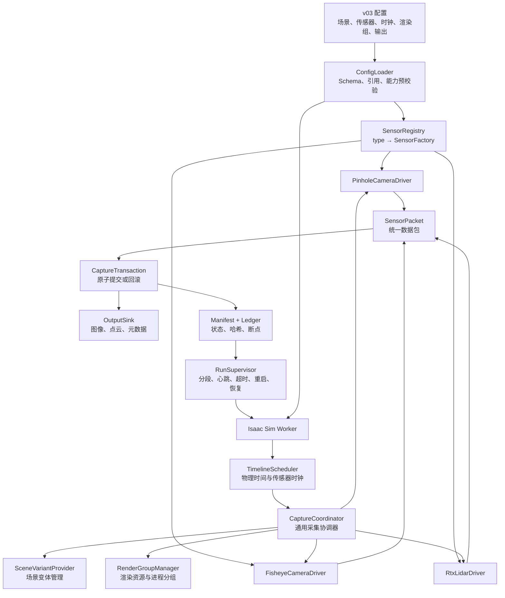

# v03 脚本项目核心思路、架构、实现方案与 v02 对比

## 问题

现在重新讲解 v03 脚本项目的核心思路，核心架构，实现方案以及功能和架构上和 v02 版脚本的区别。

## 回答

一句话概括：v03 要把 v02 的“固定单相机采集脚本”，升级成“配置驱动、插件化、多传感器同步、支持断点恢复的仿真数据采集框架”。

它不是简单复制 v02 后添加鱼眼和 LiDAR，而是重新划分职责，让主流程不再依赖具体传感器。

## 一、v03 的核心目标

### 1. 已支持传感器的新增只改配置

例如增加：

- 第二个针孔相机
- 鱼眼相机
- 第三个不同分辨率的相机
- 已支持型号的 RTX LiDAR

都不再修改主调度器，而是在 `sensors[]` 中增加实例。

需要注意边界：

- 增加“已支持类型”的实例：只改配置。
- 首次支持一种全新的传感器类型：需要开发一个驱动插件。
- 新驱动只注册到 `SensorRegistry`，不修改主采集链。

### 2. 同时支持不同采集语义

v03 不会把所有传感器都简单理解为“拍一张图”。

它区分：

- `snapshot`：针孔、鱼眼等瞬时相机采集。
- `interval`：旋转 LiDAR 等覆盖一段时间的扫描。
- `continuous`：后续可能加入的 IMU、里程计等连续数据。

### 3. 提升 Path Tracing 稳定性

重点解决：

- GPU page fault
- 原生渲染调用长期阻塞
- 超长进程中途退出
- 算力实例被回收
- 任务中断后无法恢复
- 日志和资源无限增长

v03 将加入：

- 分段 worker
- 进程外 watchdog
- 阶段心跳
- 原子事务
- 断点续跑
- GPU/内存监控
- 崩溃分类和证据保留

### 4. 建立统一、可追溯的数据契约

所有传感器输出都必须能够追溯到：

- `sensor_id`
- `capture_id`
- 仿真时间
- 物理步
- 场景变体
- 相机或 LiDAR 标定
- USD、轨迹、mapping 和渲染配置哈希

## 二、v03 的核心思路

v03 的核心可以归纳成六句话：

1. 配置决定“有哪些传感器”。
2. 注册表决定“由哪个驱动实现”。
3. 时间调度器决定“什么时候采集”。
4. 传感器驱动决定“怎样获得数据”。
5. 输出与事务层决定“怎样验证和提交”。
6. Supervisor 决定“任务异常后如何活下来”。

## 三、v03 核心架构



最重要的变化是：

> `CaptureCoordinator` 不知道传感器内部是 RenderProduct、鱼眼 schema 还是 GenericModelOutput，它只调用统一的 SensorDriver 接口。

## 四、各核心模块的职责

### 1. ConfigLoader：配置入口

负责读取并验证：

```text
scene
render_groups
sensors[]
capture
variants
synchronization_groups
outputs
runtime
```

它应该在 Isaac Sim 启动前发现：

- sensor ID 重复
- 未注册的传感器类型
- Prim 路径格式错误
- 输出目录冲突
- 时钟与物理步不兼容
- 缺少相机标定
- LiDAR tick rate 与 scan rate 不一致
- 传感器与 render group 不兼容

这样可以避免 USD 加载完成后才发现普通配置错误。

### 2. SensorRegistry：传感器类型注册表

建立类型字符串和驱动工厂之间的映射：

```text
camera.pinhole          → PinholeCameraDriver
camera.fisheye_opencv   → FisheyeCameraDriver
lidar.rtx.rotary        → RtxLidarDriver
```

配置文件只写：

```json
"type": "camera.fisheye_opencv"
```

不写具体 Python 类，也不让配置任意导入代码。

### 3. SensorDriver：传感器统一接口

所有传感器驱动遵守统一生命周期：

```python
class SensorDriver:
    def preflight(self, stage, spec): ...
    def initialize(self, runtime_context): ...
    def warmup(self): ...
    def capture(self, request): ...
    def health(self): ...
    def close(self): ...
```

#### 针孔相机驱动

内部负责：

- 验证 `UsdGeom.Camera`
- 读取相机参数
- 创建 RenderProduct
- 创建 RGB、semantic、depth 等 Annotator
- 生成图像类 SensorPacket

#### 鱼眼相机驱动

除了相机基础能力，还负责：

- 检查 OpenCV fisheye schema
- 读取或写入鱼眼标定参数
- 验证内参和畸变系数
- 保存标定哈希

对于已有 Prim：

```text
source.mode = existing_prim
```

代码自动从 USD Stage 读取：

- 相机内参
- 畸变模型和畸变系数
- 相对安装位姿
- 每帧世界坐标外参
- 曝光、快门和裁剪范围

配置中仍指定采集任务参数，例如：

- 分辨率
- 采集频率
- 输出模态
- render group
- 输出策略

对于新建相机：

```text
source.mode = create
```

才需要从独立标定文件或配置中提供参数。

#### RTX LiDAR 驱动

负责：

- 创建或绑定 OmniLidar
- 管理 scan rate 和 tick rate
- 管理完整扫描积累
- 读取 GenericModelOutput
- 生成点云、range、intensity
- 记录扫描开始和结束时间

LiDAR 不复用相机的“冻结世界拍一张图”逻辑。

### 4. TimelineScheduler：时间与频率调度

假设：

```text
Physics：60 Hz
前相机：10 Hz
后相机：10 Hz
鱼眼相机：5 Hz
LiDAR：10 Hz
```

TimelineScheduler 每个物理步计算哪些传感器到期。

它只生成事件：

```text
physics_step = 60
到期：front_camera、rear_camera、lidar
未到期：fisheye
```

不直接执行渲染。

### 5. CaptureCoordinator：主协调器

协调器负责：

1. 获取本次到期的传感器。
2. 建立权威世界状态。
3. 准备场景变体。
4. 调用对应驱动。
5. 收集 SensorPacket。
6. 统一验证和事务提交。

主协调器中不会出现：

```python
if fisheye:
if lidar:
if second_camera:
```

### 6. RenderGroupManager：渲染组管理

Isaac Sim 的 renderer 和很多 RTX 设置是进程级状态，不能假设每个传感器都有完全独立的 renderer。

因此引入：

```text
camera_pathtracing
camera_realtime
lidar_rtx
```

渲染组决定：

- 哪些传感器共享同一个 renderer/profile
- 多个 RenderProduct 同时激活还是顺序激活
- 哪些传感器需要单独 worker
- 显存预算和生命周期策略

初期建议：

- 相同 profile 的多个相机可以放在同一个组。
- PathTracing 相机和 RTX LiDAR 分组。
- 生命周期有冲突时直接使用不同 worker 进程。

### 7. SensorPacket：统一数据包

无论相机还是 LiDAR，都返回统一元数据：

```text
run_id
capture_id
sensor_id
sample_id
frame_id
variant_id
timestamp
interval_start / interval_end
physics_step
world_state_hash
calibration_hash
modalities
payload descriptors
validation result
render metrics
```

payload 可以是：

- PNG
- NPY
- 点云
- 深度图
- JSON 元数据

### 8. OutputSink：输出层

不同数据由不同 Sink 处理：

```text
SemanticImageSink
PointCloudSink
MetadataSink
```

现有 v02 的这些能力可以复用：

- SemanticMapping
- 语义内容验证
- 原子 staging
- commit/discard
- 图像和 metadata 写出

但必须去掉“Writer 只接受一个 RenderProduct”的限制。

建议目录改成：

```text
output/
  run_manifest.json
  ledger.jsonl
  calibration/
    front_camera.json
    fisheye_camera.json
    lidar.json
  sensors/
    front_camera/
      full_scene/rgb/
      full_scene/semantic/
    fisheye_camera/
      full_scene/rgb/
    lidar/
      full_scene/point_cloud/
  .transactions/
```

### 9. CaptureTransaction：多传感器原子事务

假设一个同步组包含：

```text
front_camera
rear_camera
fisheye_camera
```

采集结果：

```text
front_camera：成功
rear_camera：成功
fisheye_camera：失败
```

如果三者都是 required sensor，则整个 `capture_id` 回滚，不产生半完整数据。

成功时才统一提交：

```text
capture_id = 100
dataset_time = 10.0
world_state_hash = abc123
```

### 10. RunSupervisor：进程外监督

Supervisor 不运行在 Isaac Sim worker 内部。

它负责：

- 按 300～500 帧启动一个 worker
- 检查阶段心跳
- 检查 worker 退出码
- 检测 GPU crash dump
- 渲染超时后终止 worker
- 保存日志和 GPU 状态
- 从最后一个已提交事务继续
- 限制最大重启次数

这是因为 GPU page fault 可能让原生渲染调用失去响应，进程内部的 Python 超时未必能够抢回控制权。

## 五、v03 的完整运行流程

一次任务大致这样执行。

### 第一步：Supervisor 读取配置

在启动 Isaac Sim 前完成 JSON Schema 和路径校验，计算配置 fingerprint。

### 第二步：规划任务分段

例如：

```text
segment 0：frame 0～499
segment 1：frame 500～999
segment 2：frame 1000～1499
```

### 第三步：启动 Isaac Sim worker

Worker：

- 打开 USD Stage
- 应用 RenderProfile
- 运行 StagePreflight
- 初始化物理世界和轨迹
- 由 SensorRegistry 创建所有启用的驱动

### 第四步：传感器初始化

已有鱼眼相机：

```text
根据 prim_path 读取 USD 参数
→ 验证 fisheye schema
→ 保存实际标定快照
→ 创建 RenderProduct
```

新建 LiDAR：

```text
根据 config 或传感器 USD 创建 OmniLidar
→ 检查 tick/scan rate
→ 创建运行时对象和 Annotator
```

### 第五步：调度采集

TimelineScheduler 产生到期事件，CaptureCoordinator 建立权威状态并调用各驱动。

### 第六步：生成 SensorPacket

各传感器返回统一数据包。

### 第七步：事务提交

required sensor 全部成功后：

- 写出文件
- 更新 ledger
- 更新 manifest
- 原子提交事务

### 第八步：分段结束

Worker 正常关闭，释放 RTX/GPU 上下文，Supervisor 启动下一段。

如果 worker 异常退出，则从最后一个已提交 `capture_id` 恢复。

## 六、Path Tracing 的专项实现方案

### 1. 推荐使用 variant-major

v02 当前是帧优先：

```text
frame 0：full → excavator → teeth → full
frame 1：full → excavator → teeth → full
```

这会每帧反复改变可见性并重新装载大量 Gaussian prim。

v03 的 PathTracing 推荐变体优先：

```text
Pass 1：所有 full_scene 帧
Pass 2：所有 excavator_only 帧
Pass 3：所有 front_teeth_only 帧
```

然后使用：

```text
frame_id
dataset_time
world_state_hash
```

完成三个 pass 的严格配对。

`frame_major` 可以保留，作为“必须在同一进程中立即得到三变体”的兼容模式，但不建议作为 PathTracing 默认模式。

### 2. 减少重复探测渲染

v02 当前通常是：

```text
探测渲染
→ 语义验证通过
→ 再进行一次正式渲染
```

v03 可以改成：

```text
渲染并读取真实 Annotator
→ 验证通过：直接将当前结果提交
→ 验证失败：重置后再次渲染
```

这需要先验证：

- 没有前一变体残留
- 实际 spp 达标
- 图像质量一致
- Annotator 数据是当前渲染结果

### 3. 分段主动释放资源

即使没有崩溃，也每隔若干帧主动重启 worker，避免：

- SceneDB 长期资源碎片
- Hydra/Annotator 生命周期积累
- 原生插件状态长期漂移
- 日志无限增长

### 4. 明确错误分类

不再把所有问题都叫“卡住”，而是区分：

```text
python_exception
writer_failure
render_timeout
gpu_crash_dump_detected
worker_signal_exit
host_interrupted
user_cancelled
```

## 七、v02 与 v03 的功能区别

| 维度 | v02 | v03 |
|---|---|---|
| 主要定位 | 单语义相机专项脚本 | 通用多传感器采集框架 |
| 传感器配置 | 一个全局 `camera_prim_path` | `sensors[]` 任意数量实例 |
| 新增相机 | 修改配置、调度器、Writer | 已支持类型只改配置 |
| 鱼眼参数 | 没有正式抽象 | 已有 Prim 自动读取；新建相机引用标定 |
| LiDAR | 不在主框架中 | 独立 LiDAR Driver 和点云 Sink |
| 多 RenderProduct | Writer 明确只接受一个 | 每传感器或渲染组管理多个 |
| 时间模型 | 一个全局 `capture_fps` | 每个传感器独立 clock |
| 采集语义 | 相机 snapshot | snapshot、interval、continuous |
| 多传感器同步 | 不支持 | synchronization group |
| 场景变体 | 主循环写死三种 | 配置化 VariantProvider |
| 输出结构 | 按业务变体固定目录 | 按 sensor/variant/modality 组织 |
| Writer | 与相机调度器紧耦合 | OutputSink 与 Driver 分离 |
| 事务 | 单相机三变体事务 | 多传感器 capture transaction |
| 渲染模式 | 一个全局 profile | RenderGroup 明确管理兼容性 |
| PathTracing | 单个超长进程 | variant-major、分段、恢复 |
| 故障检测 | 依赖 Python 异常 | 进程外 watchdog + heartbeat |
| 中断恢复 | 基本没有正式 resume | ledger 驱动的断点续跑 |
| 可观测性 | 日志和最终 manifest | 阶段心跳、GPU/内存/耗时指标 |
| 扩展方式 | 修改主流程 | 插件驱动注册 |

## 八、v02 与 v03 的架构区别

v02 更接近：

```text
Config
  → SimulationOrchestrator
      → SemanticCameraScheduler
          → 一个 RenderProduct
          → 固定 Annotators
          → SemanticDatasetWriter
      → 手写三种变体流程
```

主要问题是所有职责向主流程和相机调度器集中。

v03 则是：

```text
Config
  → ConfigLoader
  → SensorRegistry
  → TimelineScheduler
  → CaptureCoordinator
      → SceneVariantProvider
      → RenderGroupManager
      → SensorDriver[]
  → SensorPacket[]
  → CaptureTransaction
  → OutputSink[]
  → Manifest/Ledger

进程外：
RunSupervisor
```

v03 的核心不是模块数量更多，而是依赖方向更清晰：

- 核心层不依赖具体传感器。
- 传感器层不决定全局调度。
- 输出层不控制渲染。
- Supervisor 不理解业务数据，只监督 worker。
- 配置层只描述行为，不包含任意执行代码。

## 九、哪些 v02 能力应该保留

v03 不需要推翻整个 v02。以下能力可以重构后复用：

- `WorldScheduler`
- 固定物理步与数据时间计算
- 轨迹和根姿态权威回放
- `RenderProfile`
- `StagePreflight`
- `SemanticMapping`
- 语义内容验证
- 场景可见性控制
- staging/commit/discard 帧事务
- 运行 manifest
- 摄像机状态与运动状态记录

重点是把这些能力从“单相机具体流程”中抽出来，变成通用服务。

## 十、推荐实现顺序

### 第一阶段：稳定性底座

先完成：

- Supervisor
- heartbeat
- segment
- ledger/resume
- GPU 和进程指标
- 日志轮转
- PathTracing 消融测试

否则多传感器加入后，GPU 崩溃会更难定位。

### 第二阶段：v03 核心抽象

实现：

- Config schema v03
- SensorRegistry
- SensorDriver
- SensorPacket
- CaptureCoordinator
- OutputSink

先只接入一个针孔相机，验证结果与 v02 等价。

### 第三阶段：多相机与鱼眼

实现：

- 多个针孔相机
- 已有 Prim 自动读取参数
- OpenCV fisheye schema
- 同步相机组
- 多 RenderProduct 管理

### 第四阶段：RTX LiDAR

实现：

- interval acquisition
- scan accumulation
- 点云输出
- 独立 render group
- LiDAR 时间和校准元数据

### 第五阶段：PathTracing 生产化

完成：

- variant-major
- validated capture promotion
- 500/5000/10190 帧稳定性测试
- 主动中断恢复测试
- 质量和性能对照

最终可以把 v02 和 v03 的差异总结为：

> v02 关注“如何可靠地用一台语义相机完成一次特定采集”；v03 关注“如何让任意数量、不同时间语义的传感器，在统一调度、事务和故障恢复框架下持续生产可追溯数据”。

## 相关设计文档

[《V03 传感器配置化与 PathTracing 稳定性排查方案》](../../../260811_01semantic_worldModule_v02/docs/ImpementPlan/V03_传感器配置化与PathTracing稳定性排查方案_20260819.md)
