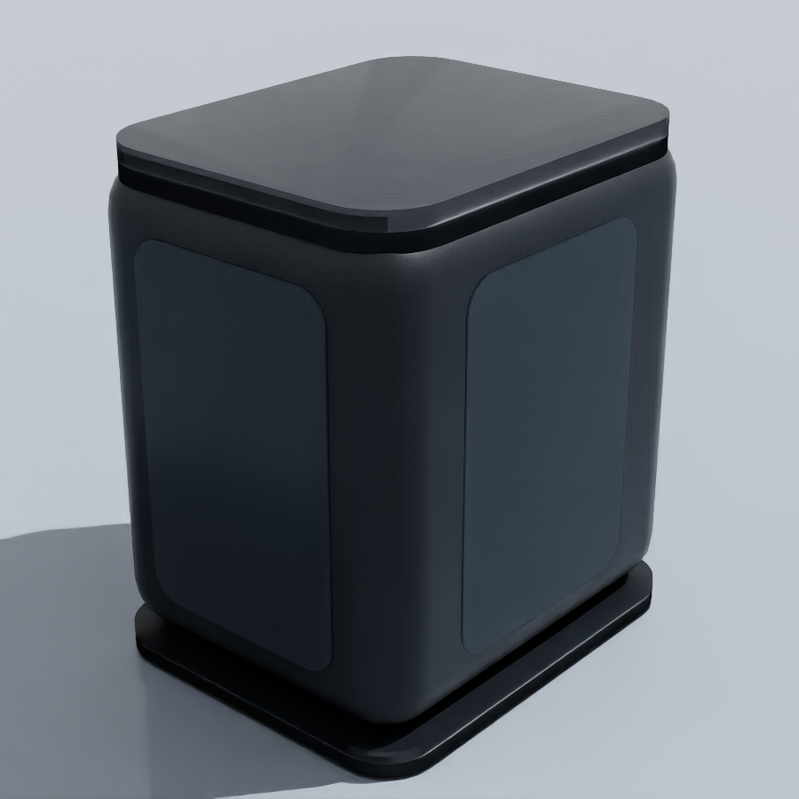

# NZ3 外壳部署验收

已通过并部署：`/root/gpufree-data/IsaacSim_Asset/sensor_set/lidar_set/NZ3/MyNZ3.usda`。

完整运行：`reference_asset/20260910T081315299074Z/`。机器可读清单见 [latest.json](reference_asset/latest.json)。

| 项目 | 结果 |
|---|---|
| 远端建模 | Blender 5.1.1，7个网格、1,076个三角形，基础USD材质，无贴图依赖 |
| 外壳尺寸 | 宽71×高100×深86 mm，导出后的USD尺寸已核对 |
| 原点 | 沿用扫描原点，暂按外壳中心放置；相对实机光学中心的偏移未标定 |
| 近处几何忽略 | `rangeOffsetM=0.08 m`，外壳顶点最大半径约0.071879 m，测距下限仍为0.2 m |
| 关闭忽略的反例 | 30帧均只有36,128个环境回波，证实外壳会造成自遮挡 |
| 启用忽略 | 单雷达测试房间取得46,080个独立采样位置的环境回波 |
| 加壳前后对比 | 46,080点最大位置差0.000002861 m；原始扫描配置文件SHA-256完全一致 |
| 多雷达 | 两台雷达互相探测到外壳，输出与CPU三角网格求交吻合；自遮挡设置没有全局隐藏外壳 |
| 位姿与距离 | 平移、旋转及新增目标检查通过；各阶段最大距离误差约0.0000161 m |
| 标准资产复用 | 直接USD引用、保存重开、新目录搬迁、新进程引用正式部署资产均通过 |
| 本地重建 | 重新打包能保留外壳引用、8 cm设置及原扫描配置的精确内容 |
| 部署文件 | USDA入口、扫描配置、外壳USDA及使用说明；四个文件远端/本地SHA-256均一致 |

这些误差是仿真求交与数值一致性结果，不代表实机精度。多雷达场景中对方黑色或掠射外壳表面可能没有有效回波，报告逐项记录；所有应命中环境的射线均要求覆盖。对单雷达无遮挡测试房间要求全部46,080位置覆盖。

8 cm设置会忽略这一区域内的所有几何，不是按外壳ID排除。资产保持单位缩放；更改外壳大小、位置或扫描原点后需要重新核对这个范围。

原部署文件备份保存在本次运行的 `previous_deployment/` 中。全部检查使用独立Isaac Sim进程，未重启已有交互实例。

实际Isaac Sim渲染预览：

