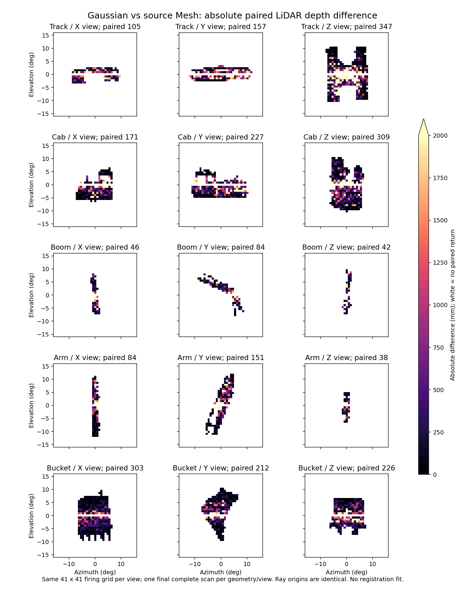

# Mesh / Gaussian 同视角静态测距对照

在新覆盖层中分别只保留对应 link 的 source Mesh 或 Gaussian，停用其他部件和业务图。两者都关闭 Motion BVH，以静态状态排除运动因素。每个部件分别从 +X、+Y、+Z 三个方向测量，每视角采用相同的 41×41 发射网格（±16°）。传感器距共同的 Mesh 包围盒中心 4 倍包围球半径，原始尺寸未缩放。

每个几何/视角预热推进 90 次更新，比较最后一个完整扫描中相同 emitterId 的距离。各射线在一圈内分布发射，场景和传感器在该视角采样期间静止。这是三视角单圈抽查，未建立多圈重复统计或真实 LiDAR 的材质标定。

“仅 Mesh / 仅 Gaussian”表示同一发射射线在另一种几何中没有对应的非零返回，可能与表面、遮挡、透明度、材质或检测阈值有关，不能直接解释成调度丢帧。两种几何都未返回的射线可能只是射出目标轮廓，不能计为故障。

| 部件 | 配对回波数 | 仅 Mesh | 仅 Gaussian | 深度差中位数 | 深度差 P95 | 最大差 |
|---|---:|---:|---:|---:|---:|---:|
| 履带 | 609 | 128 | 32 | 355.76 mm | 4025.74 mm | 9670.98 mm |
| 驾驶室 | 707 | 76 | 52 | 284.58 mm | 2965.30 mm | 9905.88 mm |
| 大臂 | 172 | 20 | 17 | 239.45 mm | 3117.94 mm | 8519.13 mm |
| 小臂 | 273 | 32 | 15 | 199.56 mm | 2360.23 mm | 8032.99 mm |
| 铲斗及牙齿 | 741 | 63 | 17 | 177.83 mm | 1741.12 mm | 3808.66 mm |

上述差值没有把任一几何当作实物真值；它量化“换成 Mesh 后测量会改变多少”。配对点统计也不包含仅一方有返回的射线，所以必须结合覆盖计数阅读。

证据：depth_analysis.json、depth_compare_*.npz、cases/depth_*_v6 的 USD、运行快照、日志、原始 NPZ。*_context.png 的相机固定在 +X 方向，仅用于确认目标几何可见，不代表 Y/Z 测距视角。