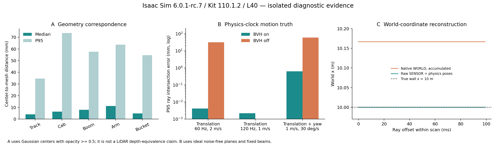

# Gaussian / Motion BVH：几何与逐射线运动实验

日期：2026-09-17。远端：Isaac Sim 6.0.1-rc.7、Kit 110.1.2、NVIDIA L40。结论只覆盖本次安装和实验条件。

## 当前得到的可用链路

已验证：**以物理时间驱动运动 → Mesh + Motion BVH 求交 → 输出 NONCOMPENSATED / SENSOR → 用同一物理时间轴上的位姿历史逐点变换**。直线平移、移动目标以及平移叠加旋转均完成了独立平面真值对照。

这比上一轮“能够输出点云”多验证了时间和几何准确性，但还不是完整业务验收。旋转扫描有少量遗漏/零距离记录；Mesh 与 Gaussian 的同视角回波差异明显，部分达到米级。尚未把两进程状态同步接入原业务场景。



## 文件保护与复现目录

全部实验使用新匿名根层，并在新 case 目录导出 experiment.usda。被引用的源层设置禁止编辑、禁止保存。实验后 SHA-256 核验 93 个既有 USDA：changed=[]、missing=[]、unchanged=true。结果见 source_usda_verification.json。所有本轮 GPU 测试进程已结束，显存恢复到约 668 MiB。

远端实验目录：

`/root/gpufree-data/diagnostics/motion_truth_20260917_063702`

本地目录：

`D:/learning/IntelligentDepartment/CodesSet/Self/260707IsaacSIm/scripts/260917_motion_truth`

被读取的主场景：`/root/gpufree-data/IsaacSim_Asset/combine_stage/combine_scene_11_origin03.usda`。

## 1. Mesh 与 Gaussian 的几何对应

从相同 USD 组成中提取 15 个 Gaussian 字段，以及对应 5 个 link 的原始三角网格。选择 visualization=source_mesh，检查 URDFReference / URDFOverlay 辅助外形的可见性。

- 10 个参考/叠加 Mesh 均隐藏。
- 比较在原世界坐标中进行，没有 ICP、刚体配准或拟合偏移。
- Gaussian 大部件最多固定随机抽样 15,000 个中心，保留 opacity ≥ 0.5 的样本。
- 每个中心计算到**对应 link** 三角网格的最近距离，不会误匹配相邻部件。
- 这是一项几何对应诊断；高斯中心不是表面测量，结果不能直接当成 LiDAR 测距误差。

| 部件 | 中位距离 | P95 距离 |
|---|---:|---:|
| 履带 | 4.08 mm | 34.65 mm |
| 驾驶室 | 6.34 mm | 73.66 mm |
| 大臂 | 7.94 mm | 57.60 mm |
| 小臂 | 11.15 mm | 63.63 mm |
| 铲斗主体 | 4.82 mm | 54.66 mm |

10 个牙齿 Gaussian 子块的中位距离为 3.44–4.55 mm，P95 为 16.69–28.01 mm。驾驶室样本的最大距离达到 0.593 m，不能仅用中位数描述其几何一致性。

判断：两套资产大体在同一位置；尚不能证明其具有等价的测量表面。要用于精密测量，需要进一步检查尾部差异、孔洞、遮挡和实际回波覆盖。

### 同视角实际回波对照

进一步完成了 5 个部件 × 2 种几何 × 3 个视角的静态 LiDAR 对照。两种几何使用相同发射位置、相同射线模式，均关闭 Motion BVH，按 emitterId 配对；配对射线方向的最大差异小于 0.000003°，因此观察到的差异不是把不同方向的点错误配对造成的。

| 部件 | 配对回波距离差中位数 | P95 距离差 |
|---|---:|---:|
| 履带 | 0.356 m | 4.026 m |
| 驾驶室 | 0.285 m | 2.965 m |
| 大臂 | 0.239 m | 3.118 m |
| 小臂 | 0.200 m | 2.360 m |
| 铲斗及牙齿 | 0.178 m | 1.741 m |

这是三视角各取最后一个完整扫描的抽查。还存在只有一方有回波的射线，详见 [静态测距报告](DEPTH_REPORT.md) 中的覆盖计数。

**此结果不说明 Mesh 或 Gaussian 哪一个更接近实物真值；它说明当前配置下直接替换测量几何会显著改变输出。** 尚未把几何表面差异、Gaussian 检测/透明度行为、材质和潜在渲染问题逐项分离。不能由“中心到网格距离很小”推导出“高斯回波与 Mesh 回波等价”，也不能将这些距离差全部归因于模型配准误差。

证据：geometry_analysis.json、geometry/geometry.json、geometry/ 中的坐标和距离 NPZ。analyze_geometry.py 使用局部 vendor/trimesh，不修改系统环境。

## 2. 运动交点真值：区分时钟问题与 Motion BVH 效果

实验场景是新建的六面房间，内壁为 x/y/z=±10 m，关闭测距噪声。每项测试有两次 Play → Stop。

固定方向测试在每个 100 ms 扫描内发射 100 束 +X 射线，间隔 1 ms。运动真值由设定速度、发射时间与解析射线—平面交点独立计算。每轮最初 0.3 s 作为预热，原始数据仍全部保存。

逐束时间使用：

`ray_time_ns = GMO.timestampNs + GMO.timeOffsetNs[i]`

### 2.1 发现并消除 USD 动画时间与物理时间的偏移

直接用 USD 时间样本驱动 2 m/s 的物体时，固定射线出现约 **66.67 mm** 偏差。

记录同时显示：本次初始化后，physics_time 比 timeline.current_time 领先 2 个 60 Hz 时间步。USD 动画位置按 timeline 变化，而传感器时间和运动历史使用物理/渲染时钟。统一目标帧率、设置固定步长和 zero-delay 等待并没有自动对齐 USD 动画采样时间。

改用 PhysX 刚体速度驱动后，实际位置与 physics_time 对齐，偏差消除。没有对结果做固定 33.3 ms 平移修正。分析中保留的 diagnostic_minus_two_dt 只用于诊断，不能作为修复或验收数据。

这属于本次脚本和初始化流程的实测时钟关系，不应硬编码为所有 Isaac Sim 场景的通用延迟。

### 2.2 使用正确运动时间轴的结果

表中为有效非零回波到**逐束解析交点**的距离。

| 测试 | Motion BVH | P95 误差 | 最大误差 |
|---|---|---:|---:|
| 静止房间、旋转扫描基线 | 开 | 0.0050 mm | 0.0078 mm |
| 传感器平移 2 m/s，60 Hz | 开 | 0.00414 mm | 0.00494 mm |
| 传感器平移 2 m/s，60 Hz | 关 | 31.34 mm | 32.67 mm |
| 目标平移 2 m/s，60 Hz | 开 | 0.00402 mm | 0.00548 mm |
| 传感器平移 1 m/s，120 Hz | 开 | 0.00218 mm | 0.00289 mm |
| 传感器平移 1 m/s + 偏航 30°/s，60 Hz | 开 | 0.626 mm | 0.875 mm |
| 同一平移 + 偏航 | 关 | 59.84 mm | 102.64 mm |

上述微米数值来自理想平面、关闭噪声的数值测试，不代表真实 LiDAR 或 Gaussian 场景的物理精度。固定方向测试中，60 Hz 用例预热后每项共 5,400 束，120 Hz 用例共 3,400 束，均无缺失记录或零距离记录。

最初两个偏航用例未关闭 PhysX 默认角阻尼，实际角速度随时间下降，不满足“恒定 30°/s”的解析前提。它们标记 nominal_trajectory_valid=false；正式结果来自显式设置角阻尼和线性阻尼为 0 的新用例。

## 3. 输出补偿的独立验证

Motion BVH 控制运动几何求交；outputMotionCompensationState 控制求交之后的输出坐标变换。两者必须分别检查。

在 2 m/s 传感器平移、静止 x=10 m 墙面的测试中：

- 原生 COMPENSATED / SENSOR 累积输出与扫描起始时刻的传感器坐标真值一致，P95 约 0.00362 mm。
- 原生 COMPENSATED / WORLD 累积输出落在 x≈10.166667 m，存在约 **166.67 mm** 偏差。
- 关闭 accumulateOutputs 后，原生 WORLD 的 P95 降到约 0.00095 mm，但最大仍约 1.334 mm，且原始分片中检测到重复的射线键。因此本轮没有将非累积模式直接作为生产替代。
- 从原始 NONCOMPENSATED / SENSOR 点，利用**记录的物理位姿历史**变换到 WORLD，平移测试 P95 约 **0.000858 mm**；平移 + 偏航测试 P95 约 **0.750 mm**，最大约 1.006 mm。

累积 WORLD 问题与累积输出的参考帧处理有关是当前证据支持的调查方向；尚未进行闭源内部函数定位，不把它表述为已确定的底层代码根因。

### 已实现的坐标变换模块

deskew.py 提供 PoseHistory：

1. 每个 Play 周期使用独立的纳秒时间轴。
2. 平移线性插值，旋转采用 XYZW 四元数 SLERP。
3. 对第 i 个原始点使用该束发射时刻的传感器世界位姿：
   `p_world[i] = R_world_sensor(t_i) @ p_sensor[i] + position_world_sensor(t_i)`。
4. 若需要某一参考时刻的传感器坐标，再乘该时刻位姿的逆变换。
5. 拒绝越界外推、非单调时间、跨周期拼接和无效四元数。

模块已经用于真实采集数据回放分析，并通过平移+旋转坐标约定、四元数符号等价、时间越界/周期混合 3 项测试。尚未接入原业务扩展或 ROS 发布器。

## 4. 旋转扫描的覆盖问题必须保留

在 8 通道、10 Hz 扫描、1000 Hz 发射的 ROTARY 测试中，物理驱动传感器平移 2 m/s：

- 预热后理论发射 43,200 束。
- GMO 实际输出 43,160 条，缺少 40 条。
- 其中另外 8 条 flags=64，但坐标为零距离，不能作为有效墙面回波。
- 可用非零回波 43,152 条：P95 误差约 0.879 mm，最大约 1.639 mm。
- 如果直接把所有 flags=64 的记录用于比较，最大误差约 11.45 m。该异常来自零距离记录，不能被无声删除后宣称所有点都通过。

本轮尚未修复这 48 束不可用测量。两轮结果重复；也观察到 Stop/Play 后旧缓冲仍可能短暂返回，60 Hz 累积测试通常拒绝 4 次旧缓冲，120 Hz 测试拒绝 10 次。

完整业务链路需要按 epoch 区分运行周期，重建/清空传感器输出，并同时验收覆盖率、重复率和几何误差，不能只检查 scanComplete 或点云非空。

## 5. 下一阶段的实现边界

准备接入的方案是：

- **传感器进程**加载 Mesh 覆盖层，启用 Motion BVH，负责唯一权威物理状态；保留 raw SENSOR 点、逐束时间及完整位姿历史。
- **视觉进程**加载 Gaussian 覆盖层，关闭 Motion BVH，按传感器/状态进程发布的状态渲染。
- 同步消息包含 epoch、frame_id、physics_time_ns、资产版本、每个 link 和传感器的世界位姿。视觉进程不另行运行一套独立物理轨迹。
- 点云对应一个时间区间；不能只拿 RGB 帧时刻的单个矩阵补偿整个扫描。
- Stop/Play 重置必须传播 epoch，并阻止上一周期的缓冲混入下一周期。

本轮未启动完整双进程业务联调。进入该阶段之前，需要对几何替代误差作出明确判断，并处理/量化扫描遗漏。Gaussian 与 Motion BVH 的底层兼容限制仍采用上一轮的进程隔离方向；本轮没有修改闭源 RTX 实现。

## 复现与证据

本轮远端共保留 47 个 case 目录：35 个完成数据采集，其余为几何导出、超时或准备失败。case_inventory.json 逐项记录状态；“采集完成”本身不等于精度验收通过。完整远端证据镜像为 evidence_complete_v2.tar.gz。

在远端目录执行（必须使用一个未出现过的新 case 名）：

```bash
python3 run_case.py repeat_linear --script motion_case.py \
  --driver physics --zero-delay --pattern fixed --motion sensor

python3 run_case.py repeat_yaw --script motion_case.py \
  --driver physics --zero-delay --pattern fixed --motion sensor \
  --speed 1 --angular-speed 30 --zero-damping
```

在本地目录执行：

```bash
python test_deskew.py
python analyze_motion.py
python plot_results.py
```

- 各 cases/*/probe_case_snapshot.py 记录该用例实际运行的脚本版本。
- result.json、逐扫描 NPZ、console.log、kit.log、process.json 构成原始证据。
- motion_analysis.json 分别保留非零有效点统计、全部 flagged 点统计、覆盖计数、物理历史补偿统计。
- fixed_sensor_physics 首次启动超时，由监督器仅终止自己的进程组；新用例 fixed_sensor_physics_retry 正常完成。超时原因未定位，不能计为通过。
- 几何测距准备过程中的 Render/Vars 或 RenderProduct 初始化错误及无回波测试均保留，不能用于宣称 Mesh/Gaussian 深度一致。

[官方 Multi-Tick Rendering 文档](https://docs.isaacsim.omniverse.nvidia.com/6.0.1/sensors/isaacsim_sensors_multitick_rendering.html) 解释 timeline、物理时间和渲染外部时间的区别。
[官方 Lidar 文档](https://docs.omniverse.nvidia.com/kit/docs/omni.sensors.nv.lidar/latest/lidar_extension.html) 分别定义 Motion BVH、输出补偿及输出参考坐标系。上面的误差数值来自本次实验，不是文档保证。
