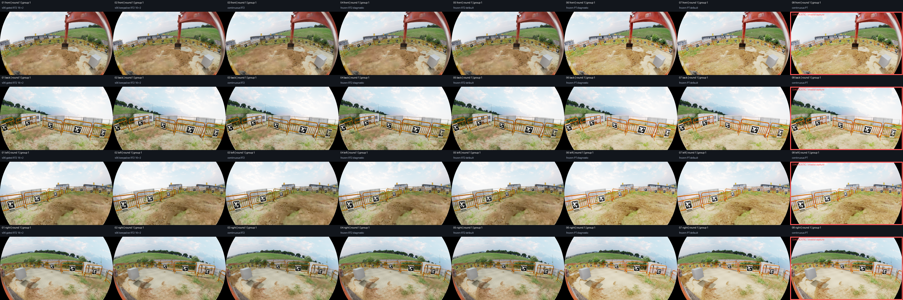
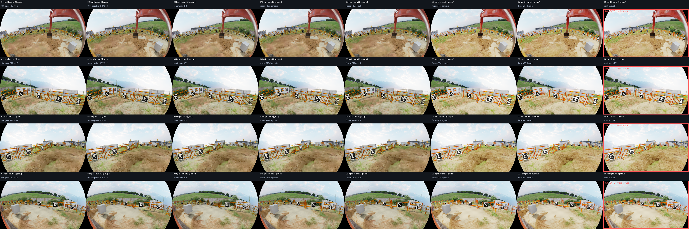
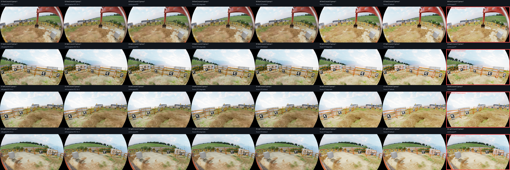
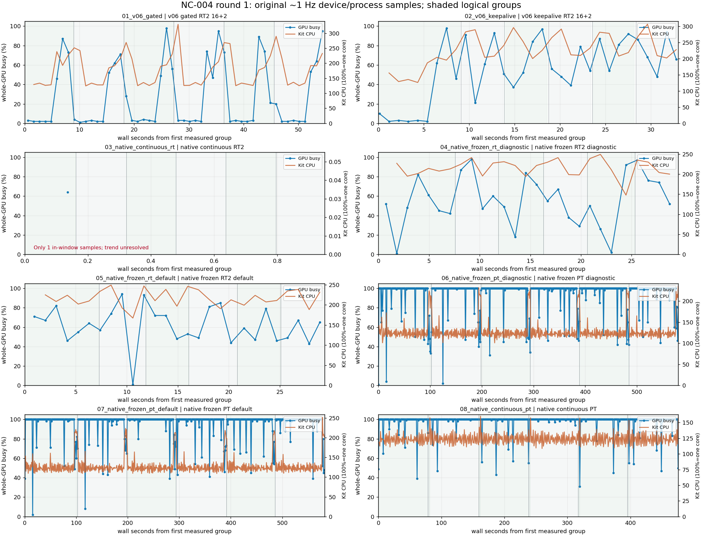
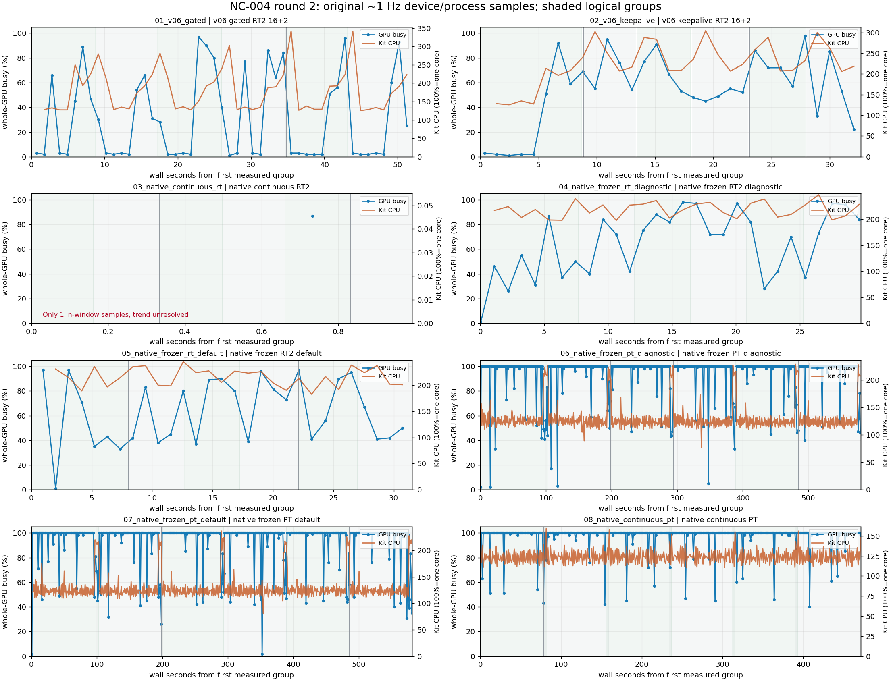
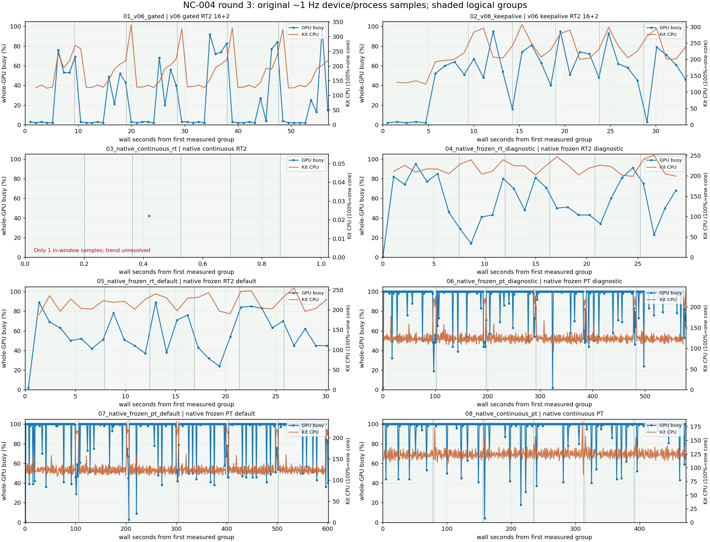

# NC-004 八种采集配置统一复跑报告

套件状态：**completed**；完成 24 / 24 项，已分析 24 项。图片全部由实际 MCAP 解码，采集时没有额外 RGB PNG 输出。

有效运行 21 项；目标图像已导出 564 张，其中有效图像 504 张。

## 配置聚合

| 配置 | 有效轮/已分析轮 | capture 窗口中位数 s | 每组完整观察范围中位数 s | SDK 渲染范围中位数 s | 应用更新中位数 s |
|---|---:|---:|---:|---:|---:|
| v06 gated RT2 16+2 | 3/3 | 55.283 | 9.111 | 8.402 | — |
| v06 keepalive RT2 16+2 | 3/3 | 33.605 | 4.670 | 3.533 | — |
| native continuous RT2 | 3/3 | 0.992 | — | — | 0.162 |
| native frozen RT2 diagnostic | 3/3 | 31.970 | 4.452 | 3.381 | — |
| native frozen RT2 default | 3/3 | 32.286 | 4.523 | 3.474 | — |
| native frozen PT diagnostic | 3/3 | 582.322 | 95.448 | 83.180 | — |
| native frozen PT default | 3/3 | 584.162 | 96.979 | 84.665 | — |
| native continuous PT | 0/3 | 490.585 | 81.027 | — | — |

窗口为各链路自己的 capture 边界，见下面限制。失败配置的时间只表示诊断成本，不能参与有效吞吐排名。24 次运行分三轮独立进程；每轮六组。三轮统计样本较少，组内 18 个样本不是 18 次独立启动。

## 首组与后续组

| 配置 | 首组完整观察范围中位数 s | 后续组中位数 s |
|---|---:|---:|
| v06 gated RT2 16+2 | 8.869 | 9.127 |
| v06 keepalive RT2 16+2 | 8.943 | 4.658 |
| native continuous RT2 | — | — |
| native frozen RT2 diagnostic | 7.585 | 4.426 |
| native frozen RT2 default | 7.931 | 4.496 |
| native frozen PT diagnostic | 102.537 | 95.397 |
| native frozen PT default | 103.063 | 95.850 |
| native continuous PT | 81.457 | 81.018 |

组间变化可能包括初始化、资源准备和时间累积历史。这里只陈述测量，不把全部差额归为某个未经本轮底层跟踪的驱动调用。

## 逐轮耗时与资源

| 配置/轮 | 有效 | capture s | 整进程 s | GPU 均值 % | GPU 峰值 % | Kit CPU 均值 % | 显存峰值 GiB | Kit RSS 峰值 GiB | 样本数 |
|---|---|---:|---:|---:|---:|---:|---:|---:|---:|
| 01_v06_gated/1 | True | 55.283 | 123.683 | 26.962 | 98.000 | 177.879 | 10.700 | 11.048 | 52 |
| 02_v06_keepalive/1 | True | 33.605 | 101.707 | 55.219 | 98.000 | 224.925 | 10.380 | 10.930 | 32 |
| 03_native_continuous_rt/1 | True | 0.950 | 39.172 | 64.000 | 64.000 | — | 7.601 | 9.365 | 1 |
| 04_native_frozen_rt_diagnostic/1 | True | 31.724 | 72.759 | 55.704 | 98.000 | 215.549 | 7.649 | 9.507 | 27 |
| 05_native_frozen_rt_default/1 | True | 31.706 | 71.735 | 61.593 | 94.000 | 216.784 | 7.649 | 9.498 | 27 |
| 06_native_frozen_pt_diagnostic/1 | True | 582.569 | 655.772 | 94.613 | 100.000 | 128.819 | 9.725 | 9.711 | 543 |
| 07_native_frozen_pt_default/1 | True | 584.162 | 658.831 | 95.891 | 100.000 | 128.788 | 9.730 | 9.702 | 542 |
| 08_native_continuous_pt/1 | False | 494.177 | 564.308 | 97.735 | 100.000 | 123.871 | 9.708 | 9.703 | 445 |
| 04_native_frozen_rt_diagnostic/2 | True | 32.064 | 73.179 | 64.172 | 98.000 | 218.641 | 7.649 | 9.499 | 29 |
| 05_native_frozen_rt_default/2 | True | 33.716 | 77.231 | 63.069 | 97.000 | 215.099 | 7.649 | 9.503 | 29 |
| 06_native_frozen_pt_diagnostic/2 | True | 582.322 | 656.337 | 94.686 | 100.000 | 129.599 | 9.725 | 9.701 | 541 |
| 07_native_frozen_pt_default/2 | True | 583.235 | 656.829 | 94.593 | 100.000 | 129.126 | 9.725 | 9.710 | 541 |
| 08_native_continuous_pt/2 | False | 489.567 | 559.810 | 97.714 | 100.000 | 123.847 | 9.700 | 9.708 | 440 |
| 01_v06_gated/2 | True | 52.411 | 117.073 | 30.959 | 97.000 | 180.738 | 10.695 | 11.042 | 49 |
| 02_v06_keepalive/2 | True | 33.234 | 97.485 | 54.065 | 98.000 | 224.458 | 10.446 | 11.257 | 31 |
| 03_native_continuous_rt/2 | True | 0.992 | 41.174 | 87.000 | 87.000 | — | 7.851 | 9.310 | 1 |
| 07_native_frozen_pt_default/3 | True | 603.408 | 679.334 | 94.253 | 100.000 | 128.687 | 9.725 | 9.763 | 562 |
| 08_native_continuous_pt/3 | False | 490.585 | 561.317 | 96.700 | 100.000 | 125.027 | 9.700 | 9.708 | 443 |
| 01_v06_gated/3 | True | 57.455 | 125.488 | 24.778 | 98.000 | 177.633 | 10.633 | 11.048 | 54 |
| 02_v06_keepalive/3 | True | 33.880 | 101.475 | 51.094 | 95.000 | 223.715 | 10.380 | 10.942 | 32 |
| 03_native_continuous_rt/3 | True | 1.024 | 43.174 | 42.000 | 42.000 | — | 7.601 | 9.360 | 1 |
| 04_native_frozen_rt_diagnostic/3 | True | 31.970 | 74.231 | 57.357 | 95.000 | 219.246 | 7.899 | 9.508 | 28 |
| 05_native_frozen_rt_default/3 | True | 32.286 | 74.730 | 56.483 | 89.000 | 218.259 | 7.899 | 9.484 | 29 |
| 06_native_frozen_pt_diagnostic/3 | True | 580.290 | 654.330 | 95.072 | 100.000 | 129.024 | 9.725 | 9.708 | 539 |

GPU/RAM 范围是首目标组开始到最后目标组观察结束。约 1 Hz 样本存在覆盖和边界误差；CPU 是累计 ticks 差分、100% 表示一个核，只统计差分区间完全落在目标范围的样本。GPU 为全卡 busy，不是 SM occupancy。显存为全设备，RSS 仅 Kit；ROS recorder/独立编码进程不能据此说成整机 CPU。

## 同姿态图像与对齐

以每轮 05 原生冻结 RT2 默认 Helper 的同组同方向图片为参考；正式比较 504 对，排除 60 对。相机内参逐项匹配，光学 TF 世界矩阵容差 2e-3，关节弧度容差 1e-6。具体最大误差见 image_metrics.csv。

打开本地图片索引（本地原始画廊：`scripts/260920SensorVisualizer/capture_comparison_004/results/comparison_20261012_070140/analysis/gallery.html`）。点击缩略图查看原始 1920×1080 PNG。





局部原像素对照（打开原图按 100% 缩放查看；没有锐化或插值）：

- [crop_front_ground_round_01.png](crop_front_ground_round_01.png)
- [crop_front_ground_round_02.png](crop_front_ground_round_02.png)
- [crop_front_ground_round_03.png](crop_front_ground_round_03.png)
- [crop_front_machine_round_01.png](crop_front_machine_round_01.png)
- [crop_front_machine_round_02.png](crop_front_machine_round_02.png)
- [crop_front_machine_round_03.png](crop_front_machine_round_03.png)

image_metrics.csv 包含 RGB MAE、MSE、PSNR 和亮度。它们是相对参考图的差异指标，不是绝对画质或物理准确度；完全相同图像的 PSNR 记空并用 pixel_identical=True 标注。差分图仅为绝对 RGB 差乘 4 的可视化。不同渲染器、不同时间累积历史不能当成同一种算法的误差收敛实验。

| 配置 | 有效图像对数 | RGB MAE 均值 | 图像平均亮度 |
|---|---:|---:|---:|
| v06 gated RT2 16+2 | 72 | 2.841 | 156.510 |
| v06 keepalive RT2 16+2 | 72 | 3.186 | 155.851 |
| native continuous RT2 | 72 | 3.064 | 156.316 |
| native frozen RT2 diagnostic | 72 | 0.678 | 156.508 |
| native frozen RT2 default | 72 | 0.000 | 156.509 |
| native frozen PT diagnostic | 72 | 14.496 | 170.122 |
| native frozen PT default | 72 | 14.496 | 170.122 |
| native continuous PT | 0 | — | — |

static_stability.csv 另外记录各配置各方向首组至末组的像素变化。稳定或不稳定本身都不能单独证明 3DGS 加载完成与否。

## 失败与 warning

### 01_v06_gated / round 1

录包有效：True；退出码 0；解码退出码 0。

```json
{
  "validation_error_examples": [],
  "engine_warning_error_counts": {
    "Warning/omni.rtx": 2,
    "Warning/omni.log": 1,
    "Warning/pxr.Semantics": 1,
    "Warning/omni.replicator.core.scripts.extension": 1,
    "Warning/omni.usd": 6,
    "Warning/omni.graph.core._impl._registration.register_python_ogn": 1,
    "Warning/omni.kit.widget.cache_indicator.cache_state_menu": 1,
    "Warning/carb.audio.device": 1,
    "Warning/carb.audio.output": 1,
    "Warning/carb.audio.context": 1,
    "Warning/carb": 146,
    "Warning/usdrt.population.plugin": 2,
    "Warning/rtx.sensors.lidar.core.plugin": 1
  }
}
```

### 02_v06_keepalive / round 1

录包有效：True；退出码 0；解码退出码 0。

```json
{
  "validation_error_examples": [],
  "engine_warning_error_counts": {
    "Warning/omni.rtx": 2,
    "Warning/omni.log": 1,
    "Warning/pxr.Semantics": 1,
    "Warning/omni.replicator.core.scripts.extension": 1,
    "Warning/omni.usd": 6,
    "Warning/omni.graph.core._impl._registration.register_python_ogn": 1,
    "Warning/omni.kit.widget.cache_indicator.cache_state_menu": 1,
    "Warning/carb.audio.device": 1,
    "Warning/carb.audio.output": 1,
    "Warning/carb.audio.context": 1,
    "Warning/carb": 133,
    "Warning/usdrt.population.plugin": 2,
    "Warning/rtx.sensors.lidar.core.plugin": 1
  }
}
```

### 03_native_continuous_rt / round 1

录包有效：True；退出码 0；解码退出码 0。

```json
{
  "validation_error_examples": [],
  "engine_warning_error_counts": {
    "Warning/omni.rtx": 2,
    "Warning/omni.log": 1,
    "Warning/pxr.Semantics": 1,
    "Warning/omni.replicator.core.scripts.extension": 1,
    "Warning/omni.usd": 6,
    "Warning/omni.graph.core._impl._registration.register_python_ogn": 1,
    "Warning/omni.kit.widget.cache_indicator.cache_state_menu": 1,
    "Warning/carb.audio.device": 1,
    "Warning/carb.audio.output": 1,
    "Warning/carb.audio.context": 1,
    "Warning/carb": 2,
    "Warning/usdrt.population.plugin": 2,
    "Warning/isaacsim.ros2.nodes": 382,
    "Warning/rtx.sensors.lidar.core.plugin": 1,
    "Warning/omni.fabric.plugin": 1,
    "Warning/omni.timeline.plugin": 1
  }
}
```

### 04_native_frozen_rt_diagnostic / round 1

录包有效：True；退出码 0；解码退出码 0。

```json
{
  "validation_error_examples": [],
  "engine_warning_error_counts": {
    "Warning/omni.rtx": 2,
    "Warning/omni.log": 1,
    "Warning/pxr.Semantics": 1,
    "Warning/omni.replicator.core.scripts.extension": 1,
    "Warning/omni.usd": 6,
    "Warning/omni.graph.core._impl._registration.register_python_ogn": 1,
    "Warning/omni.kit.widget.cache_indicator.cache_state_menu": 1,
    "Warning/carb.audio.device": 1,
    "Warning/carb.audio.output": 1,
    "Warning/carb.audio.context": 1,
    "Warning/carb": 4,
    "Warning/usdrt.population.plugin": 2,
    "Warning/isaacsim.ros2.nodes": 3460,
    "Warning/rtx.sensors.lidar.core.plugin": 1,
    "Warning/omni.fabric.plugin": 1,
    "Warning/omni.syntheticdata.plugin": 1,
    "Warning/omni.timeline.plugin": 1,
    "Warning/isaacsim.core.simulation_manager.plugin": 204
  }
}
```

### 05_native_frozen_rt_default / round 1

录包有效：True；退出码 0；解码退出码 0。

```json
{
  "validation_error_examples": [],
  "engine_warning_error_counts": {
    "Warning/omni.rtx": 2,
    "Warning/omni.log": 1,
    "Warning/pxr.Semantics": 1,
    "Warning/omni.replicator.core.scripts.extension": 1,
    "Warning/omni.usd": 6,
    "Warning/omni.graph.core._impl._registration.register_python_ogn": 1,
    "Warning/omni.kit.widget.cache_indicator.cache_state_menu": 1,
    "Warning/carb.audio.device": 1,
    "Warning/carb.audio.output": 1,
    "Warning/carb.audio.context": 1,
    "Warning/carb": 4,
    "Warning/usdrt.population.plugin": 2,
    "Warning/isaacsim.ros2.nodes": 3460,
    "Warning/rtx.sensors.lidar.core.plugin": 1,
    "Warning/omni.fabric.plugin": 1,
    "Warning/omni.syntheticdata.plugin": 1,
    "Warning/omni.timeline.plugin": 1,
    "Warning/isaacsim.core.simulation_manager.plugin": 204
  }
}
```

### 06_native_frozen_pt_diagnostic / round 1

录包有效：True；退出码 0；解码退出码 0。

```json
{
  "validation_error_examples": [],
  "engine_warning_error_counts": {
    "Warning/omni.rtx": 2,
    "Warning/omni.log": 1,
    "Warning/pxr.Semantics": 1,
    "Warning/omni.replicator.core.scripts.extension": 1,
    "Warning/omni.usd": 6,
    "Warning/omni.graph.core._impl._registration.register_python_ogn": 1,
    "Warning/omni.kit.widget.cache_indicator.cache_state_menu": 1,
    "Warning/carb.audio.device": 1,
    "Warning/carb.audio.output": 1,
    "Warning/carb.audio.context": 1,
    "Warning/carb": 4,
    "Warning/usdrt.population.plugin": 2,
    "Warning/isaacsim.ros2.nodes": 8932,
    "Warning/rtx.sensors.lidar.core.plugin": 1,
    "Warning/omni.fabric.plugin": 1,
    "Warning/omni.syntheticdata.plugin": 1,
    "Warning/omni.timeline.plugin": 1,
    "Warning/isaacsim.core.simulation_manager.plugin": 204
  }
}
```

### 07_native_frozen_pt_default / round 1

录包有效：True；退出码 0；解码退出码 0。

```json
{
  "validation_error_examples": [],
  "engine_warning_error_counts": {
    "Warning/omni.rtx": 2,
    "Warning/omni.log": 1,
    "Warning/pxr.Semantics": 1,
    "Warning/omni.replicator.core.scripts.extension": 1,
    "Warning/omni.usd": 6,
    "Warning/omni.graph.core._impl._registration.register_python_ogn": 1,
    "Warning/omni.kit.widget.cache_indicator.cache_state_menu": 1,
    "Warning/carb.audio.device": 1,
    "Warning/carb.audio.output": 1,
    "Warning/carb.audio.context": 1,
    "Warning/carb": 4,
    "Warning/usdrt.population.plugin": 2,
    "Warning/isaacsim.ros2.nodes": 8932,
    "Warning/rtx.sensors.lidar.core.plugin": 1,
    "Warning/omni.fabric.plugin": 1,
    "Warning/omni.syntheticdata.plugin": 1,
    "Warning/omni.timeline.plugin": 1,
    "Warning/isaacsim.core.simulation_manager.plugin": 204
  }
}
```

### 08_native_continuous_pt / round 1

录包有效：False；退出码 1；解码退出码 2。

```json
{
  "validation_error_examples": [
    "Group 0 MCAP/current XYZ hash mismatch: ['/lidar/MyAiry_back/points', '/lidar/MyAiry_backleft/points', '/lidar/MyAiry_backright/points', '/lidar/MyAiry_front/points', '/lidar/MyAiry_left/points', '/lidar/MyAiry_right/points', '/lidar/MyAiry_up/points', '/lidar/MyNZ3_back/points', '/lidar/MyNZ3_backleft/points', '/lidar/MyNZ3_backright/points', '/lidar/MyNZ3_front/points', '/lidar/MyNZ3_left/points', '/lidar/MyNZ3_right/points']",
    "Group 0 missing fresh messages: ['/camera/fisheye_back/camera_info', '/camera/fisheye_back/image_raw', '/camera/fisheye_front/camera_info', '/camera/fisheye_front/image_raw', '/camera/fisheye_left/camera_info', '/camera/fisheye_left/image_raw', '/camera/fisheye_right/camera_info', '/camera/fisheye_right/image_raw', '/lidar/MyAiry_back/points', '/lidar/MyAiry_backleft/points', '/lidar/MyAiry_backright/points', '/lidar/MyAiry_front/points', '/lidar/MyAiry_left/points', '/lidar/MyAiry_right/points', '/lidar/MyAiry_up/points', '/lidar/MyNZ3_back/points', '/lidar/MyNZ3_backleft/points', '/lidar/MyNZ3_backright/points', '/lidar/MyNZ3_front/points', '/lidar/MyNZ3_left/points', '/lidar/MyNZ3_right/points']",
    "Group 0 MCAP/current RGB hash mismatch: ['/camera/fisheye_back/image_raw', '/camera/fisheye_front/image_raw', '/camera/fisheye_left/image_raw', '/camera/fisheye_right/image_raw']",
    "Group 1 MCAP/current XYZ hash mismatch: ['/lidar/MyAiry_back/points', '/lidar/MyAiry_backleft/points', '/lidar/MyAiry_backright/points', '/lidar/MyAiry_front/points', '/lidar/MyAiry_left/points', '/lidar/MyAiry_right/points', '/lidar/MyAiry_up/points', '/lidar/MyNZ3_back/points', '/lidar/MyNZ3_backleft/points', '/lidar/MyNZ3_backright/points', '/lidar/MyNZ3_front/points', '/lidar/MyNZ3_left/points', '/lidar/MyNZ3_right/points']",
    "Group 1 missing fresh messages: ['/camera/fisheye_back/camera_info', '/camera/fisheye_back/image_raw', '/camera/fisheye_front/camera_info', '/camera/fisheye_front/image_raw', '/camera/fisheye_left/camera_info', '/camera/fisheye_left/image_raw', '/camera/fisheye_right/camera_info', '/camera/fisheye_right/image_raw', '/lidar/MyAiry_back/points', '/lidar/MyAiry_backleft/points', '/lidar/MyAiry_backright/points', '/lidar/MyAiry_front/points', '/lidar/MyAiry_left/points', '/lidar/MyAiry_right/points', '/lidar/MyAiry_up/points', '/lidar/MyNZ3_back/points', '/lidar/MyNZ3_backleft/points', '/lidar/MyNZ3_backright/points', '/lidar/MyNZ3_front/points', '/lidar/MyNZ3_left/points', '/lidar/MyNZ3_right/points']",
    "Group 1 MCAP/current RGB hash mismatch: ['/camera/fisheye_back/image_raw', '/camera/fisheye_front/image_raw', '/camera/fisheye_left/image_raw', '/camera/fisheye_right/image_raw']",
    "Group 2 MCAP/current XYZ hash mismatch: ['/lidar/MyAiry_back/points', '/lidar/MyAiry_backleft/points', '/lidar/MyAiry_backright/points', '/lidar/MyAiry_front/points', '/lidar/MyAiry_left/points', '/lidar/MyAiry_right/points', '/lidar/MyAiry_up/points', '/lidar/MyNZ3_back/points', '/lidar/MyNZ3_backleft/points', '/lidar/MyNZ3_backright/points', '/lidar/MyNZ3_front/points', '/lidar/MyNZ3_left/points', '/lidar/MyNZ3_right/points']",
    "Group 2 missing fresh messages: ['/camera/fisheye_back/camera_info', '/camera/fisheye_back/image_raw', '/camera/fisheye_front/camera_info', '/camera/fisheye_front/image_raw', '/camera/fisheye_left/camera_info', '/camera/fisheye_left/image_raw', '/camera/fisheye_right/camera_info', '/camera/fisheye_right/image_raw', '/lidar/MyAiry_back/points', '/lidar/MyAiry_backleft/points', '/lidar/MyAiry_backright/points', '/lidar/MyAiry_front/points', '/lidar/MyAiry_left/points', '/lidar/MyAiry_right/points', '/lidar/MyAiry_up/points', '/lidar/MyNZ3_back/points', '/lidar/MyNZ3_backleft/points', '/lidar/MyNZ3_backright/points', '/lidar/MyNZ3_front/points', '/lidar/MyNZ3_left/points', '/lidar/MyNZ3_right/points']",
    "Group 2 MCAP/current RGB hash mismatch: ['/camera/fisheye_back/image_raw', '/camera/fisheye_front/image_raw', '/camera/fisheye_left/image_raw', '/camera/fisheye_right/image_raw']",
    "Group 3 MCAP/current XYZ hash mismatch: ['/lidar/MyAiry_back/points', '/lidar/MyAiry_backleft/points', '/lidar/MyAiry_backright/points', '/lidar/MyAiry_front/points', '/lidar/MyAiry_left/points', '/lidar/MyAiry_right/points', '/lidar/MyAiry_up/points', '/lidar/MyNZ3_back/points', '/lidar/MyNZ3_backleft/points', '/lidar/MyNZ3_backright/points', '/lidar/MyNZ3_front/points', '/lidar/MyNZ3_left/points', '/lidar/MyNZ3_right/points']",
    "Group 3 missing fresh messages: ['/camera/fisheye_back/camera_info', '/camera/fisheye_back/image_raw', '/camera/fisheye_front/camera_info', '/camera/fisheye_front/image_raw', '/camera/fisheye_left/camera_info', '/camera/fisheye_left/image_raw', '/camera/fisheye_right/camera_info', '/camera/fisheye_right/image_raw', '/lidar/MyAiry_back/points', '/lidar/MyAiry_backleft/points', '/lidar/MyAiry_backright/points', '/lidar/MyAiry_front/points', '/lidar/MyAiry_left/points', '/lidar/MyAiry_right/points', '/lidar/MyAiry_up/points', '/lidar/MyNZ3_back/points', '/lidar/MyNZ3_backleft/points', '/lidar/MyNZ3_backright/points', '/lidar/MyNZ3_front/points', '/lidar/MyNZ3_left/points', '/lidar/MyNZ3_right/points']",
    "Group 3 MCAP/current RGB hash mismatch: ['/camera/fisheye_back/image_raw', '/camera/fisheye_front/image_raw', '/camera/fisheye_left/image_raw', '/camera/fisheye_right/image_raw']"
  ],
  "engine_warning_error_counts": {
    "Warning/omni.rtx": 2,
    "Warning/omni.log": 1,
    "Warning/pxr.Semantics": 1,
    "Warning/omni.replicator.core.scripts.extension": 1,
    "Warning/omni.usd": 6,
    "Warning/omni.graph.core._impl._registration.register_python_ogn": 1,
    "Warning/omni.kit.widget.cache_indicator.cache_state_menu": 1,
    "Warning/carb.audio.device": 1,
    "Warning/carb.audio.output": 1,
    "Warning/carb.audio.context": 1,
    "Warning/carb": 2,
    "Warning/usdrt.population.plugin": 2,
    "Warning/isaacsim.ros2.nodes": 4030,
    "Warning/rtx.sensors.lidar.core.plugin": 1,
    "Warning/omni.fabric.plugin": 1,
    "Warning/omni.syntheticdata.plugin": 1,
    "Warning/omni.timeline.plugin": 1
  }
}
```

### 04_native_frozen_rt_diagnostic / round 2

录包有效：True；退出码 0；解码退出码 0。

```json
{
  "validation_error_examples": [],
  "engine_warning_error_counts": {
    "Warning/omni.rtx": 2,
    "Warning/omni.log": 1,
    "Warning/pxr.Semantics": 1,
    "Warning/omni.replicator.core.scripts.extension": 1,
    "Warning/omni.usd": 6,
    "Warning/omni.graph.core._impl._registration.register_python_ogn": 1,
    "Warning/omni.kit.widget.cache_indicator.cache_state_menu": 1,
    "Warning/carb.audio.device": 1,
    "Warning/carb.audio.output": 1,
    "Warning/carb.audio.context": 1,
    "Warning/carb": 4,
    "Warning/usdrt.population.plugin": 2,
    "Warning/isaacsim.ros2.nodes": 3460,
    "Warning/rtx.sensors.lidar.core.plugin": 1,
    "Warning/omni.fabric.plugin": 1,
    "Warning/omni.syntheticdata.plugin": 1,
    "Warning/omni.timeline.plugin": 1,
    "Warning/isaacsim.core.simulation_manager.plugin": 204
  }
}
```

### 05_native_frozen_rt_default / round 2

录包有效：True；退出码 0；解码退出码 0。

```json
{
  "validation_error_examples": [],
  "engine_warning_error_counts": {
    "Warning/omni.rtx": 2,
    "Warning/omni.log": 1,
    "Warning/pxr.Semantics": 1,
    "Warning/omni.replicator.core.scripts.extension": 1,
    "Warning/omni.usd": 6,
    "Warning/omni.graph.core._impl._registration.register_python_ogn": 1,
    "Warning/omni.kit.widget.cache_indicator.cache_state_menu": 1,
    "Warning/carb.audio.device": 1,
    "Warning/carb.audio.output": 1,
    "Warning/carb.audio.context": 1,
    "Warning/carb": 4,
    "Warning/usdrt.population.plugin": 2,
    "Warning/isaacsim.ros2.nodes": 3460,
    "Warning/rtx.sensors.lidar.core.plugin": 1,
    "Warning/omni.fabric.plugin": 1,
    "Warning/omni.syntheticdata.plugin": 1,
    "Warning/omni.timeline.plugin": 1,
    "Warning/isaacsim.core.simulation_manager.plugin": 204
  }
}
```

### 06_native_frozen_pt_diagnostic / round 2

录包有效：True；退出码 0；解码退出码 0。

```json
{
  "validation_error_examples": [],
  "engine_warning_error_counts": {
    "Warning/omni.rtx": 2,
    "Warning/omni.log": 1,
    "Warning/pxr.Semantics": 1,
    "Warning/omni.replicator.core.scripts.extension": 1,
    "Warning/omni.usd": 6,
    "Warning/omni.graph.core._impl._registration.register_python_ogn": 1,
    "Warning/omni.kit.widget.cache_indicator.cache_state_menu": 1,
    "Warning/carb.audio.device": 1,
    "Warning/carb.audio.output": 1,
    "Warning/carb.audio.context": 1,
    "Warning/carb": 4,
    "Warning/usdrt.population.plugin": 2,
    "Warning/isaacsim.ros2.nodes": 8913,
    "Warning/rtx.sensors.lidar.core.plugin": 1,
    "Warning/omni.fabric.plugin": 1,
    "Warning/omni.syntheticdata.plugin": 1,
    "Warning/omni.timeline.plugin": 1,
    "Warning/isaacsim.core.simulation_manager.plugin": 204
  }
}
```

### 07_native_frozen_pt_default / round 2

录包有效：True；退出码 0；解码退出码 0。

```json
{
  "validation_error_examples": [],
  "engine_warning_error_counts": {
    "Warning/omni.rtx": 2,
    "Warning/omni.log": 1,
    "Warning/pxr.Semantics": 1,
    "Warning/omni.replicator.core.scripts.extension": 1,
    "Warning/omni.usd": 6,
    "Warning/omni.graph.core._impl._registration.register_python_ogn": 1,
    "Warning/omni.kit.widget.cache_indicator.cache_state_menu": 1,
    "Warning/carb.audio.device": 1,
    "Warning/carb.audio.output": 1,
    "Warning/carb.audio.context": 1,
    "Warning/carb": 4,
    "Warning/usdrt.population.plugin": 2,
    "Warning/isaacsim.ros2.nodes": 8932,
    "Warning/rtx.sensors.lidar.core.plugin": 1,
    "Warning/omni.fabric.plugin": 1,
    "Warning/omni.syntheticdata.plugin": 1,
    "Warning/omni.timeline.plugin": 1,
    "Warning/isaacsim.core.simulation_manager.plugin": 204
  }
}
```

### 08_native_continuous_pt / round 2

录包有效：False；退出码 1；解码退出码 2。

```json
{
  "validation_error_examples": [
    "Group 0 MCAP/current XYZ hash mismatch: ['/lidar/MyAiry_back/points', '/lidar/MyAiry_backleft/points', '/lidar/MyAiry_backright/points', '/lidar/MyAiry_front/points', '/lidar/MyAiry_left/points', '/lidar/MyAiry_right/points', '/lidar/MyAiry_up/points', '/lidar/MyNZ3_back/points', '/lidar/MyNZ3_backleft/points', '/lidar/MyNZ3_backright/points', '/lidar/MyNZ3_front/points', '/lidar/MyNZ3_left/points', '/lidar/MyNZ3_right/points']",
    "Group 0 missing fresh messages: ['/camera/fisheye_back/camera_info', '/camera/fisheye_back/image_raw', '/camera/fisheye_front/camera_info', '/camera/fisheye_front/image_raw', '/camera/fisheye_left/camera_info', '/camera/fisheye_left/image_raw', '/camera/fisheye_right/camera_info', '/camera/fisheye_right/image_raw', '/lidar/MyAiry_back/points', '/lidar/MyAiry_backleft/points', '/lidar/MyAiry_backright/points', '/lidar/MyAiry_front/points', '/lidar/MyAiry_left/points', '/lidar/MyAiry_right/points', '/lidar/MyAiry_up/points', '/lidar/MyNZ3_back/points', '/lidar/MyNZ3_backleft/points', '/lidar/MyNZ3_backright/points', '/lidar/MyNZ3_front/points', '/lidar/MyNZ3_left/points', '/lidar/MyNZ3_right/points']",
    "Group 0 MCAP/current RGB hash mismatch: ['/camera/fisheye_back/image_raw', '/camera/fisheye_front/image_raw', '/camera/fisheye_left/image_raw', '/camera/fisheye_right/image_raw']",
    "Group 1 MCAP/current XYZ hash mismatch: ['/lidar/MyAiry_back/points', '/lidar/MyAiry_backleft/points', '/lidar/MyAiry_backright/points', '/lidar/MyAiry_front/points', '/lidar/MyAiry_left/points', '/lidar/MyAiry_right/points', '/lidar/MyAiry_up/points', '/lidar/MyNZ3_back/points', '/lidar/MyNZ3_backleft/points', '/lidar/MyNZ3_backright/points', '/lidar/MyNZ3_front/points', '/lidar/MyNZ3_left/points', '/lidar/MyNZ3_right/points']",
    "Group 1 missing fresh messages: ['/camera/fisheye_back/camera_info', '/camera/fisheye_back/image_raw', '/camera/fisheye_front/camera_info', '/camera/fisheye_front/image_raw', '/camera/fisheye_left/camera_info', '/camera/fisheye_left/image_raw', '/camera/fisheye_right/camera_info', '/camera/fisheye_right/image_raw', '/lidar/MyAiry_back/points', '/lidar/MyAiry_backleft/points', '/lidar/MyAiry_backright/points', '/lidar/MyAiry_front/points', '/lidar/MyAiry_left/points', '/lidar/MyAiry_right/points', '/lidar/MyAiry_up/points', '/lidar/MyNZ3_back/points', '/lidar/MyNZ3_backleft/points', '/lidar/MyNZ3_backright/points', '/lidar/MyNZ3_front/points', '/lidar/MyNZ3_left/points', '/lidar/MyNZ3_right/points']",
    "Group 1 MCAP/current RGB hash mismatch: ['/camera/fisheye_back/image_raw', '/camera/fisheye_front/image_raw', '/camera/fisheye_left/image_raw', '/camera/fisheye_right/image_raw']",
    "Group 2 MCAP/current XYZ hash mismatch: ['/lidar/MyAiry_back/points', '/lidar/MyAiry_backleft/points', '/lidar/MyAiry_backright/points', '/lidar/MyAiry_front/points', '/lidar/MyAiry_left/points', '/lidar/MyAiry_right/points', '/lidar/MyAiry_up/points', '/lidar/MyNZ3_back/points', '/lidar/MyNZ3_backleft/points', '/lidar/MyNZ3_backright/points', '/lidar/MyNZ3_front/points', '/lidar/MyNZ3_left/points', '/lidar/MyNZ3_right/points']",
    "Group 2 missing fresh messages: ['/camera/fisheye_back/camera_info', '/camera/fisheye_back/image_raw', '/camera/fisheye_front/camera_info', '/camera/fisheye_front/image_raw', '/camera/fisheye_left/camera_info', '/camera/fisheye_left/image_raw', '/camera/fisheye_right/camera_info', '/camera/fisheye_right/image_raw', '/lidar/MyAiry_back/points', '/lidar/MyAiry_backleft/points', '/lidar/MyAiry_backright/points', '/lidar/MyAiry_front/points', '/lidar/MyAiry_left/points', '/lidar/MyAiry_right/points', '/lidar/MyAiry_up/points', '/lidar/MyNZ3_back/points', '/lidar/MyNZ3_backleft/points', '/lidar/MyNZ3_backright/points', '/lidar/MyNZ3_front/points', '/lidar/MyNZ3_left/points', '/lidar/MyNZ3_right/points']",
    "Group 2 MCAP/current RGB hash mismatch: ['/camera/fisheye_back/image_raw', '/camera/fisheye_front/image_raw', '/camera/fisheye_left/image_raw', '/camera/fisheye_right/image_raw']",
    "Group 3 MCAP/current XYZ hash mismatch: ['/lidar/MyAiry_back/points', '/lidar/MyAiry_backleft/points', '/lidar/MyAiry_backright/points', '/lidar/MyAiry_front/points', '/lidar/MyAiry_left/points', '/lidar/MyAiry_right/points', '/lidar/MyAiry_up/points', '/lidar/MyNZ3_back/points', '/lidar/MyNZ3_backleft/points', '/lidar/MyNZ3_backright/points', '/lidar/MyNZ3_front/points', '/lidar/MyNZ3_left/points', '/lidar/MyNZ3_right/points']",
    "Group 3 missing fresh messages: ['/camera/fisheye_back/camera_info', '/camera/fisheye_back/image_raw', '/camera/fisheye_front/camera_info', '/camera/fisheye_front/image_raw', '/camera/fisheye_left/camera_info', '/camera/fisheye_left/image_raw', '/camera/fisheye_right/camera_info', '/camera/fisheye_right/image_raw', '/lidar/MyAiry_back/points', '/lidar/MyAiry_backleft/points', '/lidar/MyAiry_backright/points', '/lidar/MyAiry_front/points', '/lidar/MyAiry_left/points', '/lidar/MyAiry_right/points', '/lidar/MyAiry_up/points', '/lidar/MyNZ3_back/points', '/lidar/MyNZ3_backleft/points', '/lidar/MyNZ3_backright/points', '/lidar/MyNZ3_front/points', '/lidar/MyNZ3_left/points', '/lidar/MyNZ3_right/points']",
    "Group 3 MCAP/current RGB hash mismatch: ['/camera/fisheye_back/image_raw', '/camera/fisheye_front/image_raw', '/camera/fisheye_left/image_raw', '/camera/fisheye_right/image_raw']"
  ],
  "engine_warning_error_counts": {
    "Warning/omni.rtx": 2,
    "Warning/omni.log": 1,
    "Warning/pxr.Semantics": 1,
    "Warning/omni.replicator.core.scripts.extension": 1,
    "Warning/omni.usd": 6,
    "Warning/omni.graph.core._impl._registration.register_python_ogn": 1,
    "Warning/omni.kit.widget.cache_indicator.cache_state_menu": 1,
    "Warning/carb.audio.device": 1,
    "Warning/carb.audio.output": 1,
    "Warning/carb.audio.context": 1,
    "Warning/carb": 2,
    "Warning/usdrt.population.plugin": 2,
    "Warning/isaacsim.ros2.nodes": 4011,
    "Warning/rtx.sensors.lidar.core.plugin": 1,
    "Warning/omni.fabric.plugin": 1,
    "Warning/omni.syntheticdata.plugin": 1,
    "Warning/omni.timeline.plugin": 1
  }
}
```

### 01_v06_gated / round 2

录包有效：True；退出码 0；解码退出码 0。

```json
{
  "validation_error_examples": [],
  "engine_warning_error_counts": {
    "Warning/omni.rtx": 2,
    "Warning/omni.log": 1,
    "Warning/pxr.Semantics": 1,
    "Warning/omni.replicator.core.scripts.extension": 1,
    "Warning/omni.usd": 6,
    "Warning/omni.graph.core._impl._registration.register_python_ogn": 1,
    "Warning/omni.kit.widget.cache_indicator.cache_state_menu": 1,
    "Warning/carb.audio.device": 1,
    "Warning/carb.audio.output": 1,
    "Warning/carb.audio.context": 1,
    "Warning/carb": 146,
    "Warning/usdrt.population.plugin": 2,
    "Warning/rtx.sensors.lidar.core.plugin": 1
  }
}
```

### 02_v06_keepalive / round 2

录包有效：True；退出码 0；解码退出码 0。

```json
{
  "validation_error_examples": [],
  "engine_warning_error_counts": {
    "Warning/omni.rtx": 2,
    "Warning/omni.log": 1,
    "Warning/pxr.Semantics": 1,
    "Warning/omni.replicator.core.scripts.extension": 1,
    "Warning/omni.usd": 6,
    "Warning/omni.graph.core._impl._registration.register_python_ogn": 1,
    "Warning/omni.kit.widget.cache_indicator.cache_state_menu": 1,
    "Warning/carb.audio.device": 1,
    "Warning/carb.audio.output": 1,
    "Warning/carb.audio.context": 1,
    "Warning/carb": 133,
    "Warning/usdrt.population.plugin": 2,
    "Warning/rtx.sensors.lidar.core.plugin": 1
  }
}
```

### 03_native_continuous_rt / round 2

录包有效：True；退出码 0；解码退出码 0。

```json
{
  "validation_error_examples": [],
  "engine_warning_error_counts": {
    "Warning/omni.rtx": 2,
    "Warning/omni.log": 1,
    "Warning/pxr.Semantics": 1,
    "Warning/omni.replicator.core.scripts.extension": 1,
    "Warning/omni.usd": 6,
    "Warning/omni.graph.core._impl._registration.register_python_ogn": 1,
    "Warning/omni.kit.widget.cache_indicator.cache_state_menu": 1,
    "Warning/carb.audio.device": 1,
    "Warning/carb.audio.output": 1,
    "Warning/carb.audio.context": 1,
    "Warning/carb": 2,
    "Warning/usdrt.population.plugin": 2,
    "Warning/isaacsim.ros2.nodes": 363,
    "Warning/rtx.sensors.lidar.core.plugin": 1,
    "Warning/omni.fabric.plugin": 1,
    "Warning/omni.timeline.plugin": 1
  }
}
```

### 07_native_frozen_pt_default / round 3

录包有效：True；退出码 0；解码退出码 0。

```json
{
  "validation_error_examples": [],
  "engine_warning_error_counts": {
    "Warning/omni.rtx": 2,
    "Warning/omni.log": 1,
    "Warning/pxr.Semantics": 1,
    "Warning/omni.replicator.core.scripts.extension": 1,
    "Warning/omni.usd": 6,
    "Warning/omni.graph.core._impl._registration.register_python_ogn": 1,
    "Warning/omni.kit.widget.cache_indicator.cache_state_menu": 1,
    "Warning/carb.audio.device": 1,
    "Warning/carb.audio.output": 1,
    "Warning/carb.audio.context": 1,
    "Warning/carb": 4,
    "Warning/usdrt.population.plugin": 2,
    "Warning/isaacsim.ros2.nodes": 8932,
    "Warning/rtx.sensors.lidar.core.plugin": 1,
    "Warning/omni.fabric.plugin": 1,
    "Warning/omni.syntheticdata.plugin": 1,
    "Warning/omni.replicator.core.scripts.orchestrator": 1,
    "Warning/omni.timeline.plugin": 1,
    "Warning/isaacsim.core.simulation_manager.plugin": 204
  }
}
```

### 08_native_continuous_pt / round 3

录包有效：False；退出码 1；解码退出码 2。

```json
{
  "validation_error_examples": [
    "Group 0 MCAP/current XYZ hash mismatch: ['/lidar/MyAiry_back/points', '/lidar/MyAiry_backleft/points', '/lidar/MyAiry_backright/points', '/lidar/MyAiry_front/points', '/lidar/MyAiry_left/points', '/lidar/MyAiry_right/points', '/lidar/MyAiry_up/points', '/lidar/MyNZ3_back/points', '/lidar/MyNZ3_backleft/points', '/lidar/MyNZ3_backright/points', '/lidar/MyNZ3_front/points', '/lidar/MyNZ3_left/points', '/lidar/MyNZ3_right/points']",
    "Group 0 missing fresh messages: ['/camera/fisheye_back/camera_info', '/camera/fisheye_back/image_raw', '/camera/fisheye_front/camera_info', '/camera/fisheye_front/image_raw', '/camera/fisheye_left/camera_info', '/camera/fisheye_left/image_raw', '/camera/fisheye_right/camera_info', '/camera/fisheye_right/image_raw', '/lidar/MyAiry_back/points', '/lidar/MyAiry_backleft/points', '/lidar/MyAiry_backright/points', '/lidar/MyAiry_front/points', '/lidar/MyAiry_left/points', '/lidar/MyAiry_right/points', '/lidar/MyAiry_up/points', '/lidar/MyNZ3_back/points', '/lidar/MyNZ3_backleft/points', '/lidar/MyNZ3_backright/points', '/lidar/MyNZ3_front/points', '/lidar/MyNZ3_left/points', '/lidar/MyNZ3_right/points']",
    "Group 0 MCAP/current RGB hash mismatch: ['/camera/fisheye_back/image_raw', '/camera/fisheye_front/image_raw', '/camera/fisheye_left/image_raw', '/camera/fisheye_right/image_raw']",
    "Group 1 MCAP/current XYZ hash mismatch: ['/lidar/MyAiry_back/points', '/lidar/MyAiry_backleft/points', '/lidar/MyAiry_backright/points', '/lidar/MyAiry_front/points', '/lidar/MyAiry_left/points', '/lidar/MyAiry_right/points', '/lidar/MyAiry_up/points', '/lidar/MyNZ3_back/points', '/lidar/MyNZ3_backleft/points', '/lidar/MyNZ3_backright/points', '/lidar/MyNZ3_front/points', '/lidar/MyNZ3_left/points', '/lidar/MyNZ3_right/points']",
    "Group 1 missing fresh messages: ['/camera/fisheye_back/camera_info', '/camera/fisheye_back/image_raw', '/camera/fisheye_front/camera_info', '/camera/fisheye_front/image_raw', '/camera/fisheye_left/camera_info', '/camera/fisheye_left/image_raw', '/camera/fisheye_right/camera_info', '/camera/fisheye_right/image_raw', '/lidar/MyAiry_back/points', '/lidar/MyAiry_backleft/points', '/lidar/MyAiry_backright/points', '/lidar/MyAiry_front/points', '/lidar/MyAiry_left/points', '/lidar/MyAiry_right/points', '/lidar/MyAiry_up/points', '/lidar/MyNZ3_back/points', '/lidar/MyNZ3_backleft/points', '/lidar/MyNZ3_backright/points', '/lidar/MyNZ3_front/points', '/lidar/MyNZ3_left/points', '/lidar/MyNZ3_right/points']",
    "Group 1 MCAP/current RGB hash mismatch: ['/camera/fisheye_back/image_raw', '/camera/fisheye_front/image_raw', '/camera/fisheye_left/image_raw', '/camera/fisheye_right/image_raw']",
    "Group 2 MCAP/current XYZ hash mismatch: ['/lidar/MyAiry_back/points', '/lidar/MyAiry_backleft/points', '/lidar/MyAiry_backright/points', '/lidar/MyAiry_front/points', '/lidar/MyAiry_left/points', '/lidar/MyAiry_right/points', '/lidar/MyAiry_up/points', '/lidar/MyNZ3_back/points', '/lidar/MyNZ3_backleft/points', '/lidar/MyNZ3_backright/points', '/lidar/MyNZ3_front/points', '/lidar/MyNZ3_left/points', '/lidar/MyNZ3_right/points']",
    "Group 2 missing fresh messages: ['/camera/fisheye_back/camera_info', '/camera/fisheye_back/image_raw', '/camera/fisheye_front/camera_info', '/camera/fisheye_front/image_raw', '/camera/fisheye_left/camera_info', '/camera/fisheye_left/image_raw', '/camera/fisheye_right/camera_info', '/camera/fisheye_right/image_raw', '/lidar/MyAiry_back/points', '/lidar/MyAiry_backleft/points', '/lidar/MyAiry_backright/points', '/lidar/MyAiry_front/points', '/lidar/MyAiry_left/points', '/lidar/MyAiry_right/points', '/lidar/MyAiry_up/points', '/lidar/MyNZ3_back/points', '/lidar/MyNZ3_backleft/points', '/lidar/MyNZ3_backright/points', '/lidar/MyNZ3_front/points', '/lidar/MyNZ3_left/points', '/lidar/MyNZ3_right/points']",
    "Group 2 MCAP/current RGB hash mismatch: ['/camera/fisheye_back/image_raw', '/camera/fisheye_front/image_raw', '/camera/fisheye_left/image_raw', '/camera/fisheye_right/image_raw']",
    "Group 3 MCAP/current XYZ hash mismatch: ['/lidar/MyAiry_back/points', '/lidar/MyAiry_backleft/points', '/lidar/MyAiry_backright/points', '/lidar/MyAiry_front/points', '/lidar/MyAiry_left/points', '/lidar/MyAiry_right/points', '/lidar/MyAiry_up/points', '/lidar/MyNZ3_back/points', '/lidar/MyNZ3_backleft/points', '/lidar/MyNZ3_backright/points', '/lidar/MyNZ3_front/points', '/lidar/MyNZ3_left/points', '/lidar/MyNZ3_right/points']",
    "Group 3 missing fresh messages: ['/camera/fisheye_back/camera_info', '/camera/fisheye_back/image_raw', '/camera/fisheye_front/camera_info', '/camera/fisheye_front/image_raw', '/camera/fisheye_left/camera_info', '/camera/fisheye_left/image_raw', '/camera/fisheye_right/camera_info', '/camera/fisheye_right/image_raw', '/lidar/MyAiry_back/points', '/lidar/MyAiry_backleft/points', '/lidar/MyAiry_backright/points', '/lidar/MyAiry_front/points', '/lidar/MyAiry_left/points', '/lidar/MyAiry_right/points', '/lidar/MyAiry_up/points', '/lidar/MyNZ3_back/points', '/lidar/MyNZ3_backleft/points', '/lidar/MyNZ3_backright/points', '/lidar/MyNZ3_front/points', '/lidar/MyNZ3_left/points', '/lidar/MyNZ3_right/points']",
    "Group 3 MCAP/current RGB hash mismatch: ['/camera/fisheye_back/image_raw', '/camera/fisheye_front/image_raw', '/camera/fisheye_left/image_raw', '/camera/fisheye_right/image_raw']"
  ],
  "engine_warning_error_counts": {
    "Warning/omni.rtx": 2,
    "Warning/omni.log": 1,
    "Warning/pxr.Semantics": 1,
    "Warning/omni.replicator.core.scripts.extension": 1,
    "Warning/omni.usd": 6,
    "Warning/omni.graph.core._impl._registration.register_python_ogn": 1,
    "Warning/omni.kit.widget.cache_indicator.cache_state_menu": 1,
    "Warning/carb.audio.device": 1,
    "Warning/carb.audio.output": 1,
    "Warning/carb.audio.context": 1,
    "Warning/carb": 2,
    "Warning/usdrt.population.plugin": 2,
    "Warning/isaacsim.ros2.nodes": 4030,
    "Warning/rtx.sensors.lidar.core.plugin": 1,
    "Warning/omni.fabric.plugin": 1,
    "Warning/omni.syntheticdata.plugin": 1,
    "Warning/omni.timeline.plugin": 1
  }
}
```

### 01_v06_gated / round 3

录包有效：True；退出码 0；解码退出码 0。

```json
{
  "validation_error_examples": [],
  "engine_warning_error_counts": {
    "Warning/omni.rtx": 2,
    "Warning/omni.log": 1,
    "Warning/pxr.Semantics": 1,
    "Warning/omni.replicator.core.scripts.extension": 1,
    "Warning/omni.usd": 6,
    "Warning/omni.graph.core._impl._registration.register_python_ogn": 1,
    "Warning/omni.kit.widget.cache_indicator.cache_state_menu": 1,
    "Warning/carb.audio.device": 1,
    "Warning/carb.audio.output": 1,
    "Warning/carb.audio.context": 1,
    "Warning/carb": 146,
    "Warning/usdrt.population.plugin": 2,
    "Warning/rtx.sensors.lidar.core.plugin": 1
  }
}
```

### 02_v06_keepalive / round 3

录包有效：True；退出码 0；解码退出码 0。

```json
{
  "validation_error_examples": [],
  "engine_warning_error_counts": {
    "Warning/omni.rtx": 2,
    "Warning/omni.log": 1,
    "Warning/pxr.Semantics": 1,
    "Warning/omni.replicator.core.scripts.extension": 1,
    "Warning/omni.usd": 6,
    "Warning/omni.graph.core._impl._registration.register_python_ogn": 1,
    "Warning/omni.kit.widget.cache_indicator.cache_state_menu": 1,
    "Warning/carb.audio.device": 1,
    "Warning/carb.audio.output": 1,
    "Warning/carb.audio.context": 1,
    "Warning/carb": 133,
    "Warning/usdrt.population.plugin": 2,
    "Warning/rtx.sensors.lidar.core.plugin": 1
  }
}
```

### 03_native_continuous_rt / round 3

录包有效：True；退出码 0；解码退出码 0。

```json
{
  "validation_error_examples": [],
  "engine_warning_error_counts": {
    "Warning/omni.rtx": 2,
    "Warning/omni.log": 1,
    "Warning/pxr.Semantics": 1,
    "Warning/omni.replicator.core.scripts.extension": 1,
    "Warning/omni.usd": 6,
    "Warning/omni.graph.core._impl._registration.register_python_ogn": 1,
    "Warning/omni.kit.widget.cache_indicator.cache_state_menu": 1,
    "Warning/carb.audio.device": 1,
    "Warning/carb.audio.output": 1,
    "Warning/carb.audio.context": 1,
    "Warning/carb": 2,
    "Warning/usdrt.population.plugin": 2,
    "Warning/isaacsim.ros2.nodes": 382,
    "Warning/rtx.sensors.lidar.core.plugin": 1,
    "Warning/omni.fabric.plugin": 1,
    "Warning/omni.timeline.plugin": 1
  }
}
```

### 04_native_frozen_rt_diagnostic / round 3

录包有效：True；退出码 0；解码退出码 0。

```json
{
  "validation_error_examples": [],
  "engine_warning_error_counts": {
    "Warning/omni.rtx": 2,
    "Warning/omni.log": 1,
    "Warning/pxr.Semantics": 1,
    "Warning/omni.replicator.core.scripts.extension": 1,
    "Warning/omni.usd": 6,
    "Warning/omni.graph.core._impl._registration.register_python_ogn": 1,
    "Warning/omni.kit.widget.cache_indicator.cache_state_menu": 1,
    "Warning/carb.audio.device": 1,
    "Warning/carb.audio.output": 1,
    "Warning/carb.audio.context": 1,
    "Warning/carb": 4,
    "Warning/usdrt.population.plugin": 2,
    "Warning/isaacsim.ros2.nodes": 3460,
    "Warning/rtx.sensors.lidar.core.plugin": 1,
    "Warning/omni.fabric.plugin": 1,
    "Warning/omni.syntheticdata.plugin": 1,
    "Warning/omni.timeline.plugin": 1,
    "Warning/isaacsim.core.simulation_manager.plugin": 204
  }
}
```

### 05_native_frozen_rt_default / round 3

录包有效：True；退出码 0；解码退出码 0。

```json
{
  "validation_error_examples": [],
  "engine_warning_error_counts": {
    "Warning/omni.rtx": 2,
    "Warning/omni.log": 1,
    "Warning/pxr.Semantics": 1,
    "Warning/omni.replicator.core.scripts.extension": 1,
    "Warning/omni.usd": 6,
    "Warning/omni.graph.core._impl._registration.register_python_ogn": 1,
    "Warning/omni.kit.widget.cache_indicator.cache_state_menu": 1,
    "Warning/carb.audio.device": 1,
    "Warning/carb.audio.output": 1,
    "Warning/carb.audio.context": 1,
    "Warning/carb": 4,
    "Warning/usdrt.population.plugin": 2,
    "Warning/isaacsim.ros2.nodes": 3460,
    "Warning/rtx.sensors.lidar.core.plugin": 1,
    "Warning/omni.fabric.plugin": 1,
    "Warning/omni.syntheticdata.plugin": 1,
    "Warning/omni.timeline.plugin": 1,
    "Warning/isaacsim.core.simulation_manager.plugin": 204
  }
}
```

### 06_native_frozen_pt_diagnostic / round 3

录包有效：True；退出码 0；解码退出码 0。

```json
{
  "validation_error_examples": [],
  "engine_warning_error_counts": {
    "Warning/omni.rtx": 2,
    "Warning/omni.log": 1,
    "Warning/pxr.Semantics": 1,
    "Warning/omni.replicator.core.scripts.extension": 1,
    "Warning/omni.usd": 6,
    "Warning/omni.graph.core._impl._registration.register_python_ogn": 1,
    "Warning/omni.kit.widget.cache_indicator.cache_state_menu": 1,
    "Warning/carb.audio.device": 1,
    "Warning/carb.audio.output": 1,
    "Warning/carb.audio.context": 1,
    "Warning/carb": 4,
    "Warning/usdrt.population.plugin": 2,
    "Warning/isaacsim.ros2.nodes": 8932,
    "Warning/rtx.sensors.lidar.core.plugin": 1,
    "Warning/omni.fabric.plugin": 1,
    "Warning/omni.syntheticdata.plugin": 1,
    "Warning/omni.timeline.plugin": 1,
    "Warning/isaacsim.core.simulation_manager.plugin": 204
  }
}
```

## 比较边界与结论使用规则

`frames.csv` 中历史字段名 `bag_receive_stamp_ns` 实际是 `SequentialReader.read_next()` 返回的包内记录时间；不是另行测量的网络接收墙钟。启用仿真时钟录包时不可当成 Unix 墙钟，不用它推算网络延迟。
相同组号表示同一静止输入姿态，不表示相同绝对仿真时间。连续 RT2 普通更新间隔约 1/60 秒，冻结链路目标间隔约 0.1 秒，初始化时钟起点也不同。原始时间不作平移或重写。

1. v06 为 single06_lab/frozen_runtime 保留基线。01 与 02 固定 RT2 16＋2，仅资源生命周期改变；可用于评估常驻的实际收益。v06 写 PNG CompressedImage，原生写 Image，额外元数据话题不同。
2. 04 与 05、06 与 07 分别主要对照诊断门控与默认 Helper，诊断配置显式改接了执行边，不能称为未修改的原生 Helper。重复发布量和录包成本见 decoded.json/topics。
3. 03 原生连续 RT2 不做逐组 16＋2，只有普通逐帧更新，其速度与图像只能作为不同预算对照；不能据此宣布相同画质快多少倍。
4. 冻结组完整观察范围分别为 v06 从时钟推进到持有数据完成、原生从准备到 RGB/XYZ 哈希观察完成；持有和校验成本并不完全相同。SDK 范围是调用与等待，不是纯 GPU 时间。
5. v06 capture 窗口包含 worker 写入尾部；原生窗口不包含最终 SDK 排空与 recorder 关闭。整进程和控制器含校验总耗时另列，PNG 解码在这些计时之后。
6. 连续 PT 原生调度各组触发到观察的范围可能重叠，不能相加替代 scenario 时间。SPP 表示预算及 SDK 子帧完成证据，不是实际硬件射线计数。对齐失败时只输出诊断图片，不修改 ROS 时间戳，不进入有效排名。
7. 本轮全为静止姿态，未证明运动/安装改变条件下的对齐，也未重跑全部子帧/SPP 预算矩阵。LiDAR 参数相同不代表有相同噪声随机种子或逐点相同结果。
8. warning/error 分类计数是定位证据；数值校验通过不代表所有警告均无影响。源日志保留，进一步分析具体组件才能判断影响。
9. 保留源代码清单、根场景校验、运行配置、进程日志、解码器/分析器哈希与传输清单。实验未修改旧源码、磁盘 USD 或系统依赖。

## 数据目录

每个配置/round_XX：config.json、input_spec.json、capture/（远端 MCAP 与原始日志）、decoded.json、frames.csv、frame_metadata.json、timing.csv/json、images/<方向>/ 或 diagnostic_images/<方向>/。

analysis/：comparison.csv/json、image_metrics.csv、contact_round_XX.png、differences/、gallery.html、本报告。MCAP 保留在远端，实际路径见每项 decoded.json/bag_path。

## Resource timeline figures

Approximate 1 Hz evidence. GPU busy is not SM occupancy; CPU is Kit only. Continuous PT group ranges may overlap. Short windows cannot resolve stage-specific utilization.







## 采集结束后的公共输入与点云核对

全部有效采集的 17 路传感器实际 TF 与双方共同记录参数对齐：**True**。原始核对见 common_inputs.json。

## 点云一致性仍有一项未解释

录包时序通过不等于跨链路几何结果逐点相同。v06 与原生链路的部分 NZ3 点数存在稳定差异；以下是第一轮第一目标组的实际 MCAP XYZ 距离统计：

| 配置 / MyNZ3_left | 总点数 | 距离≤0.5 m | 距离≤1 m | 距离≤2 m |
|---|---:|---:|---:|---:|
| 01_v06_gated | 35297 | 1139 | 5012 | 7712 |
| 02_v06_keepalive | 35297 | 1139 | 5012 | 7712 |
| 05_native_frozen_rt_default | 27711 | 22 | 185 | 1438 |

对 v06 gated、keepalive、原生默认冻结 RT2 的三轮首组，共 117 个传感器样本检查：非有限点 0，零 XYZ 点 0，缺失样本 `[]`。逐路分位数见 lidar_ranges.csv。

差距主要集中在近距离，但本轮尚不能确定是近处几何在 RTX 中的状态、射线发射/噪声时序，还是 CPU/GPU 提取路径的行为不同。已发布 TF 相同也不能单独证明 RTX 内部所有遮挡几何完全相同。不要把这一差异直接称为随机噪声，也不要将原生更少的点自动判成更准确。

后续应固定发射状态与时钟，核对 RTX 传感器的实际变换及近场遮挡几何，再同时比较 CPU/GPU 提取器的同一次原始结果。上表第一轮首组的 v06 gated/keepalive 距离统计一致，但第二轮也有差异；本轮未固定噪声随机种子，不宣称逐点一致。跨链路点云的完全等价性仍未证明。

