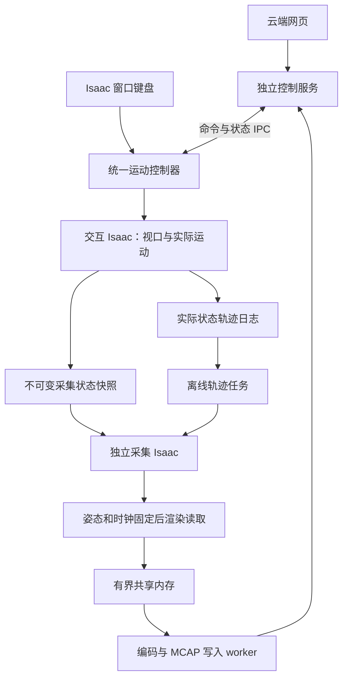

# Sensor Visualizer：网页、键盘、轨迹与采集优化实现方案

日期：2026-10-09，Asia/Shanghai。方案版本：R1。

状态：**规划存档，尚未实现**。本文不能作为网页、键控、轨迹导入或双 GPU 已部署的证明。当前实现基线为 v04；历史测量与部署状态参见 [v04 交接文档](../v04/docs/agent_handoff_20261009.md)。

## 1. 核心目标与确定的要求

首要目标是交付操作流畅、行为明确、可以稳定重复运行的系统。优先改善控制和场景操作的体感，随后提高采集效率；不以 GPU 占用率越高越好作为验收标准。

已确认的需求：

1. 网页只负责参数输入、任务控制、状态与轨迹管理，三维观察继续在 Isaac Sim 中进行。首版网页运行在云端，使用云端桌面的浏览器访问。
2. 支持键盘连续控制可控关节以及整机 XYZ 平移、Yaw/Pitch/Roll 旋转。键控过程中模型必须及时反馈，不能只让网页显示“已接收”。
3. 保留当前 Direct、Target + speed、Periodic 控制，以及传感器安装位姿调整、日志、明确保存的位姿快照、录制和 RViz 相关能力。cab–track 默认保持现有固定约定；不因“键控各关节”擅自改变资产关节定义。
4. 键盘操作、网页参数操作及自动运动，均可生成包含实际已应用状态的轨迹表。网页支持导入轨迹和离线采集。
5. 两种模式均作为可选项：A. 交互记录轨迹，随后离线采集；B. 交互过程中同步录制传感器数据。
6. 正式采集仍按“设置姿态 → 固定姿态和仿真时钟 → 渲染/读取 → 提交保存”进行。一组图像、点云和 TF 使用同一采集状态。
7. 优先使用进程隔离、引擎调度、资源复用、减少同步等待与拷贝等优化。保持现有预览画质和正式采集参数，不默认降低分辨率、传感器数量、采样质量或暖机量。
8. 交互仿真仍不高于 0.1 倍速；离线模式不限墙钟倍率。输入、网页刷新、视口刷新和仿真推进应分开调度。
9. 工作环境可能变成双显卡；支持显式配置 GPU 分工，保留单显卡路径。
10. 用户预计有 4–5 个完整工作日用于交付。系统性学习留到稳定交付之后，不在本轮实施中安排逐行讲解课程。
11. 保留旧代码与资产。建议新建独立后续版本，以 v04 的已验证逻辑为基线；不覆盖 v02/v03/v04，也不通过跨版本运行时导入造成回退依赖。

## 2. 基线事实与优化边界

以下来自已保存的 v04 证据，并非本次重新测量：

- 场景为 `combine_scene_16_terrain_fisheye.usda`；4 路 1920×1080 鱼眼相机、13 路 Instant LiDAR。正式实现前核对当前用户场景与自动发现结果。
- v04 已有有界 mmap 槽、独立录制进程、并行 PNG 编码、MCAP 写入与分阶段日志；这些逻辑应复用，不重新造一套保存系统。
- 8 组同配置短测中，v04 gated 采集加排空约 75.37 秒、keepalive 约 46.11 秒，v03 约 92.23 秒。短测收益不能代表 100 组稳定性或键控体感。
- 多秒原生调用仍会占用 Kit 主线程。已有追踪涉及 CUDA 页锁定内存管理、Vulkan/RTX 资源准备和同步；API 耗时可能包含等待，不能直接解释成纯分配成本。
- 当前运行配置关闭了引擎异步渲染。只把 Python 函数声明为 async、增加编码线程或换网页，不会自动消除这些原生阻塞。
- v04 点云与 v03 并非位级一致，部分固定姿态返回仍受渲染序列影响；严格跨端对齐与完整射线返回覆盖也尚未全部证明。新架构不能宣称这些问题已解决。

因此需要分别优化并测量：网页响应、机器人状态应用、视口反馈、采集吞吐、保存积压和数据一致性。

## 3. 技术栈及作用

| 层次 | 计划采用的技术 | 作用与边界 |
|---|---|---|
| 网页 | HTML/CSS/原生 JavaScript | 控制表单、状态、键位提示、轨迹管理；首版不引入网页三维引擎 |
| 服务 | 独立进程中的 Python、FastAPI、Uvicorn、WebSocket | 接收请求、反馈命令状态、推送任务进度；不放入被 Kit 原生调用阻塞的同一事件循环 |
| 命令与状态通信 | Unix Domain Socket、长度明确的消息协议、有界队列 | 传输小型控制/状态消息；不把全部图像和点云发给控制网页 |
| 键盘输入 | Isaac 内 `carb.input`；网页内 keydown/keyup | 两个入口进入同一个控制模型，避免焦点切换时只能在网页操作 |
| 运动 | 现有 Articulation/场景控制逻辑、固定控制步、四元数姿态 | 主线程执行运动；保持资产零点、轴向和关节限制 |
| 场景与采集 | USD、PhysX/SimulationManager、Replicator、RTX Sensor APIs | 设置与读取实际姿态、管理原生时钟、固定状态采集 |
| 轨迹 | CSV + JSON 元数据；实际状态采样；线性插值/SLERP | 可查看、可导入、可按采样网格重放；跳变段不插值 |
| 保存 | v04 有界共享内存与独立 worker、Pillow、ROS 2 CDR、rosbag2/MCAP | 复用现有编码保存链路；写包仍保持确定顺序 |
| 分析 | NVTX、Nsight Systems、/proc/cgroup、nvidia-smi、浏览器 Performance API | 关联线程、GPU、回读与交互延迟；工具开销单独评估 |
| 可选原生优化 | C++/pybind11、页锁定内存池、CUDA Stream/Event | 只在可控制的路径存在已证明热点时立项，不作为首版交付前提 |

依赖实施前先清点已安装版本，再确定与云端 Python/Isaac 兼容的锁定版本。新网页依赖使用项目独立环境，不安装进 Isaac、ROS 或平台桌面环境。外部依赖下载须按现有 cloud-instance-ops Skill 提交具体批次清单；本文不是依赖下载授权。

## 4. 主架构：控制与交互、采集分离



### 4.1 交互进程

- 保持用户当前视口画质，负责浏览、运动、安装位姿调整和轨迹记录。
- 轨迹模式中不执行全部正式传感器产品的采集，避免它们占用交互主线程；这减少额外采集工作，不改变视口的画质设置。
- 交互期间不在控制回调中等待图像编码、写盘或完整传感器渲染。
- USD/Articulation 的状态写入和状态确认由所有者主线程执行；网络线程只接收消息。

### 4.2 采集进程

- 使用独立的 Kit/Isaac 上下文加载同一已确认场景和资产版本。实时采集时也不锁住交互进程的场景。
- 接收完整不可变快照，或从轨迹读取指定采样时刻的状态。
- 保留必要渲染产品和暖机流程，不逐组销毁重建，不未经验证删除暖机。
- 每组独立设置并冻结自身场景；交互进程继续移动不会改变本组渲染状态。
- 无界面运行时关闭不需要的默认视口更新，仅保留正式传感器渲染；这是移除额外视图工作，不降低传感器质量。

### 4.3 独立进程的约束

两套 Isaac 会重复占用部分资产、显存和 CPU 资源。双 GPU 时优先隔离显卡，单 GPU 时仍可能竞争。启动前必须实测每套环境的常驻/峰值显存和 CPU 配额，不能预先保证单 GPU 并发也无卡顿。

单 GPU 若并发无法满足体感，保持轨迹后离线模式可用，并清楚报告并发模式的性能限制；不能用网页响应流畅代替“键控场景不卡”的验收。

## 5. 键盘与网页控制

### 5.1 控制模型

- keydown/keyup 更新按键状态；不依赖系统按键重复频率，不为每次重复事件排一个动作。
- 每个控制步计算关节角度和整机姿态增量，按经过的仿真时间积分；仿真慢放不通过降低整个主循环刷新率实现。
- 网页参数输入和键控共享控制器，并明确当前控制来源。同一自由度不同时执行键控、目标运动和周期运动。
- 进入键控时切换受控自由度的模式，退出时停止速度；松键停止、失焦清空、断线超时停止输入。
- 只在明确启用的控制上下文中接管键位；输入框编辑时不触发运动。提供可配置键位与冲突提示，保留浏览视口的操作方式。

### 5.2 坐标约定

- 网页整机目标位置以世界坐标表示；位置单位为米。键盘默认前后/左右沿整机 Yaw 的水平朝向，升降沿世界 Z，并提供世界坐标运动选项。
- 网页姿态沿用已确认的 RPY 显示约定；内部与轨迹以明确排列的四元数保存，不把三个旋转分量的任意相加当作通用旋转合成。
- 关节键控沿资产关节轴，零点和正负方向来自现有接口定义；轨迹元数据保存定义版本。
- 传感器安装位姿仍相对父安装节点，保存父路径和安装 revision，不擅自转换成另一种 TF 合约。

### 5.3 请求语义

命令包含 session_id、command_id、序号、来源、目标、动作和必要参数。状态区分 received、queued、applied、failed/cancelled。

- 连续键控速度采用最新状态；过期速度指令不逐条补执行。
- 尚未执行的同一参数修改允许合并；不得跨过 Save/Reset/Start/Stop 等顺序边界合并。
- 实际应用结果包含状态 revision 和应用时间；网页显示服务与 Isaac 是否连接、状态是否过期。
- 高频状态通知采用节流与差量发送，轨迹记录仍保留完整实际状态；两者不是同一采样需求。

## 6. 轨迹表与重放合约

建议每次会话形成：

```text
trajectory_session/
  trajectory.csv          # 各控制步已经应用并确认的整机与关节状态
  metadata.json           # 单位、坐标、关节定义、场景/资产版本、采样与重放策略
  mount_snapshots.jsonl   # 带 revision 的传感器安装状态
  events.jsonl            # 开始、停止、跳转、模式切换、来源、异常
```

CSV 至少包含 seq、t_sim_s、t_wall_elapsed_s、state_revision、mount_revision、base_x_m/base_y_m/base_z_m、base_qx/base_qy/base_qz/base_qw、各关节 `joint_<id>_deg`、transition_kind。

- 四元数列排列固定为 XYZW；归一化、坐标系和角度单位写入 metadata。
- 记录已经应用并确认的状态；目标请求另存 events，不能将请求回执当成实际轨迹。
- 暂停时可以保存不同 revision 的调整事件，但运动轨迹时间不靠墙钟继续增长。恢复采集的起始状态明确记录。
- 安装修改与整机/关节轨迹关联，通过 mount_revision 找到对应快照；离线任务不能一律使用最后一次安装位置。
- CSV 每行按语义是完整状态。默认重放时间单调；同一仿真时间存在多次修改时，按序号和跳变规则明确选择最终状态，不产生不明插值。
- 整机平移和连续关节段采用线性插值；整机姿态采用四元数 SLERP。Direct 跳转段采用阶跃，不在跳变之间伪造运动。旋转展开规则和周期运动定义写入元数据。
- 固定采样频率为用户可选，首版沿用现有 10 Hz 仿真时间网格；不能据此承诺墙钟 10 组/秒。
- 首版保证已支持的机器人、安装与指定场景配置可重放。用户在 Stage 中临时改几何、灯光或材质时，应保存新的场景 revision；未记录的任意 USD 编辑不属于自动可重现范围。

导入只做与正确重放直接相关的检查：字段与单位、时间顺序、数值有效性、关节映射、安装 revision 和场景版本。网页展示映射与任务参数，不因同一个已确认场景反复做全量扫描。

## 7. 两种可选采集模式

### 7.1 模式 A：交互记录轨迹 → 离线采集

1. 打开交互场景和网页，确认控制器连接。
2. 按需调整并保存安装状态，开始轨迹记录。
3. 键控、网页或周期运动改变实际状态；用户浏览场景。
4. 结束轨迹记录，导出或在网页选择/导入轨迹。
5. 配置采样频率和输出任务，启动离线采集。
6. 采集进程按轨迹重放，各组固定后生成完整图像、点云、TF 和相机参数。
7. 后台排空、完成文件、报告质量与性能；网页可以再次启动任务。

这是单 GPU 上优先满足键控体感的路径。离线阶段无 0.1 倍速上限，数据时间仍按轨迹仿真时间。

### 7.2 模式 B：交互时同步录制传感器

交互进程在一个已提交的控制步生成快照，采集进程在自己的场景中固定并渲染该快照。快照包括 scene_revision、snapshot_id、原生仿真时间、完整根姿态、各关节状态、mount_revision 和完整传感器安装状态。

“同步”表示一组传感器输出对应同一个明确的交互状态，并不表示耗时渲染必须在同一墙钟时刻完成。网页显示当前交互状态、正在渲染的快照及落后量；MCAP 记录实际采集时间，不假装捕获了每个交互控制步。

采集能力低于运动更新频率时提供两种策略，网页必须明确展示选择：

- **及时性策略（建议首版默认）**：采集进程就绪后申请最新已提交状态；不排无限快照。真实采样间隔可能不均匀，记录实际时刻和采样覆盖情况，不能宣称满足固定 10 Hz 完整采样。
- **完整性策略**：连续记录轻量完整轨迹，采集进程按固定采样网格有序处理。采集可以落后，交互不等待；积压体现在网页中。停止交互后可以继续离线完成，并对磁盘与待完成任务设置容量边界。

所有正式快照一旦进入渲染，不在其中途修改机器人或安装位置。控制服务和交互进程不等待本组传感器生成。

RViz 接收已完成快照对应的数据及 TF；其状态可能落后交互视口。新安装位姿只能与相同 revision 的数据一起发布，不能先切 TF 再发送旧位姿点云。

## 8. 一组正式采集的顺序与时间

1. 等待可用共享内存槽和明确的采样状态，执行必要的暂停/停止请求。
2. 在采集进程推进自身原生仿真时钟到对应网格时刻，再应用完整目标姿态与安装 revision。原生时钟适配需要实验验证，不仅改 ROS header 来制造同步。
3. 固定 Timeline 和姿态，建立 CaptureTicket，记录全部矩阵、原生时钟、revision、快照/轨迹编号。
4. 在固定状态下完成必要预热与正式渲染；保留当前已验证的产品顺序和质量配置作为基线。
5. 收集全部回调，取得拥有明确生命周期的数据；检查来源时钟、矩阵、revision、传感器完整性。
6. 提交有界共享内存，编码和写包与下一组可重叠。不会提前复用仍被编码器持有的槽。
7. 记录完成、失败或缺失原因，并发送任务状态；结束时排空并封包。

正式采集过程中时间与姿态不推进。每组的逻辑时间来自目标轨迹和已核对的引擎原生时间；墙钟只用于耗时和监控。双进程时拒绝简单复制交互 header 而不验证采集引擎来源。

当前 source_frame_id 未可靠暴露的问题必须保留：snapshot_id/request_id 只证明关联，不自动证明原生帧新鲜。新架构的来源校验需以实际可取得的接口为准。

## 9. 单双显卡执行策略

| 配置 | 交互工作 | 采集工作 | 主要验证 |
|---|---|---|---|
| single_sequential | 同质量交互与轨迹记录 | 随后离线使用同一 GPU | 交互体感、切换与资源释放 |
| single_concurrent | 交互进程 | 独立采集进程共享 GPU | 显存峰值、GPU/CPU 竞争与键控延迟；不预先保证无卡顿 |
| dual_isolated | 显式指定预览 GPU | 显式指定采集 GPU | 两个进程确实只用指定设备，CPU 配额与显存独立 |
| dual_offline | 可关闭交互任务 | 实验比较引擎 multi-GPU 与独立任务并行 | 总吞吐、初始化开销、完整性与渲染历史影响 |

GPU 使用 UUID/明确选择配置，启动时枚举并记录型号、显存、设备映射和实际生效配置，不将物理设备编号硬编码。Vulkan/RTX 和 CUDA 的设备枚举可能不同，需验证实际进程归属，不能只设置 CUDA_VISIBLE_DEVICES 就宣称完成 RTX 隔离。

优先实现 dual_isolated，因为它直接对应“采集不影响交互”的需求。两张卡不保证吞吐翻倍，也不把显存当作自动合并。

多 GPU 渲染会增加 CPU 分发与汇总成本，不能修复 CPU 主线程瓶颈；[NVIDIA 多 GPU 性能说明](https://nvidia-omniverse.github.io/omniverse-performance/reference/rendering-performance.html#multi-gpu)也建议先区分 CPU 与 GPU 限制。

首版不默认把相邻帧随机分发给不同采集进程。已有证据表明返回受渲染序列影响，轨迹分段并行必须验证每段暖机、时钟、安装 revision、随机性和历史状态。独立轨迹任务并行先于任意逐帧拆分。

## 10. 底层优化优先级

| 优先级 | 方向 | 实施依据与限制 |
|---|---|---|
| P0 | 分离控制服务、交互场景与耗时采集 | 从架构移除采集对键控的直接阻塞；检查共享资源竞争 |
| P0 | 输入/视口更新与仿真限速分离 | 保留 0.1 倍速；不能用整个主循环低 FPS 实现慢放 |
| P0 | 轨迹与快照统一状态合约 | 记录已应用状态，确保重放与同步数据有明确来源 |
| P1 | 持久产品、资源复用与阶段启停 | 复用 v04 有效逻辑；区分 gated 和 keepalive，不恢复已失败的盲目拆分暖机方案 |
| P1 | 异步渲染/等待和减少同步点 | 交互进程先测试；采集进程独立验收，不直接全局打开 |
| P1 | CPU 线程与任务预算 | 根据真实 cgroup 配额分配预览、采集、编码；不以线程越多越好为目标 |
| P1 | 复用拥有的数据缓冲、减少重复拷贝 | 先量化每次拷贝和生命周期；不以借用未拥有的 GPU/CPU 数组冒充零拷贝 |
| P2 | 原生内存池、CUDA stream/event、原生扩展 | 仅优化可控制且已证明的热点；闭源内部资源不能靠 Python 池替换 |
| P2 | 多 GPU 离线调度 | 在基本体感与数据一致性通过后做硬件实测 |

运行时异步渲染在当前 6.0.1 文档中属实验功能，部分 Replicator 工作流需要关闭；不能预先承诺收益。[Isaac 性能优化说明](https://docs.isaacsim.omniverse.nvidia.com/6.0.1/reference_material/sim_performance_optimization_handbook.html#asynchronous-rendering)

GPU 读取路径不盲目打开 outputBufferOnGPU；当前 annotator 有接口兼容限制。自定义 GPU 读取器、替换 RTX 原生渲染、CUDA 算法重写不在首版必交范围。

## 11. 日志与验收

### 11.1 关联记录

保留已有采集日志，补充 command_id、snapshot_id、trajectory_id、group_id、state/mount/scene revision、进程与 GPU 身份。

至少记录：输入事件、服务接收、状态应用、轨迹落盘、采集接收、暖机开始/结束、正式渲染开始/结束、回读、拥有数据、共享内存提交、编码、MCAP 写入与排空。

- 同一主机进程使用可关联的单调时钟；浏览器 Performance 时间原点不同，需要校准，不能直接相减。
- 机器人应用延迟和可见画面延迟分开测。引擎应用回执不能证明远程桌面已经显示；视口帧与平台显示延迟分别报告，必要时结合人工录像验收。
- 系统采样包括单线程 CPU、进程 CPU、cgroup 限制、GPU/显存、内存、磁盘与队列深度。nvidia-smi 秒级采样不能定位所有毫秒级卡点。
- 长时间性能测试与高开销 Nsight 诊断分开做，避免把追踪开销当成用户体感。
- Warning 保存原文与重复计数，关联生命周期；优先处理纹理失效、资源释放、来源和设备错误，不靠屏蔽日志消除问题。

### 11.2 初始验收目标

以下是拟定目标，不是已测结果或保证：

1. 云端网页请求接收延迟 P95 ≤ 200 ms，采集忙时仍能输入、查看状态和提交控制。
2. 同质量交互时，原生键控到实际模型状态应用 P95 ≤ 100 ms；目标是在连续操作中无明显动作冻结。视口首次可见反馈和远程桌面延迟另测。
3. 松键、失焦、断线不持续失控；长按、多键组合、浏览/键控切换、输入框编辑均行为明确。
4. 同一轨迹重复导入可正确重放，Direct 跳转不被平滑，关节轴向与安装 revision 不丢失；输出时间、TF 和采集状态关联完整。
5. 两种模式均可选择，实时模式显示实际采样率/延迟/覆盖策略；完整性模式积压不会拖住交互线程。
6. 保持现有画质和正式传感器配置，比较画面、返回分布和几何误差；不要求随机传感器逐点位级一致，但必须报告差异与未证明的严格对齐。
7. 完成至少 100 组和至少 30 分钟交互/重复启动停止测试，无未解释的持续内存增长、槽泄漏、任务遗留或未封包输出。
8. 分别报告单 GPU 与双 GPU 的实际可用模式；未在双 GPU 测试时只交付适配配置，不宣称已通过。

## 12. 模块划分与实施顺序

后续版本模块建议如下，名称为规划，可随实际目录约定调整：

| 模块 | 职责 |
|---|---|
| web/static、web_service | 页面、WebSocket、状态与任务接口 |
| protocol、control_gateway | 命令模型、来源、序号、队列与请求状态 |
| keyboard_adapter | Isaac/网页键盘状态、焦点、超时与控制上下文 |
| motion_controller、interactive_runtime | 关节/整机控制、主线程更新、实际状态确认 |
| trajectory_recorder、trajectory_player | 状态记录、CSV/JSON、导入、插值与跳变 |
| snapshot_contract、capture_supervisor | 完整快照、revision、实时/离线策略、采集进程生命周期 |
| capture_runtime、sensor_drivers | 复用经过验证的 v04 采集逻辑，独立场景固定与来源检查 |
| record_pipeline | 共享内存、编码、ROS 消息与 MCAP |
| diagnostics、benchmarks | 控制延迟、渲染等待、资源、警告和回归证据 |

建议以 4–5 天为交付窗口，按阶段推进，不将日期安排视为全部收益的保证：

- **阶段 0：基线与保护。** 备份 v04，核对当前场景、资产、依赖与设备；测无采集键控/视口基线，保存质量配置与旧版功能清单。
- **阶段 1：交互闭环。** 独立网页、统一控制器、Isaac 原生键控、限速与刷新分离；先证明实际运动反馈流畅。
- **阶段 2：轨迹闭环。** 记录、导出、网页导入、安装 revision 和独立离线重放；打通一组完整 MCAP。
- **阶段 3：同步模式。** 完整快照、独立采集进程、及时性/完整性策略、状态延迟与 RViz 对应关系；有双 GPU 时优先验证设备隔离。
- **阶段 4：性能与稳定。** 针对实测热点做资源复用/异步实验，运行长测、Warning 排查、回归和交付演示。

每阶段有功能门槛，失败时保留证据并修复，不把缺失模式、降低画质或隐藏积压当成按时完成。独立版本避免影响现有可用代码。

## 13. 首版交付与回退

交付物：独立新版本源码、锁定依赖说明、网页与键位说明、轨迹格式与示例、两种模式启动流程、GPU 配置、性能/质量/Warning 报告、未验证问题清单。

保持 v04 与原资产可运行。新流程停止后排空本项目 worker，仅结束本项目进程；不批量停止其他 Isaac 或平台桌面。Stop/Reset 延续现有恢复语义，并明确轨迹何时封存、后台采集是否继续完成；关闭键控先清除按键状态。

远端部署只涉及项目目录、项目独立依赖和明确启动参数。不修改驱动、系统桌面、全局 Python、预加载、启动服务或原始 USD。需要新场景时另存文件。

## 14. 仍需现场核实的事项

- 当前 GPU 数量/型号/显存、CPU 配额和项目是否有用户更新；历史快照不能代替现场情况。
- 完整质量视口在不挂载正式传感器产品时的真实帧间隔，平台网页桌面的额外延迟。
- 独立采集引擎对快照时间的原生时钟适配、跨进程来源证明和初始渲染历史影响。
- 当前资产 RPY、关节零点、轴向与 TF 合约的具体定义；元数据必须来自已确认实现，不靠命名猜测。
- FastAPI/Uvicorn 是否已有，缺失时准备具体下载批次并使用项目环境。
- 双进程显存是否足够，以及单卡并发能否达到交互目标；双 GPU 性能需在实际新环境验证。

以上是实现前的必要技术核实，不要求用户重新回答已经确定的两种模式、网页范围、画质优先级或交付目标。
