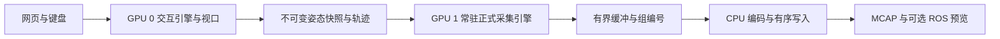

# Sensor Visualizer v07 双卡优化目标与实现方案

日期：2026-10-10，北京时间。基线：Sensor Visualizer v06。目标环境：已迁移项目的双 L40 云实例。

下一轮首先交付保持现有画质的流畅操作体验：让键盘、网页参数和 Isaac 视口持续响应，同时由另一张卡独立完成正式采集。实施顺序为设备分工、CPU 调度、交互渲染配置、常驻采集服务；Fabric 和异步 GPU 回读在获得实测收益与正确性证据后接入。

v07 是拟建的独立项目，本方案尚未执行代码改造。v06 和现有资产作为可回退基线保留；双卡环境尚未运行正式性能对照，文中的改善方向与验收目标不能解释为已取得的性能。

## 1 核心目标和交付范围

| 优先级 | 核心目标 | 具体要求 |
| --- | --- | --- |
| P0 | 操作流畅 | 键盘连续控制关节、整机平移和旋转时，网页输入和视口保持响应；采集启动、结束和排空不产生明显停顿 |
| P0 | 数据正确 | 继续按运动、固定姿态、完整采集、交给记录管线的顺序执行；点云、图像、TF 和时间保持当前对接定义 |
| P0 | 质量保持 | 保留完整场景、十三路 Instant LiDAR、四路 1920×1080 鱼眼相机及当前正式渲染配置 |
| P1 | 双卡资源有效利用 | 交互与正式采集分别绑定物理设备，减少相互争用；CPU 工作线程遵守容器配额 |
| P1 | 多轮使用稳定 | 连续开始、暂停、停止、再次采集无需重启网页；任务完成与引擎常驻状态分别表达 |
| P1 | 瓶颈可解释 | 日志能够把输入延迟、线程限流、渲染等待、缓冲等待、编码和清理阶段对应起来 |
| P2 | 深层吞吐优化 | 有条件接入 Fabric、池化异步回读与双卡离线分组采集 |

保留既有网页分类和按钮含义、键盘映射、关节 Direct／Target／Periodic 三种运动方式、整机姿态与高度控制、传感器安装调整、轨迹导入导出及 ROS／MCAP 接口。

两种工作方式继续可选：仅记录操作轨迹、之后离线生成数据；操作期间同时生成传感器数据。后者保留 `live_latest` 与 `live_complete` 的区别：前者允许明确记录跳过的网格，后者保留完整轨迹并排队处理，不能静默丢组。

交互运动继续保留 0.1 倍速上限；该上限约束运动时间推进，不应把输入处理和视口刷新一起压低。离线采集不限速。首轮不通过减少传感器、分辨率、预热子帧或光照质量来换取速度。

## 2 双卡环境和现有瓶颈

### 2.1 已核实的工作环境

| 项目 | 2026-10-10 检查结果 | 对实现的约束 |
| --- | --- | --- |
| GPU | 两张 NVIDIA L40，每张 46,068 MiB 显存 | 每个引擎各自持有场景；两卡显存不自动合并 |
| 驱动 | 580.126.09 | 当前无需以驱动升级作为优化前置条件 |
| 拓扑 | GPU 间为 PIX，两卡均邻近 NUMA 0 | 优先试验邻近 CPU 与内存布局，避免不必要的跨 NUMA 访问 |
| P2P | nvidia-smi 与 CUDA Driver API 均报告双向支持 | 说明具备能力，不能证明现有数据已经沿正确设备路径传输 |
| CUDA 复制能力 | 每卡两个异步复制引擎 | 可研究传输与计算重叠；仍需生产完成和缓冲生命周期契约 |
| CPU | 可见 128 个逻辑 CPU，`cpu.max` 为 `2800000 100000` | 相当于每 100 ms 有 28 核的时间预算，不等于 128 核可用或 28 个独占物理核 |
| 内存 | cgroup 上限 240 GiB | 可以试验常驻双场景和缓冲池，但要观测实际内存增长 |
| Isaac SDK | 6.0.1-rc.7，Replicator 1.13.27 | 新文档中的 API 必须先查当前安装版本，不能直接假定可用 |
| 分析工具 | 已有 nvidia-smi、taskset、Vulkan 工具、CUDA 工具链；测试路径未找到 Nsight Systems | 先使用现有日志与资源接口，需要原生追踪时再列明工具安装批次 |

本次硬件采样时没有 Sensor Visualizer 进程，负载记录仅为空闲基线。源单卡实例已经关闭，后续对照均在同一双卡实例上进行，不用旧单卡数字直接计算双卡加速比。

### 2.2 已确认的代码行为和待验证的影响

| 行为或证据 | 解释 | 接下来的验证 |
| --- | --- | --- |
| v06 可指定 renderer 与 physics 设备，但 Annotator 使用 `device='cuda'` | 渲染设备与数据目标设备需要分别核实，存在泛化设备选择的风险 | 记录 renderer、SDK 源设备、Warp 数组和目标池的物理 GPU 身份及实际复制方向 |
| 交互和正式采集入口都关闭异步渲染 | 正式数据同步要求被同时应用到交互视口 | 只改变交互进程的异步配置，检查响应、显示延迟及快照一致性 |
| Kit 入口没有明确设置 Carbonite 和 TBB 线程上限 | 两个引擎可能过度展开线程并消耗配额 | 对照线程上限与 cgroup 限流增量，不能仅根据低平均 CPU 占用推断没有限流 |
| 每轮采集重新创建并退出一个 Kit 进程 | 重复承担引擎启动、场景加载和上下文释放成本 | 对比新建进程与常驻进程的启动、结束、重复任务延迟 |
| 源单卡追踪曾出现约 500 ms 的 PhysX 到 USD 同步 | 已定位到该样本的 CPU 执行热点，双卡不能自动消除这类工作 | 双卡重新追踪，确认相同路径是否仍然主导长帧 |
| 源单卡 keepalive 实验提高过吞吐，长尾未消失 | 活动资源复用值得试验，但当时两个引擎共享一张卡 | 双卡分别评估资源门控、活动资源保留与交互延迟 |

源单卡的 CPU 同步热点和资源复用结果见 [v06 原生热点说明](../v06/docs/native_hotspots_and_gpu_design.md) 和 [v06 性能证据](../v06/docs/performance_evidence.md)。这些是候选方向的依据，不是新实例上的验收结果。

## 3 核心优化思路和技术栈

### 3.1 交互和采集分别拥有设备与场景

交互引擎不创建正式传感器 RenderProduct。采集引擎接收完整姿态快照或轨迹，各自在自己的主线程操作 USD、PhysX 和 RTX；网页线程不直接操控原生引擎对象。跨引擎主要传递关节、根姿态、传感器安装状态和版本信息，不传整份渲染场景。

该结构先优化两项工作的相互影响。离线使用两张卡采集属于后续模式，不在交互期间默认让正式采集占用交互卡。

### 3.2 使用的技术和接口

| 层次 | 技术或接口 | 作用 |
| --- | --- | --- |
| 网页控制 | 保留 Python 标准库 HTTP 服务与现有 HTML／JS | 保留熟悉的面板和控制接口，首轮无需新增网页依赖 |
| 控制通信 | Unix Socket、不可变状态代、有界命令队列 | 缩短共享锁持有时间，避免渲染任务阻塞网页线程 |
| GPU 身份 | UUID、PCI bus、CUDA Driver／Vulkan／SDK 设备记录 | 建立物理设备与各接口编号的映射，验证实际执行位置 |
| CPU 调度 | `carb.tasking`、TBB、PhysX 线程设置，启动前进程 affinity | 控制工作线程展开，降低配额耗尽和调度竞争 |
| 场景和运动 | 当前 Articulation／PhysX Tensor 与 USD 路径 | 第一阶段保留运动与参考帧定义；后续评估 Fabric／USDRT |
| 渲染 | 交互异步配置；正式 `rep.orchestrator.step_async` 与完整回执 | 让交互显示与控制适度重叠，保持正式组冻结和完成校验 |
| 数据传递 | 已有 mmap 三槽、组编号、槽位代数和确认协议 | 防止缓冲复用覆盖未消费数据，并施加有界背压 |
| 图像和记录 | 已有 Pillow 编码、后台工作线程、ROS CDR、rosbag2_py | 保留 PNG、消息定义和 MCAP 组织，优先优化上游等待 |
| 深层回读实验 | 已安装 Warp／CUDA、锁页缓冲、Stream／Event | 有条件把回读与后续工作重叠，不改变交付格式 |
| 诊断 | monotonic_ns、线程 CPU 时间、/proc、cgroup、逐卡资源采样 | 分清执行、等待、限流和清理；需要时增加原生追踪 |

本轮的主要机制是设备分工、任务流水线、不可变快照、资源池复用和状态机。暂不以自定义 CUDA 数值内核作为交付前提：源单卡证据中，项目自己的数组整理和复制远小于引擎预热及同步成本。

## 4 分阶段实现方案

### 4.1 建立独立 v07 和双卡基线

本地拟建 `scripts/260920SensorVisualizer/v07`，远端使用 `/root/gpufree-data/semantic/scripts/260920SensorVisualizer/v07`。复制可复用逻辑后改为独立包名、配置与输出目录，运行代码不得导入旧版包；对照测试工具可以读取保留的 v06。

实施前保存本地与双卡实例 v06 的源码哈希和可恢复备份。记录场景及依赖资产清单、传感器注册表、轨迹、标定、渲染参数和设备身份，使对照条件一致。

先测试同一实例上的两种原始运行组合：交互与采集都用 GPU 0；交互用 GPU 0、采集用 GPU 1。采用同一轨迹和完整质量配置，分别统计引擎启动、采集准备、稳定运行、停止排空及退出时间。

### 4.2 完整设备绑定与 CPU 预算

新增统一设备解析模块，由物理 UUID 或 PCI 地址确定设备身份，再映射到 renderer、physics、CUDA 和 Annotator 的设备参数。记录请求设备与实际设备；CUDA 可见性筛选不能代替 Vulkan 设备核验。

初始化时检查回调数组的 device、SDK 输出节点的源设备、复制目标池和 GPU 进程记录。对相机的复制缓冲使用已核实的设备；点云如已在 CPU，不为展示 GPU 计算而重新上传。泛化 `cuda` 是否实际产生跨卡复制，以回调与追踪为准。

为两个引擎分别设置 Carbonite、TBB 与 PhysX 的工作线程上限，并限制项目数值库意外展开线程。第一轮可试交互 8、采集 12、编码 4 的组合，再对比少量相邻组合。这些数字是工作池上限，不是独占 CPU 核数；多个工作池、主线程和 SDK 线程的实际并发不能靠简单相加保证。

可在启动 Kit 之前设置本任务进程的 CPU affinity，使随后创建的线程继承。优先评估 NUMA 0 邻近的互不重叠 CPU 集合，结合物理核与超线程关系选择；不得把 affinity 当作独占资源。内存局部性先观察，再决定是否需要额外接口。

仅修改项目进程参数，不修改系统 cgroup、CPU governor、BIOS、驱动或平台服务。

### 4.3 分离渲染配置并减少无用视口工作

把启动配置分为 interactive 与 formal_capture 两种角色。

交互角色试验当前 SDK 支持的异步渲染和握手设置。保留画质、运动时间定义及主线程对象所有权；检查按键运动连续性、场景拖动、网页调整和快照输出。异步视口可能显示较早的状态，必须同时测量显示延迟，不能仅看命令回执。

正式角色保持当前同步完成回执、冻结时钟和姿态校验。检查 headless 进程是否仍更新默认视口；若存在，关闭未使用的默认视口更新，仅保留正式传感器 RenderProduct。无窗口不等于没有视口渲染，实施后需核对相机和雷达输出。

首轮继续使用 RealTimePathTracing、DLSS 2、AA 3、初始化预热 4、相机预热 16、正式子帧 2。保持当前 Motion BVH、Multi Tick 和 TLAS 兼容配置，不同时引入扫描调度改造。

### 4.4 常驻采集服务与资源复用

新增 GPU 1 常驻采集服务，在首次任务前完成场景加载、传感器创建和预热。后续任务复用引擎及兼容资源，但各自产生新的任务标识、输出目录、采样 epoch、记录进程和完成状态。

常驻的生命周期包括：启动、加载、预热、空闲、准备任务、运行、排空、返回空闲。失败进入恢复流程；必要时只回收本服务拥有的引擎进程，完成资源释放后重建。

需要区分两类锁：worker 锁维持常驻服务单例；job 锁仅覆盖一轮正式任务。任务排空后释放 job 锁，worker 锁继续保留。不能沿用“子进程存在即任务未结束”的判断，否则常驻进程会使下一轮永久被拒绝。网页重启后按 worker 身份、任务登记与握手状态恢复，不强行抢占锁。

资源复用条件包括场景版本、传感器拓扑、分辨率、标定、扫描配置和渲染参数。根姿态、关节角及安装变换是每组动态状态，不能因为普通位姿调整就反复销毁整个场景；使用 pose revision 标记更新和正式组归属。

每轮任务结束必须满足：没有原生操作未完成、当前 generation 已停止或安全排空、回调已隔离、所有槽位已确认、记录包已关闭。日志 scope、CaptureTicket 和会话编号随新任务更新；晚回调不得归入下一轮。

保留原生时钟与每轮轨迹相对时间的映射，避免为复位任务直接调用 Timeline Stop 导致 Articulation 句柄失效。若必须重建，则重新取得句柄和 epoch，明确记录变更，不能只改消息时间戳来掩盖源时钟差异。

常驻对象与持续渲染分别配置：空闲、暂停时停止传感器更新；活动任务中试验资源保留以减少每组重复建立和释放。停用资源门控与销毁 RenderProduct 不是同一件事，要用日志和原生追踪确认真正减少的工作。

单独保留显式关闭服务功能。多轮内存、显存或句柄持续增长时，在任务边界执行受控回收；回收条件由长测确定，不先写未经测量的任意轮数阈值。

### 4.5 深层优化实验

第一条是 Fabric 运行时姿态路径。当前 USD 路径同时承担渲染和 TF 检查，不能直接去掉写回。实验需验证 PhysX Tensor、Fabric、3DGS 消费者、传感器安装层级和 TF 使用同一姿态；只有这条闭环成立，才允许用更轻的运行时变换替代部分重复 USD 写入。

第二条是池化异步 GPU 回读。建立可复用 GPU 缓冲与锁页 CPU 槽，使用独立复制流和完成 Event；状态依次为 FREE、COPY_IN_FLIGHT、CPU_READY、CONSUMING、FREE。GPU 源对象、生产完成证据和槽位代数均需随任务保留，消费确认后才可复用。

没有 SDK 支持或可验证的生产完成契约时，继续使用当前同步回读。GPU 支持异步复制，不意味着可以在回调返回后任意持有 SDK 裸指针；我们的 Event 也不能自动证明 RTX 的生产工作已经完成。

正确性对照应从同一份已生成源数据得到同步参考和异步结果，逐字节比较。重新渲染两张随机噪声不同的图像不能代替复制正确性对照。确认收益后再减少中间 CPU 复制，原有独立数据所有权边界必须保持。

两项实验独立设置开关，失败或收益不足时保留已交付的双卡方案。

### 4.6 双卡离线吞吐模式

交互窗口退出或用户明确选择占用两卡后，可让两张卡各运行一个采集工作进程。按连续轨迹片段分配完整传感器组，避免同一组的相机、雷达分散到两边后增加跨卡配对复杂度。

协调器统一全局组编号、轨迹时间和输出顺序。每个工作进程独立验证原生冻结时钟及对应逻辑时间的映射，不能把局部 SDK 时钟直接当作相同的全局时钟。连续片段也需要足够的渲染历史预热，验证 DLSS 与时域累积对边界图像的影响。

使用一个有序写入协调器或经过校验的分包合并流程。较慢的工作进程导致缺少前序组时施加有界背压，不静默重排时间或丢弃完整模式的数据。多工作进程由同一采集任务管理，不能绕过现有单任务保护启动两个互不知情的监督器。

该模式共享 28 核 CPU 配额、内存带宽和数据盘；加速幅度须按端到端结果计算，不预先承诺翻倍。

## 5 代码模块调整

以下名称是 v07 的拟定实现模块，尚未创建。

| 模块 | 调整内容 | 在链路中的作用 |
| --- | --- | --- |
| `device_binding.py` | 统一设备身份和映射，导出实际设备证据 | 防止设置编号成功但实际设备路径不同 |
| `cpu_budget.py` | 解析 cgroup 配额、配置工作池和启动前 affinity | 控制 CPU 并发与记录限流 |
| `launch_profiles.py` | 分离交互、正式采集及实验配置 | 使异步交互与同步正式采集分别生效 |
| `capture_service.py` | 常驻引擎、任务状态机、恢复与服务关闭 | 减少重复初始化并正确处理多轮任务 |
| `capture_supervisor.py` | 连接常驻服务，分别管理 worker 和 job 租约 | 网页任务生命周期与引擎生命周期解耦 |
| `scene.py` 和 `sensors.py` | 兼容资源复用、动态姿态 revision、完成回执 | 保持完整组与晚回调隔离 |
| `pipeline.py` 和 `record_worker.py` | 首轮保留既有编码写盘并行，适配任务重用 | 避免在非主瓶颈处重写已验证管线 |
| `robot/runtime_transforms.py` | 可选 Fabric 实验路径 | 研究姿态同步热点 |
| `readback_pool.py` | 可选锁页槽、流、Event 和持有对象 | 研究 GPU 回读与后续任务重叠 |
| 既有诊断模块 | 增加设备、阶段、限流和多轮资源字段 | 比较常态耗时与长尾 |

## 6 一组数据的执行顺序和日志

正式采集仍依次执行：

1. 取得本组轨迹状态或不可变快照，锁定 pose revision、传感器安装状态和组编号。
2. 等待一个空闲记录槽；完整模式保持背压，不能因槽满覆盖旧组。
3. 在采集引擎推进至目标采样时间，应用根姿态和关节状态，并完成参考帧同步。
4. 固定原生仿真时间和姿态，进行当前配置要求的预热与正式渲染。
5. 等待全部传感器完成回执，核对源时钟、渲染矩阵、捕获标识和 pose revision。
6. 取得具有独立生命周期的数据；如启用异步回读，则等待本组复制 Event 完成。
7. 提交有界缓冲和元数据。后台处理本组编码、CDR 和 MCAP，采集侧可准备下一组。
8. 记录进程确认对应组和槽位代数后释放缓冲。Stop 在安全边界排空并关闭包。

交互引擎在上述过程中独立响应用户操作。下一组可以使用后续状态，当前组不能在渲染期间被新输入覆盖。

日志共同键包括 worker、job、group、pose revision、generation、slot generation、物理 GPU 和同实例 monotonic 时间。分别记录 CPU 墙钟、线程 CPU 时间、渲染等待、回读、缓冲等待、编码、写入、排空和任务准备阶段。

资源记录增加逐卡利用率与显存、进程和关键线程 CPU、运行队列、cgroup 限流计数增量、内存及队列占用。默认轻量采样；详细追踪仅录指定组和慢帧窗口，避免诊断本身成为瓶颈。低频 GPU 利用率不能作为一个短函数的精确 GPU 耗时。

浏览器时间、Linux monotonic 时间和呈现时间不是同一时钟。命令回执指标表示引擎处理延迟，不等于屏幕已显示新姿态。端到端体感需额外测量或人工验收；无可靠呈现事件时不伪造显示完成时间。

## 7 对照实验与验收标准

### 7.1 逐项加入改动

| 对照 | 相对上一项只改变的内容 | 要回答的问题 |
| --- | --- | --- |
| A | v06 同卡组合 | 同实例原始响应与采集耗时是多少 |
| B | 交互 GPU 0、采集 GPU 1，核实完整设备路径 | 分卡能否减少稳定阶段和启动结束干扰 |
| C | CPU 工作池预算 | 是否减少限流、线程竞争和长帧 |
| D | 正式进程停用无用默认视口 | 是否减少无用 GPU 工作且传感器输出保持正确 |
| E | 仅交互异步渲染 | 回执、视口连续性和显示延迟是否一起改善 |
| F | 常驻采集服务 | 再次采集的准备和结束延迟是否下降 |
| G | 活动任务资源保留 | 是否减少重复分配释放，且不恶化交互和内存 |
| H | 分别试 Fabric、异步回读、离线双卡分组 | 新热点是否获得端到端收益及完整正确性证据 |

主要对照使用同一场景、轨迹、传感器清单和渲染配置；保持诊断级别一致，交替或随机顺序重复，区分冷启动与已预热结果。先用短任务定位，再做 100 组和多轮长测，不把单次结果作为确定收益。

### 7.2 初始验收目标

以下为拟定目标，双卡基线完成后固定测量条件；达不到时需继续定位，不能直接改成降画质验收。

| 项目 | 目标或必须满足的条件 |
| --- | --- |
| 正常交互与稳定并发的引擎回执 | P95 不高于 50 ms，P99 不高于 100 ms；同时报告最大值及按键和参数命令各自分布 |
| 稳定阶段更新间隔 | 争取 P95 不高于 40 ms；完整报告超过 100 ms 和 500 ms 的次数及所属阶段 |
| 任务准备和结束 | 单独报告阶段耗时、最长停顿、线程 CPU 和限流；常驻后的再次采集应优于新建进程基线 |
| 人工使用体验 | 持续键控、输入参数、拖动视角、调整传感器、采集启动结束均无明显卡顿；不能仅用后台回执代替 |
| 多轮恢复 | 至少覆盖连续采集、Pause／Resume、Stop／再次 Start、网页重连和服务故障恢复；30 分钟长测及多轮资源曲线无无法解释的持续增长 |
| 数据完整性 | 完整配置每组十三路点云和四幅图像完整，标定、TF、时钟和运动状态按已有接口保存；完整模式组编号连续 |
| 数据对齐 | 源时钟、冻结姿态、传感器矩阵、轨迹与导出 TF 关系通过校验；重试和晚回调不能串组 |
| 画质 | 维持正式配置，配对场景检查清晰度与材质；考虑重复渲染噪声及历史差异，不仅比较配置字符串 |
| 异步复制 | 同一源缓冲的同步与异步 CPU 结果逐字节一致，取消、停止和异常排空不访问已复用数据 |
| 吞吐收益 | 报告稳定组每真实秒和点击开始至资源可复用的总耗时；改善幅度需超过对照的运行波动 |

输入事件到视口显示的完整体验是最终交付标准。单卡历史 P95、双卡平均利用率或 GPU 峰值达到 100% 都不能替代它。

## 8 实施边界和交付物

优先完成 4.1 至 4.4，再决定深层实验。若常驻与异步交互中的某一项收益不足或正确性未通过，可保留已通过的分卡和线程预算方案，该实验保持关闭。各优化单独配置，便于回退和因果对照。

交付物包括独立 v07 源码、原样保留的 v06、设备与线程配置、启动操作说明、原始日志及分析结果、数据与质量验收报告、失败和停止恢复测试、回退说明。文档明确每项优化的实际收益、限制与未通过项。

本地与双卡实例保留同名项目目录。新增外部工具或依赖按既有 cloud-instance-ops 批次清单流程列出版本、来源、校验和安装落点，再执行已确认批次；本方案不默认安装新库或修改系统环境。源单卡实例无需重新启动。

## 9 依据与相关记录

- [双卡硬件记录](../research/20261010_dual_gpu/hardware_report.json) 与 [SDK 能力记录](../research/20261010_dual_gpu/sdk_report.json)：实际配额、拓扑、复制引擎和当前 API 范围。
- [设备复制实现记录](../research/20261010_dual_gpu/device_path_report.json)：SDK 的源设备、目标设备和复制缓冲路径；泛化 CUDA 选择的实际影响仍需运行验证。
- [调研结论和实验计划](../research/20261010_dual_gpu/findings_and_plan.json)：本方案对应的检查范围与事实边界。
- [v06 架构](../v06/docs/architecture_and_data_contract.md)、[性能证据](../v06/docs/performance_evidence.md)、[剩余停顿](../v06/docs/warnings_and_remaining_stalls.md)：保留的接口、所有权规则与源单卡测量。

NVIDIA 官方说明支持对工作线程进行限额，并将交互异步渲染与 Replicator 正式生成的正确性要求分别评估；多 GPU 不会自动缩短 USD 加载或使物理计算跨卡扩展。[Isaac 性能说明](https://docs.isaacsim.omniverse.nvidia.com/6.0.1/reference_material/sim_performance_optimization_handbook.html)

CUDA 的传输与计算重叠需要适当的锁页内存、流和同步关系；本项目还必须满足 SDK 源缓冲的生命周期。[CUDA 最佳实践](https://docs.nvidia.com/cuda/cuda-c-best-practices-guide/index.html#asynchronous-and-overlapping-transfers-with-computation)

当前冻结采集对时钟和调度敏感，Multi Tick 与 per sensor TLAS 不能作为无条件开启的加速开关。[Multi Tick 说明](https://docs.isaacsim.omniverse.nvidia.com/6.0.1/sensors/isaacsim_sensors_multitick_rendering.html)
