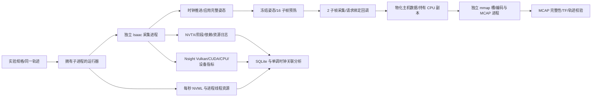

# single06_lab 实验架构

此项目以原 v06（逻辑名 single06）为独立冻结基线。`frozen_runtime` 是源码副本；运行时不导入相邻的正式 v06，不修改正式场景资产。原版本的网页与交互操作保留在正式项目，此目录用于机制验证。

## 模块与证据链

| 路径 | 职责 |
|---|---|
| `frozen_runtime/` | 原 single06 的独立源码、配置、网页与启动器副本 |
| `lab/runner.py` | 实验目录、启动配置、子进程归属、超时排空、逐轮 MCAP 校验 |
| `lab/instrumentation.py` | 不改变原同步逻辑的阶段、依赖、数组接口与 NVTX 记录 |
| `lab/resources.py` | 现有 NVML 的设备忙碌、显存、时钟、PCIe 吞吐；进程与线程 CPU ticks |
| `lab/analysis.py` | GPU 活动区间并集、原生 API、时钟锚点、设备指标目录与采样缺口、依赖账本 |
| `lab/host_pool.py` | 可选 CPU 数组复用；必须等打包完成后才能复用，不持有 SDK GPU 指针 |
| `lab/scene_lease.py` | 可选同一进程多轮场景和产品复用；每轮仍排空生成、独立录制并校验 |
| `lab/sdk_copy.py` | RGB 在 Writer 回调中立即消费的实验开关；原主机物化和独立 CPU 副本仍保留 |
| `lab/warm_routing.py` | 相机单独预热的机制复现；本轮因雷达源位姿陈旧被否决，禁止当作可用加速方案 |
| `lab/interaction.py`、`kit_owner_entry.py` | 独立 GUI 控制端、短 Unix socket、10 Hz 按键注入与并发采集延迟测试 |
| `kit_lab_entry.py` | Isaac 内入口、装配实验选项、退出及最终资源释放 |
| `tools/run_matrix.py` | A/B 与 B/A 顺序对照；追踪与普通性能结果分开 |
| `tools/validate_capture_data.py` | 在已有 ROS 环境解码并校验所有正式话题 |
| `tools/resolve_api_frames.py` | 通过实际进程映射和 ELF PT_LOAD、公开符号区间精确识别 NVRTC 采样栈 |
| `tools/group_timeline.py`、`build_timeline.py` | 逐组顺序 CSV 与无外部资源的设备指标 HTML 时间线 |
| `tools/compare_quality.py` | 同姿态、同时间戳四路图像对照和原始 JPEG 样本；指标不自动判定视觉质量 |
| `tools/run_followup.py`、`run_confirmation.py` | 已测瓶颈对应的单变量后续试验和更长的普通性能确认 |
| `tests/` | 区间并集、时钟误差、缺失指标和缓冲生命周期的有效性测试 |

## 保留的契约

同一场景、资产、传感器、完整轨迹、1920×1080 分辨率、渲染模式、16 子帧相机预热、2 子帧正式采集、原生仿真时钟和 TF 计算。实验窗口不自动减少画质。`keepalive` 允许运动阶段继续更新产品，过渡结果不录制；只有冻结采集请求的结果进入 MCAP。

## 证据边界

1. 跨 await 的 host wall 与同线程 CPU 统计是包含性作用域，不能视为函数独占成本或纯等待。
2. GPU 工作区间使用并集，避免重叠任务重复相加；工作区间不表示 SM、Tensor 或 RT 占用率。
3. Nsight 指标采用实际导出目录和表结构；不支持或未取得的指标记缺失，不记为零。NVML 是整个设备的数据，不能归给单个进程。
4. `SL06_SYNC host_ns=...` 将主机单调时钟写入 NVTX，记录拟合残差；调用延迟和追踪开销仍存在。
5. CPU 主机池只能减少项目自身数组分配，不能声称减少 SDK 内部 cudaHostAlloc / cudaFreeHost。
6. 当前 SDK 回调未提供跨组保留 GPU 缓冲的寿命契约或可接管的 Vulkan 完成栅栏；跨组 D2H/渲染重叠暂不能安全实现。CUDA Event 不能单独证明 Vulkan 生产完成。
7. 本次没有新增或更新外部工具；Nsight、NVML、Warp、ROS 与 Isaac 均使用已有版本。安装和下载必须先按具体批次请求用户同意。
8. Nsight `batch` Vulkan 工作区间是粗粒度范围，可能跨越低活动阶段；区间并集不能当作 GPU 忙碌率。核心活动以真实设备指标解释。
9. 本轮虽然请求了 CUDA API backtrace，导出的 API 行没有 `callchainId`；不能声称取得了每次分配的完整原生调用栈。CPU 采样栈与同线程 API 时间包含关系分别记录。
