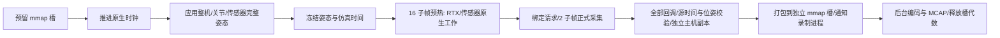

# single06 底层验证结果

日期：2026-10-11。项目是独立 `single06_lab`，原 v06 和原 USD 保留。此次交付的是可复现实验代码、底层证据和优化候选；没有将未经验证的策略替换为正式默认值。

## 1. 已经验证的关键结论

**gated 的逐组成本包含 LiDAR 原生准备／编译／模块生命周期，不能笼统归为相机渲染或 Python 复制。**

两轮交错 A/B、B/A，共 32 组数据，保留 13 路 LiDAR、4 路 1920×1080 鱼眼、16 个相机预热子帧、2 个正式采集子帧、完整轨迹、仿真时钟和 TF。

| 普通短测 | gated | keepalive | 解释 |
|---|---:|---:|---|
| 移动姿态平均吞吐 | 0.10954 组/秒 | 0.16955 组/秒 | keepalive 为 1.548 倍，包含首组冷启动后的采集全过程 |
| 固定姿态平均吞吐 | 0.11088 组/秒 | 0.16246 组/秒 | 只固定姿态仍未消除 gated 的主要耗时 |
| 移动姿态首组以后相机预热 | 约 7.60–8.03 秒/组 | 约 2.77–2.88 秒/组 | 子帧数量保持 16；不能解释为降低画质 |

短测的样本数不足以证明 P99，较长确认与并发结果另列。固定姿态不是保持轨迹的优化方案，它只是排除运动成本的实验变量。

## 2. 原生证据把问题定位到哪里

第 1 组完整原生窗口，追踪配置相同，普通吞吐与追踪耗时严格分开：

| 观测 | gated | keepalive |
|---|---:|---:|
| 整组原生窗口墙钟 | 9.954 秒 | 4.755 秒 |
| 主线程被调度时间 | 9.511 秒 | 4.594 秒 |
| 相机预热范围墙钟 | 8.563 秒 | 2.874 秒 |
| 预热范围 `cudaHostAlloc` 次数 | 3614 | 234 |
| 整组 `cuLinkCreate / Complete / Destroy` | 各 26 次 | 未记录到 |
| 整组 `cuModuleLoadData / Unload` | 各 26 次 | 未记录到 |
| 主线程 NVRTC 模块叶采样数 | 1856 | 未出现在热点列表 |
| `nvrtcCompileProgram` 公开 API 祖先采样 | 56 | 0 |
| SM Active 样本平均 | 13.33% | 35.81% |
| SM Issue 样本平均 | 2.13% | 5.65% |
| Tensor Active 样本平均 | 0.42% | 1.09% |
| GR Active 样本平均 | 21.13% | 56.20% |

公开编译栈的上一层来自 `librtx.sensors.lidar.core.plugin.so`。使用实际进程 `/proc/self/maps`、ELF PT_LOAD 和公开函数地址及长度进行精确映射，既保留 Nsight 已解析符号，也核对了地址区间。没有给私有函数猜名字。

这证明本次 gated 稳态窗口中存在 **LiDAR 插件→NVRTC 编译、CUDA 链接和模块载入/卸载**。结合相同质量的交错性能对照，支持“维持原生准备状态能减少逐组重复准备”的机制解释。**它尚不能证明每次更新开关对应哪一个私有构造函数，也不能证明所有 NVRTC 采样都属于这一个公开函数。**

项目层的 render product 创建仍在初始化、销毁在结束；重复准备发生在更深的原生链路。不要把 `updates_enabled=False`、显式 stop/drain、产品销毁和 SDK 内部重建混成同一件事。

### keepalive 的遗留成本

keepalive 整组仍记录 377 次 `cudaFreeHost`，包含性 API 墙钟合计约 2.774 秒；5913 个主线程采样中，有 3909 个落在该线程的 `cudaFreeHost` API 区间内。驱动库仍是主要叶采样热点。

**申请释放次数变少，并不等于同步耗时一定变少。**该 API 可以包含等待，不能将 2.774 秒全部解释为操作系统释放内存的成本，也不能凭“主线程仍被调度”断言具体的私有驱动忙等算法。当前证据指向原生资源和同步，而非项目自身数组分配。

LiDAR 回调给项目的是 Warp CPU 数组，RGB 给的是 Warp CUDA 数组；LiDAR 的某些生成和主机缓冲成本在项目读取回调之前已发生。项目的 CPU 数组池无法接管这些 SDK 内部分配。

## 3. 一组数据按时间顺序做什么

这里“相机预热”是项目函数名称，内部实际包含所有启用传感器及其原生工作，不能把这段时间全部计为四张 RGB 的光追。

完整追踪中，gated 时钟推进约 0.495 秒、应用姿态约 0.0069 秒、预热约 8.563 秒、正式采集/校验范围约 0.828 秒、提交打包约 0.053 秒。预热范围 SM Active 平均约 11.85%；正式采集范围约 35.49%。这些是**含追踪开销的作用域与整个设备的采样平均**，不是函数独占 GPU 时间。

逐项顺序与主线程 CPU、调度、SM/Issue/Tensor/GR 指标见 [gated 一组 CSV](../reports/followup_20261011_104521/trace_gated_stacks/group_1_timeline.csv) 和 [keepalive 一组 CSV](../reports/followup_20261011_104521/trace_keepalive_stacks/group_1_timeline.csv)。波形见 [gated 时间线](../reports/followup_20261011_104521/trace_gated_stacks/timeline.html) 与 [keepalive 时间线](../reports/followup_20261011_104521/trace_keepalive_stacks/timeline.html)。

## 4. 已做的候选与失败实验

| 候选 | 正确性 | 收益与决定 |
|---|---|---|
| keepalive | 短测全部 MCAP 校验通过 | 明显收益候选；继续普通长测和并发验证，不直接改正式默认值 |
| 项目 CPU 主机缓冲池 | 4 组通过，失败打包会毒化缓冲而非提前复用 | 0.11466 组/秒，接近 gated 波动；未证明明显收益 |
| RGB `do_array_copy=False`，Writer 立即消费 | 4 组通过，仍保留原主机物化和独立 CPU 副本 | 0.11024 组/秒，未见明显端到端收益 |
| 同进程保留场景/产品，3 轮各 2 组 | 6 组全部通过，每轮新录制进程、先排空 generation | 一个 Kit 生命周期约 126.06 秒；避免多次初始化，不能宣称稳态采集本身更快 |
| 只在相机预热阶段关闭 LiDAR | **失败：`MyAiry_back` 的源位姿差异约 4.316** | 已否决。即使先让所有传感器预热一帧，仍会得到旧位姿；不放宽校验 |
| 请求停止后完成当前组、排空录制 | 实际停止在第 2 组，2 组 MCAP 全部通过 | 第 1 组状态被观察到时下一组可能已开始；这是完整组安全退出行为 |

已有 SDK 文档允许 RGB 在 Writer 内立即使用时取消中间数组复制；这只覆盖立即消费。**没有取得跨组持有源 GPU 缓冲和 Vulkan 生产栅栏的契约，因此没有实现未经同步保证的跨组 D2H 重叠。**

## 5. 初始化、结束及并发控制

初始化原生窗口约 45.52 秒，主线程调度约 40.93 秒；热点包括 libc、CUDA 驱动、Fabric、Python、NVRTC。初始化不是纯加载磁盘的等待。

结束清理窗口约 5.47 秒，主线程调度约 5.42 秒，SM Active 平均约 0.13%；Fabric/OmniGraph/Python/USD 是主要 CPU 叶模块。CUDA 主机内存释放包含性耗时仅约 0.015 秒，不能把整段清理归因于 GPU 或 MCAP 写盘。

keepalive 并发的首次有效控制试验：1210 个 10 Hz 本机命令，accepted-to-applied P95 约 30.72 ms、最大约 859.27 ms；5054 个界面更新间隔，P95 约 33.98 ms、最大约 900.24 ms。整机位置、姿态和大臂角度确有变化。**大部分命令及时响应，长尾仍存在；不能承诺完全流畅。**这不包含网页网络，也不替代人的场景浏览体验。

## 6. 数据质量与日志可靠性

每个通过的正式采集会在已有 ROS 环境逐条解码，检查 13 点云、4 图像、相机标定、相机位姿、TF、Clock、关节/整机姿态、组索引、writer 消息摘要及源轨迹。相机仍是 1920×1080、16+2 子帧，原渲染设置保留。

TF 与相机/整机矩阵最大差异约 `1.776e-15`；各次 root USD 哈希保持一致。这里验证的是项目消息之间的内部一致性，**不代表已验证同事端 3DGS 的所有坐标约定或物理传感器真实性**。

同一姿态第 1 组四相机对照，平均 RGB 绝对差约 2.55–3.00/255，PSNR 约 33.52–34.52 dB。已查看 [四相机对照缩略图](../reports/quality_samples/comparison_contact_sheet.png)，未看到明显整机错位或大面积拖影；原始 JPEG 保留。随机渲染、TAA 与 JPEG 都能造成差异，不能仅凭 PSNR 判定画质完全相同。

已分析试验的诊断队列无丢弃计数、无 IO 错误；解析器区分缺失指标与数值零。原生 1 kHz 窗口有明确时钟锚点及残差，残差随窗口记录，不宣称纳秒级无误差。

## 7. 已知证据缺口和下一步

1. Vulkan batch 工作范围不等于核心活跃率；不能用“覆盖 100% 时间”声称 GPU 满载。SM Active、SM Issue、Tensor 和 GR 指标分别解释，也不能相加。
2. 已请求 CUDA API backtrace，但该次 SQLite 的 API 行 `callchainId` 全为空。当前掌握的是 CPU 采样祖先与同线程 API 时间包含关系，尚无每次分配的完整原生调用栈。
3. `ad10x` 通用集没有 RT 指标；**追加的现有 `ad10x-gfxt` 图形集已实际取得 RTCORE Throughput 和缓存/Warp 指标**，见第 9 节。它不是逐 RT Core 的忙闲率。导出的 MHz、GB/s、Threads/Warp 部分原始值与标签不一致，已标为不能解释，未擅自改单位。
4. 当前主要 CUDA kernel 的合计执行只占短窗口很小部分；没有为追求“底层”盲目用 Nsight Compute 重放它们。原生 RTX/Vulkan 准备、同步和生命周期应优先处理。
5. 优先研究**维持 LiDAR 原生准备状态、减少 SDK 内部锁页缓冲重建、保留采集进程**；需要再评估 GUI/采集并发的长尾与显存峰值。
6. 若现有工具不足以看到私有图形资源/RT/驱动等待，再单独提出 Nsight Graphics 等的具体申请。本次没有下载、安装或升级任何外部依赖。

## 8. 较长确认与控制长尾对照

两种策略各 16 组，32 组全部全话题验证通过。移动轨迹和质量配置相同，使用普通无原生追踪运行。

| 指标 | gated | keepalive |
|---|---:|---:|
| 16 组采集阶段墙钟 | 134.684 秒 | 77.319 秒 |
| 采集阶段吞吐 | 0.11880 组/秒 | 0.20693 组/秒 |
| 整个 Kit 生命周期 | 199.908 秒 | 143.290 秒 |
| 去掉首组后的主要组作用域平均 | 8.388 秒 | 4.553 秒 |
| 去掉首组后的主要组作用域 P95 | 9.014 秒 | 4.628 秒 |

采集吞吐比为 **1.742**，采集阶段时间减少约 **42.6%**；若包含启动与清理，端到端时间减少约 **28.3%**，不能把 1.742 倍套到整个操作流程。主要组作用域是时钟推进、capture 与 submit 的包含性作用域之和，不等于全部框架开销；完整时长以 capture 状态墙钟为准。

keepalive 首组仍约 8.86 秒；后续组约 4.48–4.63 秒。短轮数和冷启动会显著影响平均值。15 个稳态组仍不能证明生产级 P99，需后续长期重复测量。

| 本机控制试验 | 命令数 | accepted-to-applied P95 | 最大 | 更新间隔 P95 / 最大 |
|---|---:|---:|---:|---:|
| 仅控制窗口 | 300 | 27.52 ms | 137.57 ms | 32.79 / 216.04 ms |
| 控制 + gated 采集 | 1287 | 29.84 ms | 808.02 ms | 33.63 / 813.27 ms |
| 控制 + keepalive 采集 | 1210 | 30.72 ms | 859.27 ms | 33.98 / 900.24 ms |

这三个试验不是同时运行的重复随机控制，不能用 1 ms 的 P95 差异判定某策略更流畅。**keepalive 明显加快采集，但没有解决应用生命周期的控制长尾。**

两个并发试验中最大的按键延迟都发生在 capture 的 `SceneStepper.close` 已完成之后、Kit 应用退出附近；次大尖峰发生在 Kit 启动而 SceneStepper 还未初始化时。录制 finish 和 mmap 排空在这些最大尖峰之前已完成。这是同一主机单调时钟上的相关性，尚不能指出驱动中的具体锁。当前旧试验的命令时间使用 receipt-observed 近似，新的日志已补存精确 `accepted_ns/completed_ns`。

因此下一步优先验证**保留采集 Kit 进程，活动轮内维持产品准备，轮间正常排空与停用**，以避开每轮启动/退出，而非只缩短 JPEG 写盘。当前三轮 SceneLease 已证明数据一致性，尚未做保持进程时的长期 GUI 长尾验收。

## 9. 已取得更底层的图形指标

使用现有 Nsight `ad10x-gfxt`，10 kHz，完整第 1 组窗口约 4.680 秒，124 个指标条目，SQLite 共约 622 万指标行。窗口内每项约 46803 个样本，采样中位间隔约 100001 ns，未发现大于三倍周期的缺口。

| 实际导出指标 | 样本平均 | 含义与限制 |
|---|---:|---|
| RTCORE Throughput | 11.03%，P95 67%，最大 85% | 光追硬件归一化吞吐；不是逐 Core 的占用率 |
| SM Throughput / SM Issue Active | 5.82% | 指令吞吐口径，不等同通用集 SM Active |
| Compute Warps Throughput | 10.21% | 当前硬件指标的计算 Warp 吞吐口径 |
| Unallocated Warps in Active SMs | 26.05% | 活跃 SM 中未分配的 Warp 容量，不能直接当作等待某个锁的比例 |
| Idle SM Unused Warp Slots | 63.76% | 空闲 SM 的未使用 Warp 容量；不是主机 CPU 空闲率 |
| VRAM Throughput | 11.61% | 显存归一化吞吐 |
| L1 / L2 Throughput | 4.23% / 11.60% | 缓存路径吞吐 |
| PCIe Throughput | 3.86% | 硬件归一化链路吞吐；不从异常 GB/s 原始值推算带宽 |

这些数据说明平均容量还有余量且有短促峰值，**不证明增加线程或显卡就能填满空余，也不证明 RT 是唯一瓶颈**。依赖链、资源准备和同步仍决定何时有可执行工作。采样平均的缓存命中率不是按请求数量加权的整轮命中率，不据此直接宣称缓存效率低。

见 [图形指标时间线](../reports/confirmation_20261011_110041/trace_graphics/timeline.html)。当前无需安装新的 GPU 监控工具即可取得这一级短窗口数据；长时间低开销常态记录仍用原有 NVML。

## 10. 最终交付与核验

本地正式 v06 的 143 个文件、远端原快照的 141 个文件均未改变，运行相关冻结副本一致。原始日志、失败结果、SQLite 和图像样本保存本地与远端，派生报告另外保留。实验所有自有进程已退出。

项目包含阶段/NVTX 追踪、资源采样、等待账本、CPU/原生内存资源账本、公开 API 栈解析、组顺序 CSV、HTML 指标波形、MCAP 全话题校验、同姿态质量对照、交错性能和控制长尾试验。代码通过 10 项所有权/分析测试及编译检查。

本轮未新增外部依赖，未启用未经源缓冲寿命与生产栅栏确认的跨组 GPU 异步复制。正式默认值保持原样；可以用实验规格 `policy=keepalive` 复现已测收益。
