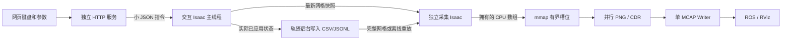

# v05 架构与数据契约

## 目标与技术栈

目标是让网页输入和交互运动不再等待完整鱼眼渲染、雷达读取或 MCAP 写盘；保留现有正式输出质量。方案采用进程隔离和有界异步管线。

| 层 | 当前实现 | 责任 |
|---|---|---|
| 网页 | 原生 HTML/CSS/JavaScript，无 CDN | 参数、连续键状态、轨迹上传下载、进度 |
| 网页服务 | Python 标准库 ThreadingHTTPServer | loopback HTTP、命令转发、采集进程管理 |
| 控制 IPC | Unix Domain Socket + 长度前缀 JSON | 有界请求、独立状态快照、应用回执 |
| 交互 Isaac | Kit update callback + Articulation + USD Session Layer | 高频规定运动、视口、实际状态记录；不创建正式传感器 RenderProduct |
| 正式 Isaac | 独立无窗口 Kit + Replicator/RTX 传感器 | 重放完整姿态、推进采样时钟、冻结后统一采集 |
| 缓冲与写盘 | mmap 槽位 + Unix Socket + ROS 工作进程 | CPU 数组传输、并行 PNG、CDR、单 MCAP writer |

可选 FastAPI/Uvicorn/WebSocket 入口留在源码，但用户暂缓依赖下载，目前无运行验证。不是交付使用的必要条件。

## 核心链路



网页服务线程、轨迹写入线程和 ROS 写盘进程不调用 USD、Articulation、annotator 或 Kit API；这些引擎 API 只在各自 Isaac 主线程执行。后台线程数量不是 GPU 射线追踪吞吐的保证。

## 文件模块

| 文件 | 作用 |
|---|---|
| run_web.py / web_service.py | 标准库网页入口、HTTP、轨迹导入导出 |
| web_asgi.py | 尚未启用的可选 FastAPI/WebSocket 适配 |
| web/static/* | 控制界面和键状态心跳 |
| control_ipc.py | Unix 控制端点、隔离状态、命令队列和回执 |
| run_in_isaac.py / kit_interactive_entry.py | 已有 GUI 或独立 GUI 的交互启动 |
| interactive_runtime.py | Play/Pause、键控、面板指令、规定运动时钟、轨迹后台排空 |
| keyboard_control.py / native_keyboard.py | 多键组合、速度积分、限制、原生按键类型适配及失焦/心跳处理 |
| interaction_log.py | 有界后台 JSONL 写入，原生输入回调不直接写盘 |
| trajectory.py | CSV/JSONL、完整状态验证、线性/SLERP 插值、跳变边界 |
| capture_supervisor.py | 启动/停止边界、任务找回、跨网页重启的单采集锁 |
| run_capture.py / gpu_config.py | 现有 Kit 的直接启动、环境隔离和 GPU 选择 |
| kit_replay_entry.py / replay_capture.py | 离线/最新/完整轨迹的正式采集调度 |
| scene.py / sensors.py / tickets.py | 场景、运动应用、原生时钟、采集门控及完成屏障 |
| robot/* | 资产发现、关节/整机运动、挂载变换、Session 恢复、渲染租约 |
| buffers.py / pipeline.py | 槽位所有权、代数 ACK、异步 IPC、排空 |
| record_worker.py / messages.py | 并行 PNG 编码、ROS 消息序列化、MCAP 与 ROS 发布 |
| diagnostics.py / resources.py / native_trace.py / trace_tools.py | 主机计时、原生标记、CPU/GPU/内存采样、日志与 trace |
| kit_entry.py / coordinator.py | 独立保留的配置文件采集入口；不导入旧版 |
| tools/* / tests/* | 部署、验证、项目范围内的实验与回归测试 |

## 一组正式采集的执行顺序

1. 选定源状态：离线轨迹网格、当前最新网格，或完整轨迹网格。
2. 等待空闲槽位。慢写盘会产生显式背压，不无限堆内存。
3. 只在本采集进程推进 native clock 到 `epoch + trajectory_time` 的物理步网格，此时正式产品关闭。
4. 写入整机位置/四元数、关节角度和安装位姿；cab–track 保持规定初始关系。
5. 固定姿态和仿真时间；相机暖帧，然后 Instant LiDAR/相机正式生成、等待完成、读取拥有的 CPU 数组。原有 callback/ticket、时间和姿态校验继续保留。
6. 携带组号、源快照 ID、修订号和时间映射放入 mmap 槽位，发送描述符。
7. ROS 工作进程并行编码 4 张 PNG，构造 PointCloud2/图像/标定/TF/Clock/JointState，CDR 序列化。释放槽位后，由一个写盘线程依序写 MCAP 并按需发布 ROS。
8. 下一组正式采集可与上一组编码/写盘重叠。交互 Isaac 在此期间可继续接收控制，当前正式组不受影响。

这里仍有 GPU → CPU 回读和一次 CPU → mmap 拷贝。不是 CUDA 零拷贝、GPUDirect Storage 或跨引擎共享 GPU 场景，也没有替换闭源 RTX 传感器内核。

## 三种采集策略

交互控制状态：初始化 → 暂停 → Play 运行 → Pause 暂停或 Stop/Restore 复位。Stop 保留引擎连接；Exit 释放场景控制但保留管理端点，只能通过 Reinitialize 恢复。正在采集或记录/排空轨迹时拒绝复位、退出操作；正式采集管线不参与交互生命周期初始化。

| 策略 | 状态来源 | 代价/语义 |
|---|---|---|
| offline | 已结束的轨迹 | 全网格、不限速，可重复重放 |
| live_latest | 已应用状态的最新 10Hz 网格快照 | 优先时效，可能跳网格，时间戳间隔不均匀 |
| live_complete | 正在写入或已结束的轨迹 | 全网格，渲染较慢时存在延迟和磁盘积压 |

实时这里表示在交互操作期间也可持续产生传感器数据。当前正式渲染每组仍需数秒，不能宣称达到真实时间 10Hz。完整模式不静默丢组；源故障、队列溢出、缺失安装修订会报错。

## 时间与坐标

- 交互时钟：`time.monotonic()` 的经过时间乘以 ≤0.1；单次积分上限 0.05 秒真实时间。原生 Timeline 保持暂停，既不会按 6FPS 限制整个主循环，也不把预览的原生时钟误当作轨迹时钟。
- 轨迹 `t_sim_s`：规定运动的相对仿真秒，从 Start Trajectory 开始归零。另存 `control_time_original_s` 与 `native_preview_time_s`，便于区分。
- 正式 MCAP stamp：`SimulationManager.get_simulation_time()` 的原生采集时钟，取整纳秒。每个组通过 epoch 与轨迹时间对应，量化误差不大于半个 60Hz 物理步；采集期间不推进。
- `monotonic_ns`：同一实例跨进程资源/性能关联使用；不是跨主机墙钟。UTC 用于操作记录，不用于物理时间积分。
- 根状态是约定的 `swing_coordinate` 的世界位姿，CSV/源状态四元数为 XYZW；传感器挂载记录另带 WXYZ，列名明确区分。关节角单位度，ROS JointState 的角单位弧度。
- 正式 TF 沿用 `world → swing_horizontal_coordinate → swing_coordinate → 各雷达帧/相机光学帧`。光学帧 X右/Y下/Z前；USD 相机 X右/Y上/−Z前。
- 空间插值：位置/角度线性，根四元数最短路径 SLERP。Direct 以及安装修订变化不跨边界插值；重复时刻取最后状态。

## 输出组织

```text
output/sensor_visualizer/v05/
  runtime/control_events.jsonl         # 控制应用/错误/回执延迟/更新间隔
  runtime/engine.sock                  # 项目私有 Unix Socket
  trajectories/<id>/                  # 实际轨迹 CSV/JSONL/metadata
  imports/<id>/                       # 导入的新轨迹
  pose_adjustments/<id>/
    pose_changes.jsonl                # 所有安装位姿调整
    poses_*.json                      # 显式保存的安装位姿快照
  tasks/<task_id>/
    job.json / task.json / control.json / status.json / kit.log
  <时间_标识>/
    bag_unified/*.mcap / metadata.yaml
    writer_report.json / capture_index.jsonl / session.json
    sensor_registry.json / render_profile.json / asset_manifest.json
    trajectory_metadata.json / job_spec.json / record_worker.log
  runs/<run_id>/diagnostics/           # 原生采集与工作进程的详细性能记录
```

MCAP 的 32 个话题：13 PointCloud2 + 4×(CompressedImage/CameraInfo/PoseStamped) + Clock/TF/JointState/根 Pose + run_metadata/camera_metadata/frame_index。每组 frame_index 携带源快照、组号、修订、原生时钟 epoch、轨迹时间和误差；这可用来核验对齐，不能代替真实视觉/几何对齐验收。

## 日志与性能边界

交互统计区分**控制 callback 自身耗时**和**相邻主循环更新间隔**。后者能揭示 GUI/native render 阻塞，即便 Python callback 自身很短。控制回执记录 accepted/completed，同一主机可计算应用延迟；不包含浏览器至服务器的全部网络延迟或显示器反馈延迟。

采集保留 group/request/attempt/ticket、render wait、读取、mmap pack、PNG、CDR、写盘和资源采样。主机 span 是包含原生/GPU 等待的墙钟，不是精确 GPU kernel 计时；必要时再使用已有原生 profiler 工具。

单 L40 的双进程仍争用 GPU 与显存，RTX 渲染吞吐没有获得数量级加速。两进程载入各自场景，后台业务线程只改善可并行的编码/写盘。双 GPU 使用显式 UUID，尚未测试实际双卡设备映射和性能。

根 USD 校验和证明根文件一致；引用的 3DGS/纹理二进制尚未全量哈希，USD 加载完成和暖帧也不能严格证明所有 GPU 纹理已经驻留。原生 LiDAR 仍无法取得可验证的 source frame ID；保留了 ticket/时钟/姿态屏障，不能声称与引擎内部所有历史状态完全等价。
