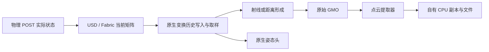

# 连续与冻结采集：配对实验结果及深层机制排查

日期：2026-10-14，Asia/Shanghai。依据：[001 实验方案](001_连续采集与v06冻结采集_先采集后比较实验方案.md)。本报告记录已实际执行的第一轮实验；001 保留为原始设计，不将其中“待实现”回写成历史事实。

**结论：连续路径能够完整保存这次预定的实验载荷，但尚未满足同步与几何门槛。证据已经从“原生姿态偶尔落后一帧”推进到“原生距离形成与旋转历史状态不一致”：在已知房间中，连续点云普遍表现为当前位置搭配半步或一步旧旋转；姿态元数据只能检出其中一部分。具体 SDK 内部故障函数仍未确定。**

## 1. 实际完成范围

本轮完成 9 组独立 C→F 配对运行：scene18 短轮、scene18 三轮主比较、房间短轮、房间三轮主比较，以及一轮单灯对齐对照。另保留 3 个失败轮次，不覆盖、不并入完成轮次的分母。

| 实验 | 实际范围 | 完成情况 |
|---|---|---|
| E0 scene18 | front 鱼眼相机＋MyAiry_front；12 个目标 | r02 完成；r01 在采集前因实验命令 source 标签错误失败 |
| E1 scene18 | 0.3m/s＋3°/s；100 个 10Hz 目标；3 次独立初始化 | 三轮均完成；本轮只覆盖预先锁定的低速混合块 |
| E0 房间 | 非对称六面房间；单 MyAiry；12 个目标 | r03 完成并通过冻结参考资格；前两轮冻结适配器崩溃，证据保留 |
| E2 房间 | 同样低速混合运动；100 个目标；3 次独立初始化 | 三轮均完成；每个目标保留完整 GMO |
| 图像条件干预 | scene18；12 个目标；C/F 显式选择同一 DomeLight | 完成；属于短轮条件排查，不能替代完整相机质量验收 |

100 个目标代表预定 10Hz 的 10 秒采样块，首末目标间隔为 9.9 秒；不以“采够 100 个合格样本”为停止条件。每轮原始失败载荷均参与计数。E1 和 E2 的每次 C、F 分别新建 Kit 进程，GPU 上始终串行执行。

当前仅完成 E1/E2 的一个关键运动块。静止、纯平移、正反低速纯旋转、非匀速、暂停恢复、关节遮挡等完整矩阵仍未完成；旧诊断中的短对照不能替代本方案要求的新三重复矩阵。E3/E4/E6 未进入，本报告不构成全模型、全组合或性能验收。

## 2. 条件、配对资格与证据可靠性

### 2.1 固定运行条件

- 单卡 `isaac-new`，NVIDIA L40；实际 Isaac Sim 为 `6.0.1-rc.7+release.42383.32955d8d.gl`，Replicator 1.13.27，sensor common 3.0.0；使用已有完整 GUI 经验和 ROS 2 Jazzy。
- 物理/loop 为 60/60Hz，原生传感器 tick 为 10Hz；相机为 1920×1080，保存无损 RGB PNG；LiDAR 保存原始 float32 XYZ。
- C 复用当前常驻产品、连续播放和原生 Writer 路径。记录每个真实物理 POST 状态，按源 epoch＋物理步＋sensor_id 显式配对，不按最近时间或文件顺序配对。
- scene18 的 F 使用原 v06 `SceneStepper`、`SensorDrivers`、`RecordPipeline`，`persistent_gated + keepalive`，16 个冻结预热子帧＋2 个正式子帧；编码 worker 固定为 2，这是实验设置，不能据此评价原基线性能。
- 房间 F 使用独立实验驱动和原 v06 `SensorDrivers` 生命周期，不经过要求机器人结构的 scene18 入口，也不产出 MCAP。它标记为 `F_room`，不冒充原应用结果。
- 运动为规定轨迹驱动；重力、碰撞及驱动按现有诊断配置关闭，不声称验证接触动力学。
- 房间将 LiDAR 距离噪声设为 0，其他发射器参数沿用实际资产；房间面为 x=10/-7、y=8/-11、z=6/-4m。10 秒轨迹始终在房间内。

### 2.2 输入与保存检查

C 先采完、排空并回读，再将完整目标实际状态交给 F。F 逐条应用实际 root、关节和安装快照，采集前后均重新读取传感器世界矩阵。位置资格阈值为 10μm，旋转为 1e-6rad，关节为 1e-6rad；共同输出门槛仍为 1mm、1e-4rad、2ns。

完成轮次的目标覆盖、输入位姿资格及载荷回读全部通过，重复事件为 0。scene18 三轮每侧每轮保存 200 个事件，房间每侧每轮保存 100 个事件。每个主轮 C 保存 604 条真实物理状态，内存账本不会代替完整落盘历史。

所有完成侧的文件清单都在远端重新读取 SHA256；PNG/XYZ 独立解码检查尺寸、类型、有限值及载荷哈希。scene18 所有完成 F 轮次还通过原 v06 的 MCAP/ROS CDR、标定、TF 和源时钟回读。C 本轮为独立实验旁路原始文件，不是正式连续 MCAP。

scene18 的输入资格最初只涵盖位姿。后续发现 C/F 灯光不等价，故历史 `pair_input_equivalence_ok=true` 不能解释为整个渲染场景条件完全相同；图像限制见第 5 节。原始结果保留，新汇总显式记录该限制。

## 3. 定量比较结果

### 3.1 scene18：原生姿态问题稳定重现

| 独立轮次 | LiDAR C 原生姿态超限 | LiDAR F 原生姿态超限 | C 最大旋转误差 | F 最大旋转误差 | 配对/文件/MCAP 回读 |
|---|---:|---:|---:|---:|---|
| r01 | 31/100 | 0/100 | 8.72924e-4rad，约 0.050015° | 3.22804e-7rad | 通过 |
| r02 | 31/100 | 0/100 | 同上 | 同上 | 通过 |
| r03 | 31/100 | 0/100 | 同上 | 同上 | 通过 |

三轮合计 C 为 93/300，F 为 0/300。相机原生位姿在这些目标上均通过，但这不能替代图像几何或画质验收。scene18 有资产噪声和复杂几何，不能将理想房间 5mm 门槛直接移植到此处；表中没有声称 scene18 的绝对点云几何通过。

### 3.2 房间：元数据会漏掉大量真实几何错误

以下每一行都是各自重新初始化的一轮，三轮结果一致：

| 轮次 | C 原生姿态超限 | C 点到面 P95>5mm | C 独立 yaw>1e-4rad | C 元数据通过但 yaw 超限 | F 对应三项超限 |
|---|---:|---:|---:|---:|---|
| r01 | 37/100 | 38/100 | 99/100 | 62/100 | 0/100、0/100、0/100 |
| r02 | 37/100 | 38/100 | 99/100 | 62/100 | 0/100、0/100、0/100 |
| r03 | 37/100 | 38/100 | 99/100 | 62/100 | 0/100、0/100、0/100 |

每轮 C 最大组点到面 P95 为 **5.93918mm**，最大 yaw 残差为 **8.72630e-4rad**；F 最大组 P95 为 **1.89984μm**，最大 yaw 残差为 **2.27591e-7rad**。

独立 yaw 采用预先规定的 50mm 平面归属歧义排除和小角度拟合，仅报告可观察的水平旋转；不代表六自由度或逐点曝光时间均已验证。半步偏差通常只有约 3mm 点到面 P95，能通过 5mm 距离条件，却会超过 yaw 条件，因此两个指标必须同时保留。

三轮合计有 297/300 组 yaw 超限，其中 186/300 组被原生姿态检查漏检。不能仅通过清洗原生 pose 超限组来取得可靠数据。

## 4. 深层机制：已经排除什么，证据指向哪里

### 4.1 原始 GMO 与提取器一致

依据实例安装头文件的 packed 布局，新增独立字节解码器读取完整 GMO；忽略序列化指针值，不跟随地址。SDK 解析使用另一份字节副本，原始包 SHA 不变。

房间 E2 的 **600 个完整 C/F GMO** 均成功解码，按 VALID 标志筛选后的 Cartesian XYZ 与点云提取器输出逐值相同。scene18 三轮固定首/中/末的 **18 个完整 C/F 包** 同样一致。

这将已观测误差定位到这些样本的 GMO 形成之前或形成过程，排除了“GMO 本来正确、之后由 Python 拷贝或提取器新引入此几何偏差”的解释。它不保证 SDK 上游全部运算正确，也不把有限抽样推广为所有型号。

### 4.2 用发射器身份和已知平面计算预期距离

本资产的有效点具有可用且唯一的 emitter/channel/tick/echo 身份。分析核对零发射器位置偏移、零距离修正、零 fireTime、SENSOR 坐标系、Cartesian 输出和单位 model transform，再按实际发射器角度计算射线与六个已知面的交点。

资产采用顺时针 azimuth 约定。其约定并非凭名称猜测：冻结侧全 100 组的预期距离 P95 残差最大仅 **2.53970μm**，构成独立资格检查。分析开发阶段曾尝试反向角度约定并得到米级误差，该分支被否定；报告只采用经 F 资格验证的规则。

对 C 同时评价三个预先明确区分的解释量：当前真实位姿、当前位置＋上一物理步旋转、当前位置＋两步间半步旋转。后两者明确为 **合成诊断候选**，不是读取到的实际历史状态，也没有写回原始数据。

| 最符合实际距离的候选 | 每轮数量 | 在 60Hz、3°/s 下的含义 |
|---|---:|---|
| 当前真实旋转＋当前位置 | 1/100 | 首个采样目标正常 |
| 上一步旋转＋当前位置 | 38/100 | 旋转约落后 0.05°，平移已到当前时刻 |
| 半步旋转＋当前位置 | 61/100 | 旋转约落后 0.025°，平移已到当前时刻 |

三个独立轮次的分类完全一致。每轮全部组中，最佳候选距离 P95 残差最大 **2.47064μm**，与冻结参考的数值残差同一量级；直接使用当前真实姿态时，大量组为约 3.9mm 或 7.8mm 的射线距离残差。

注意：射线“距离残差”与第 3 节“点到面残差”是不同量，不应把两者数值混为一个指标。候选分类是事后机制分析，不能变成新的数据验收规则。

### 4.3 最强机制解释

**当前最有证据支持的是：原生多时刻渲染／传感器链路在使用旋转历史状态时，与当前平移及对外姿态元数据没有保持一致。异常已进入返回距离，而不只是 pose 头显示错误。**

理由相互独立：

1. 相同实际输入在冻结侧接近解析几何；连续侧重复失败，故不能用重放姿态误差解释。
2. 错误输出的方位仍接近标称发射器方位，距离却符合旧/中间旋转；单纯把正确点云整体旋转一下不能解释距离变化。
3. “上一完整真实位姿”包含旧平移，不能达到上述微米级匹配；“当前位置＋旧旋转”可以。因此不能把所有字段统一挪到前一帧来修正。
4. 一部分 frameEnd/提取器 transform 显示当前姿态，但距离仍体现半步甚至旧旋转。输出头和射线／距离实际使用的姿态不应被假设为同一条证据。
5. 三次独立初始化重现相同目标序列，使随机回调延迟或落盘抖动作为唯一原因的解释变弱；确定性的同步顺序问题仍不能由此排除。

机制范围示意：

本轮直接验证了 E→F→G 的数据一致性，并用解析房间发现 D/E 与 A 的不一致。C→D 是重点排查范围，但尚未直接观测其内部输入；H 不能独自证明 D 正确。

NVIDIA 文档说明多 tick 链路通过物理时间、Hydra 时间镜像和变换历史服务取样；另一份官方 LiDAR 文档区分 Motion BVH 的时变追踪与输出 motion compensation。它们提供排查方向，不能替代本机 rc7 的实测或源码证据：[Multi-Tick Rendering](https://docs.isaacsim.omniverse.nvidia.com/6.0.1/sensors/isaacsim_sensors_multitick_rendering.html)、[LiDAR Extension](https://docs.omniverse.nvidia.com/kit/docs/omni.sensors.nv.lidar/latest/lidar_extension.html)。

### 4.4 仍不能确定的内部原因

尚不能区分：历史旋转样本写入错误、插值查询时间错误、四元数插值／归一化分支、Motion BVH／传感器使用历史时的旋转分量错误，或 GMO 之前的其他等价距离计算错误。没有内部 GPU 射线调用记录，不能声称已抓到具体 ray-tracing 函数。

旧诊断里当前 USD/Fabric 一致、独立 USD rig 仍失败，只能说明“当前状态正确”不足以保证历史消费正确；不能据此直接证明历史缓存实现有 bug。旧 `float32 dot>=1` 简单分类没有区分好坏组，因此不把某个 SLERP 阈值写成已确认根因。

GMO 的 timestamp、frameStart、frameEnd 和 source clock 语义不同。此前观察到 timestamp 落后约 100ms、frameStart 落后一个物理步、frameEnd 接近 source；本轮出现的却是半步/一步旋转特征。不能把 100ms 直接当成整帧延迟进行时间戳平移。

## 5. 相机：首先发现并处理灯光混杂

原 C 保留场景两盏可见 DomeLight：`/World/UndulatingGround/env_light` 与 `/environment_Fangshan_02/DomeLight`；原 F 的 `select_dome` 仅保留后者。三轮 E1 的图像中位 MAE 分别为 100.887、5.558、100.898，中位 PSNR 分别约 5.509、28.304、5.509dB，差异过大且随独立启动变化，不能作为纯连续时序效应。

随后另开 12 目标短轮，仅在 C 的自有 Session 层使用与 v06 相同的单灯选择；磁盘 USD 不改写。与原 12 目标 E0 比较：

| 条件 | C/F RGB 中位 MAE，0–255 | C/F RGB 中位 PSNR |
|---|---:|---:|
| 原 E0，各自灯光策略 | 4.8484 | 29.162dB |
| 同一 DomeLight | 1.5246 | 34.039dB |

差异明显缩小，说明灯光条件确实影响本轮图像比较。灯光对齐没有解决 LiDAR 问题：该短轮仍是 C 4/12、F 0/12 原生姿态超限。

另以 E1 三次独立 F 的固定首/中/末目标估计自然图像差异：共 6 对，同目标相机矩阵和 root 位置完全一致，MAE 为 0.474–0.563，中位 0.496；PSNR 为 41.514–44.735dB，中位 44.035dB。它是有限目标的冻结重复性参照，与单灯短轮的完整目标集合不同，不能直接做统计显著性推断。

对齐灯光后仍有边缘及材质细节差异；可能涉及运动渲染历史、抗锯齿/降噪积累、冻结预热深度及随机样本。当前没有实现独立已知标记的鱼眼重投影检查，也没有以 SSIM/PSNR 建立正式阈值，因此相机图像质量结论仍为 **unknown**，不能从原生 pose 合格推出 1px 重投影合格。

## 6. 实现、故障保留与复核

新增实现均在当前项目 `tools/experiments/`，包括有界证据保存、C 采集、真实状态导出、原 v06 F 适配、房间 F、配对/几何分析、独立 GMO 解码、射线距离候选分析及图表生成。`NativeProbeOwner` 增加可选物理频率和“只建场景、不建连续产品”的初始化参数，原默认行为保持不变。

房间 F 前两次在取得首组后以 Kit `-11` 崩溃。第二次复用产品仍崩溃，故最初“产品重建单独导致”的判断不足。第三次改为复用原 v06 的 `SensorDrivers` 保活、时钟推进和 generation 生命周期后，12 组资格轮及后续 3×100 组均完成。由于同时对齐了几项生命周期行为，尚未分离崩溃的具体内部触发点，不能将其当成 LiDAR 连续几何问题的根因。

首次 scene18 E0 的命令标签、批处理 stdin 路径及 Windows 路径分隔问题均已修正，失败记录仍保留。原始 GMO 指针不参与独立解析，JSONL 增加逐事件 flush，便于保留进程崩溃前缀。

5 项针对性离线检查通过：GMO 布局/指针忽略/原始字节不变、几何错步负对照、缺失目标仍入分母、nearest-rank 分位数、队列超预算拒绝。全部实验脚本完成语法检查。测试验证分析工具的必要性质，不能替代实际 SDK 验证。

结束审计确认：原 v06 源码清单与本轮开始前一致，scene18 根 USD 哈希不变，既有 36 份 READY 及根 manifest 与 C0 相同；无残留 Kit，GPU 使用约 740MiB。初次新增审计把当前项目 C0 清单与原 v06 清单直接比较，范围不一致；`v2` 改为同范围本轮前后对照，原记录保留，不能把初次 `false` 当作文件被改动的证据。

没有安装依赖、下载新 SDK、改写 SDK 或旧 v06 源码。本项目部署覆盖前由现有工具保存 `.deploy_backups/<audit_id>`；实验输出独立存放，回退代码不需要改动已有正式数据。

## 7. 下一步最有区分力的工作

| 优先级 | 下一实验/观测 | 能区分的解释 |
|---|---|---|
| 1 | 同初始朝向和暖机条件下，3°/s 纯旋转与低速混合正反方向各三重复 | 角增量本身，还是平移与旋转共同触发；是否随旋转符号翻转 |
| 2 | 固定传感器 10Hz，对照 60Hz×3°/s、120Hz×3°/s、120Hz×6°/s；先验证实际 dt | 固定时间滞后，还是每物理步角增量／小角度数值分支 |
| 3 | 固定其余变量，改变初始 yaw；保存相邻实际四元数、符号、float32 点积和完整 GMO | 绝对角度/四元数表示相关，还是纯速度相关 |
| 4 | 在最小房间取得原生历史写入端、查询时间、返回姿态和实际射线原点/方向的可观测值 | 历史生产错误、插值错误与下游消费错误的直接边界 |
| 5 | 单灯条件下补相机已知标记重投影和多次独立重复；再扩型号/安装 | 图像几何正确性、历史画质与模型适用范围 |

第 4 项优先使用已安装的受支持诊断接口。当前没有取得足够的内部历史读取能力；若需 SDK 源码、厂商调试构建或新增依赖，应另行准备具体范围，不能用推测填补观测缺口。

不建议把半步/一步补偿写进正式管线：该模式在当前块内部就会切换，且位置与旋转不共用同一偏移。正确修复必须在真实来源、时间和独立几何同时通过后再进入连续 MCAP、全组合与长期验收。

## 8. 证据索引与当前验收结论

远端原始根目录：`/root/gpufree-data/semantic/scripts/260920SensorVisualizer/v06/single0601ContinuousRt/reports/paired_capture_experiments/`。每个实验独立保留 `repeats/<id>/continuous`、`frozen_v06` 或 `frozen_room`、终态、原始载荷、文件清单与分析。

本地已验证证据：

- [E1 三轮汇总及冻结图像重复性](../../reports/paired_e1_aggregate.json)：167 份子集文件逐一校验；首/中/末载荷和全部指标已取回，完整 E1 原始载荷仍在远端。
- [房间、失败轮次与灯光对照清单](../../reports/remote/reports/paired_analysis_evidence_20261014/analysis_manifest.json)：196 份元数据/指标/固定图像，13,767,159 字节；不包含整个房间原始 GMO 库。
- [本地再次回读校验](../../reports/paired_final_local_verification.json)：记录 196 份证据的重新读取与清单 SHA。
- [房间 r01 全 200 包分析](../../reports/remote/reports/paired_analysis_evidence_20261014/paired_20261014_e2_room_mixed/repeats/r01/analysis/mechanism_relations.json)：另外两轮位于同结构 r02、r03。
- [结束保留性审计 v2](../../reports/paired_final_preservation_20261014_v2.json)。
- [分析测试](../../tools/experiments/test_experiment_analysis.py)、[配对分析器](../../tools/experiments/compare_paired_outputs.py)、[射线机制分析器](../../tools/experiments/analyze_mechanism_relations.py)、[图表生成器](../../tools/experiments/build_paired_figures.py)。

本轮 `experiment_completed=true` 表示已完成相应预定实验，不表示 `continuous_verified=true`。正式连续验收仍为 **false**；没有生成新的正式连续 READY，没有完成全模型、全组合、≥2×合格产能、30 分钟稳定性或完整控制/Reset 验收。
