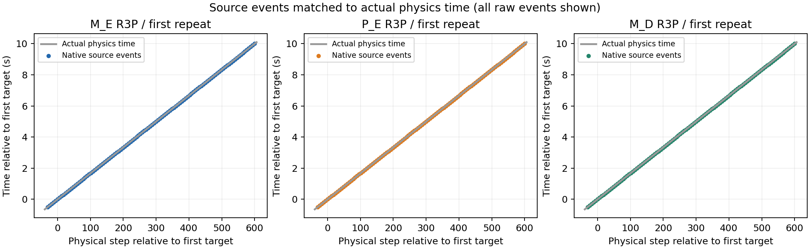
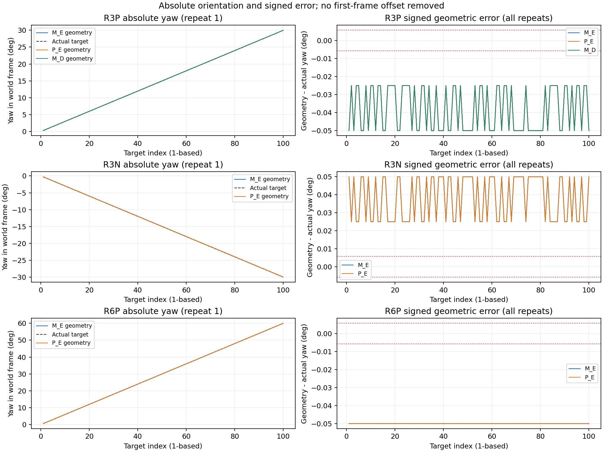
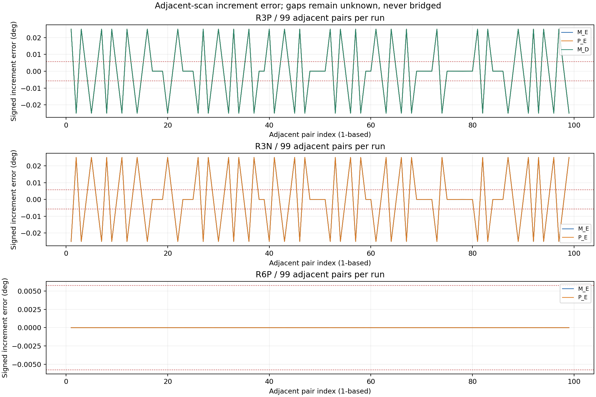
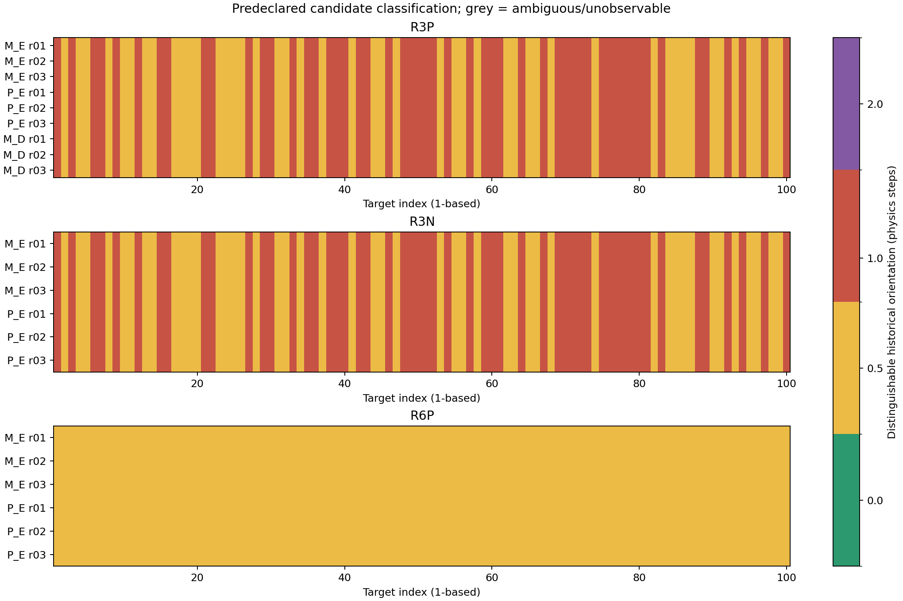
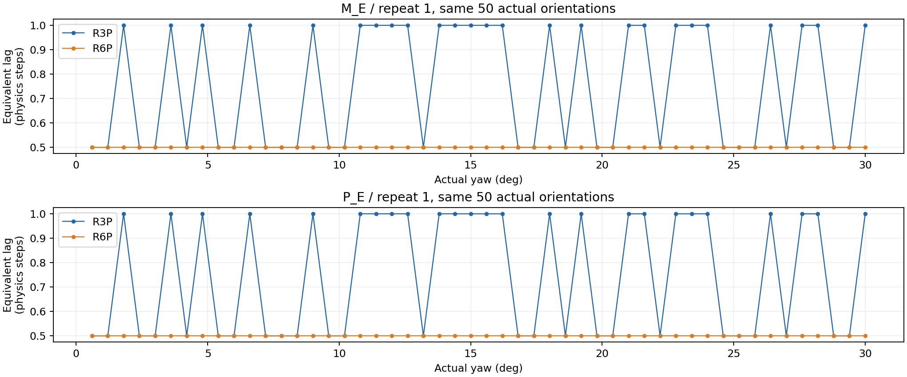

# 原生 Instant LiDAR 独立基线：实现与执行记录

日期：2026-10-15，Asia/Shanghai。依据 [005 实验方案](005_原生InstantLiDAR独立最小连续采集基线实验方案.md)。当前状态：实现及本轮矩阵执行完成：6 轮 E 资格＋24 轮必做主对照＋9 轮 D 对照，共 39 轮、3,108 个计划目标。独立最小链路与现有链路稳定复现相同旋转异常，历史长度 64→8 未消除异常；正式连续采集仍未通过。

## 1. 本轮新增边界

`tools/native_instant_baseline/run_minimal.py` 不继承或导入 EngineOwner、NativeProbeOwner、TableOwner、ContinuousBackend、生产账本或旧采集运行器。接收回调只复制同一事件的 XYZ/GMO 和元数据，并在字节归自有队列之后记录原生时间映射。物理状态关联、几何和候选判定全部离线完成。实际载入模块清单另作资格门槛。

P_E 使用现有连续入口，以本轮专用 spec 增加 PRE/POST 只读记录、局部整数步绝对目标表、两周期固定正常推进排空以及配置/输出拓扑记录。旧实验默认不启用这些分支。独立最小组和现有组均无采样前保持、逐目标重复渲染、Barrier 或按质量挑选事件。

保存辅助是独立 `io.py`，与 P_E 采用同样的后台 gzip level 1/mtime 0、自有 CPU 字节、256 MiB 队列和 2 GiB 原始预算策略。只读元数据模块两组共用，并在依赖说明中明确；运动、调度、矩阵生成、状态接收及原生 Writer 独立。

## 2. 已核验构建与 E 冻结

| 项目 | 当前实测 |
|---|---|
| GPU | 单 NVIDIA L40，UUID `GPU-98e8b2c0-e87d-4770-07ca-72683e12547c` |
| Isaac Sim | `6.0.1-rc.7+release.42383.32955d8d.gl` |
| Kit | `110.1.2+production.326809.f9bf0dda.gl` |
| Replicator / Sensors | `1.13.27` / common、lidar 均 `3.0.0` |
| SimulationManager / RenderingManager | `1.15.6` / `0.4.3` |
| 原生实验 RTX API | `1.4.6`；Lidar、LidarSensor、GMO parser 均存在，O_D 尚未运行 |
| 实际物理/loop/时间码 | 60 Hz，loop step 1/60 s，固定推进、play_every_frame 开启；按实际物理序列再次验收 |
| 核心 E 设置 | Multi-Tick、perSensorTickTlas、Motion BVH 开启，历史长度 64，异步渲染关闭 |
| 原生输出 | 单个 300×300 产品；Extractor、GMO、SimulationTime、ReferenceTime，CPU、自有副本，GMO BASIC 通道 |
| 传感器输出语义 | `instantLidar=true`、`accumulateOutputs=true`、`outputMotionCompensationState=NONCOMPENSATED`；近/远范围约 0.1/60 m，距离误差参数为 0；其余有效 schema 全量保存 |
| 资产 | 同一 MyAiry_front 源 prim；六个实际用到的磁盘 USD 层已逐一散列 |

E 来自新原生配置探针的实际读回。最终运行态版本保存为 `config/native_instant_baseline/effective_E.json`，SHA256 `66cac92a144b3cf3b02684bcd76681fb0a71b896aa1596b7adf00ffd3e75544b`。每轮重新读取并与它比较。原暂停态探针版本保留为 `effective_E_paused_probe_v1.json`，不继续用其 loop 状态作为采样态真值。

首个配置探针遇到本构建缺少 `Timeline.get_auto_update` 的接口差异，未采正式样本，清理通过。修正只读记录为 unavailable 后，以 `effective_E_probe_20261015_r02` 独立重跑成功；实际推进由每 update 物理步、dt 和原生 tick 检查。

安装配置确认 Multi-Tick/per-sensor TLAS 是本构建基础应用的启用项；不能将关闭它们直接当作受支持的 10 Hz 简化默认。独立探针 r03 去掉历史长度的启动覆盖后，读得本构建默认值 8；初始化 E 后为 64。已预登记 D 只恢复此项为 8，保留其他条件，`effective_D.json` SHA256 为 `59f1532ca289bf6efa07078e26e3af5480f4815ab6cc818b899fe982e096c9d9`。D 的逐轮有效值仍需资格验证。

## 3. 独立测量与失败保留

本地已通过七项新增控制：独立标量轴向/斜向射线与正反转；0/半步/一步/两步的绝对偏差和正确帧间增量；静态候选不可辨识；墙面覆盖不足；自有字节和 SHA 回读；最小入口导入边界；GMO 有效结构与分配尾部边界。已有 17 项 clock_state 契约仍通过。

主分析器独立实现 row-vector 世界变换、slab 房间求交、固定点集四次 Gauss–Newton yaw 测量和四个旋转候选。离线另与旧 GMO 解码、射线求交和几何实现逐目标交叉核验，分歧保留并阻断测量资格。

第一个正式短轮 `M_E/S0/r01/q01` 完成 12 目标采集、18 个原始事件，输入、时间关联、60/10 Hz 推进与退出清理通过。新解码器错误要求“ndarray 长度等于有效 GMO 大小”，导致全部几何为 unknown，批次按资格失败停止。

保留字节实查：一个原生缓冲区 5,994,592 字节，头部声明有效区间 2,997,230 字节，额外分配尾部 2,997,362 字节；该样本尾部全零。修正为 `264 ≤ declared_bytes ≤ owned_buffer_bytes`，每个序列化字段不得越过 declared span，最终游标必须等于 declared size；全缓冲区仍原样保存和散列，尾部不充作点数据，不假定所有事件尾部恒为零。

规则 v2 只修正 ABI 解析边界，全部几何、输入、时间和拟合门槛不变。`run_order_v1.json` 和 q01 原报告保留，重新登记 q02 六个资格与 main_v2 主轮。不能把 q01 的 unknown 解释为已通过几何。

## 4. 运行次序与当前状态

必做顺序保存于 `config/native_instant_baseline/run_order.json`：六个 12 目标资格，随后 S0→R3P→R3N→R6P；每条件 M1→P1→P2→M2→M3→P3，各 100 目标。主轮按最多四个独立进程一批拆分，不同 Kit 不在同卡并行。

主轮必须同时满足静态测量资格、M_E/P_E 配对资格和源码锁。旋转绝对几何失败属于结果，不作为丢弃有效样本或跳过其他方向的理由。所有原始结果写入独立 `reports/native_instant_baseline/`，不发布 READY、不改变正式连续采集验收状态。

q02 四个静态轮全部测量、几何和清理通过，但记录于暖机前；与旧探针暖机后读回的 `useFastMode/play_every_frame` 不同，不能冒称冻结配置核对通过。q03 统一为暖机后，得到两组完全一致的配置；又发现旧探针在暂停后读取 `loop_manual_mode=false`，真实采样态为 true。新的 r03 探针在同一进程直接记录运行态 true 和暂停态 false，确认生命周期变化。

因此，保留 q01/q02/q03 所有原始数据与报告，发布规则 v4、运行态 E 和新 q04 编号重新资格。请求参数、数值门槛及 q03 的采集/分析实现不变；没有删除配置检查以使结果通过。v3 同时补齐全原始事件时间唯一性检查（含暖机/排空）、P 的轻量 trace 预算计数和初始化当前 RSS 基准。

q04 四个静态轮各 12/12 几何通过。两组 R3P 各 12/12 绝对几何失败、6/12 原生 pose 失败、8/11 相邻增量失败；候选各为前一步 6、半步 6。六轮测量和清理均通过，三对配置、环境、资产、拓扑、初始化、输入及相位一致。独立最小入口实际加载模块边界通过。

2026-10-15 03:52:18 UTC 生成主轮源码锁，开始固定 24 轮 M_E/P_E 对照，后接已预登记的 9 轮 D 对照。全部预登记运行现已结束，完整终态及逐轮表见下节。

## 5. 完整主轮结果

四类条件均完成两组各三次独立初始化，每轮固定 100 目标、99 对相邻扫描。下表数字按 r01/r02/r03 依次列出，失败目标与 unknown 均未从分母删除。

| 组别 | 条件 | 原生 pose 失败（各 /100） | 绝对几何失败（各 /100） | 增量失败（各 /99） | 每轮历史候选 |
|---|---|---:|---:|---:|---|
| M_E | S0 | 0/0/0 | 0/0/0 | 0/0/0 | 静态等价、不可辨识 |
| M_E | R3P | 52/52/52 | 100/100/100 | 54/54/54 | previous1=53；half=47 |
| M_E | R3N | 52/52/52 | 100/100/100 | 54/54/54 | previous1=53；half=47 |
| M_E | R6P | 0/0/0 | 100/100/100 | 0/0/0 | half=100 |
| P_E | S0 | 0/0/0 | 0/0/0 | 0/0/0 | 静态等价、不可辨识 |
| P_E | R3P | 52/52/52 | 100/100/100 | 54/54/54 | previous1=53；half=47 |
| P_E | R3N | 52/52/52 | 100/100/100 | 54/54/54 | previous1=53；half=47 |
| P_E | R6P | 0/0/0 | 100/100/100 | 0/0/0 | half=100 |
| M_D | S0 | 0/0/0 | 0/0/0 | 0/0/0 | 静态等价、不可辨识 |
| M_D | R3P | 52/52/52 | 100/100/100 | 54/54/54 | previous1=53；half=47 |

全部 39 轮测量资格、数据完整性和退出清理通过；缺失、重复、时间未分配及几何 unknown 均为零。静态几何通过只用于本模型资格；运动载荷重算新鲜度保持 unknown。

完整 39 轮逐轮分母与候选统计见 [逐轮表](../reports/native005_summary_20261015/run_table.md)，逐目标指标、交叉表和完整分位数见 [结果索引](../reports/native005_summary_20261015/results.json) 及 [元数据目录](../../reports/native005_delivery_20261015/)。

6°/s 每轮原生 pose 和相邻增量均通过，但绝对几何 100/100 失败。不能把正确增量或元数据一致替代当前源姿态下的点云一致性。

## 6. 配对、配置与绝对误差

E 主轮 12/12 对、资格 3/3 对配对成立；环境、资产、schema、输出拓扑、初始化和源 tick 相位一致。所有配对的逐目标三轴判定及历史候选差异数均为零。M/P 实际输入位置差为零，最大旋转差约 2.22e-16 rad；这是数值等价，不声称所有矩阵字节相同。

D 已完成 3 个短轮资格和 S0/R3P 各 100×3，全部逐轮读回 history=8，其余有效配置、输入及拓扑与 E 匹配。D/E 的 3 个资格对及 6 个主轮对配置归因条件成立。恢复本构建默认历史长度没有改变本轮逐目标失败和候选分布，不能据此排除历史查询或插值机制本身。

射线/表面列为每个目标内点残差的 P95，再取全部目标及三轮的最大值；yaw/增量列为每轮目标序列绝对误差的 P95，再取三轮最大值。未扣除首帧偏差，完整 P50/P95/P99/max 与带符号序列仍保留。

| 组别 | 条件 | 当前射线残差 P95 最大（mm） | 表面残差 P95 最大（mm） | 绝对 yaw 误差 P95 最大（°） | 相邻增量误差 P95 最大（°） |
|---|---|---:|---:|---:|---:|
| M_E | S0 | 0.00204025 | 0.001430511 | 5.164044e-06 | 2.339904e-08 |
| M_E | R3P | 7.879501 | 5.889569 | 0.04999567 | 0.02500015 |
| M_E | R3N | 7.878704 | 5.889751 | 0.05000607 | 0.0250004 |
| M_E | R6P | 7.87961 | 5.890613 | 0.05000506 | 4.94102e-06 |
| P_E | S0 | 0.00204025 | 0.001430511 | 5.164044e-06 | 2.339904e-08 |
| P_E | R3P | 7.879501 | 5.889569 | 0.04999567 | 0.02500015 |
| P_E | R3N | 7.878704 | 5.889751 | 0.05000607 | 0.0250004 |
| P_E | R6P | 7.87961 | 5.890613 | 0.05000506 | 4.94102e-06 |
| M_D | S0 | 0.00204025 | 0.001430511 | 5.164044e-06 | 2.339904e-08 |
| M_D | R3P | 7.879501 | 5.889569 | 0.04999567 | 0.02500015 |

共同朝向控制使用预登记的 0.6°、1.2°、…、30.0°，每个重复 50 个目标，实际输入矩阵按门槛核验。R3P/R6P 候选不同的目标数为：M_E r01 25/50；M_E r02 25/50；M_E r03 25/50；P_E r01 25/50；P_E r02 25/50；P_E r03 25/50。完整 100 目标分母未被此子集替代。

## 7. 图表

## 8. 机制解释与仍未证实部分

已证实：异常复现不需要旧 Owner、Backend 或生产状态账本；独立最小入口与现有链路在合格配对下得到相同失败模式。完整 GMO 与 Extractor 一致，独立几何与旧实现交叉一致；两组旋转短轮完整数据在 Windows Python 3.9 重新回读、解码、计算，也与远端 Python 3.12 结果一致。

源事件按 source/ref 时间唯一关联实际物理步，所有目标输入和实际推进合格，因此不能只用 Writer 晚到或命令未施加来解释这些几何偏差。静态通过、正反转均失败、双倍转速呈稳定半步，以及相同朝向下不同每步角增量的区别，把后续重点收敛到两条链路共同使用的原生旋转状态消费、变换历史、射线生成和输出坐标表达路径。

受支持的解释是“点云有效朝向符合历史姿态候选”，并非已经观测到 SDK 内部选择了某个历史槽位或确切插值权重。D 的结果只说明历史容量 8/64 的单项切换不足以修复；不能据此认定整个配置或原生 SDK 某函数无误/有误。

本轮没有取得 GPU 射线实际姿态、历史变换样本、查询时间、插值权重和原生重算标识，无法把根因锁到具体 SLERP、float32 阈值或函数。004 中既有数值阈值模型解释力不足，本轮不将其升级为结论。下一步应以独立基线为复现入口，优先取得这些实际消费状态；当前 Fabric 世界矩阵和时间映射不能替代它们。

## 9. 保存、验证及保护范围

原始保留共 50 轮、3240 个计划目标、3540 个原始事件；其中 q01/q02/q03 仅作修订历史，不混入最终 39 轮主结果。共 8350 个采集证据文件，约 7.103 GiB。全部 3540 个 GMO 已完整回读解码；q01 另存 corrected_decoder_readback，原失败报告没有改写。

250 个主轮锁定文件最终 SHA 无变化；峰值自有队列 6.71 MiB，单轮原始预算占用最大 0.697 GiB；收尾空闲 22.40 GiB。每轮独立 Kit 串行，未安装或下载新依赖。

全部完整 XYZ/GMO 留存在远端原路径。已回传所有紧凑 JSON/JSONL、逐目标分析、原始事件元数据、原始文件 SHA 清单和冻结配置，并校验归档及逐文件 SHA；大型传感器数组和全量载荷未全部复制到本地。另回传 M_E/P_E 各一轮 R3P q04 的完整数据并完成本地数值复算。

[本地归档校验](../reports/native005_delivery_20261015/local_transfer_verification.json)；[最终清单](../reports/native005_delivery_20261015/native005_20261015_v1/final_inventory.json)；[主轮源码锁](../../config/native_instant_baseline/main_code_lock.json)；[保留范围复核](../reports/native005_final_preservation_20261015.json)。

旧 v06 源文件保持不变：True；原始 USD 保持不变：True；已有 36 份 READY/manifest 保持不变：True。收尾本任务 Kit/worker 数为 0。

重要部署均经既有凭据引用、主机指纹与 GPU 身份核验并留审计。被覆盖的项目文件保存在远端 `.deploy_backups/<audit-id>/`；最终采集部署记录见 [部署清单](../reports/native005_final_code_deployment_20261015.json)。如需恢复共享诊断入口或保存器，应按对应初始部署备份逐文件恢复；不要整树覆盖既有用户修改，不删除本轮证据。

## 10. 未完成与适用边界

- 正式连续采集故障尚未修复；`formal_continuous_acceptance=false`，没有生成新的 READY。
- 原生 GPU 状态历史和射线实际消费状态的直接证据、载荷重算新鲜度仍未取得。
- 可选 O_D/LidarSensor 路径、本轮新的 120 Hz 扩展、混合运动、机器人/接触、多传感器及长期运行未执行；不能把当前纯旋转房间诊断推广为生产验收。
- 保持窗口属于先前工程规避实验，本轮没有用保持、额外渲染、吸附时间或姿态修正使数据通过。

复现入口与命令见 [README](../../tools/native_instant_baseline/README.md)。本轮完成的是 005 所要求的独立实现、必做矩阵、推荐 D 对照及证据交付；内部机制定位和生产修复继续保持未完成。
