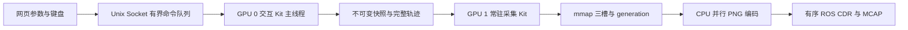

# v07 架构与数据契约

## 1 控制与采集

网页线程只接收、校验和发送控制请求；USD、Articulation、RTX 对象在各自 Kit 主线程操作。交互引擎不创建正式传感器 RenderProduct。0.1x 约束规定运动时间，不压低网页输入频率；离线采集不限速。

## 2 模块

| 模块 | 责任 |
| --- | --- |
| `run_capture.py`、`device_binding.py` | 按 UUID／PCI 解析物理卡；分别设置 renderer、PhysX CUDA ordinal、Annotator；验证回调数组的实际设备 |
| `cpu_budget.py`、`launch_profiles.py` | 读取 cgroup 配额，设置工作池、数值库线程与可选 affinity；交互异步、正式同步 |
| `interactive_runtime.py`、`native_keyboard.py` | 保留控制状态机、输入焦点、三种关节运动、整机和安装位姿调整；发布版本化快照 |
| `trajectory.py` | 保存根姿态、关节角、安装 revision、时间及资产元数据；用于完整回放 |
| `capture_supervisor.py`、`capture_service.py` | 持久任务提交、worker／job 双租约、常驻场景、重复采集、显式关闭和故障恢复 |
| `scene.py`、`sensors.py`、`tickets.py` | 推进到目标时间、应用姿态、冻结、渲染与全部传感器回执、矩阵及时间检查、独立数据复制 |
| `pipeline.py`、`record_worker.py` | 槽位背压、编码并行、有序写入、消费确认；任务边界排空并关闭包 |
| `diagnostics.py`、`resource_details.py`、`analysis.py` | 非阻塞事件、原生 warning、启动资源、逐卡及线程采样、序号完整性与离线阶段分析 |

## 3 常驻状态与复用

服务经历 loading → idle → preparing_job → running → draining → idle。每轮建立新的 job、session、capture ID、采样 epoch、记录进程和诊断 scope；兼容场景与 RenderProduct 留在同一 worker。worker 锁贯穿服务生命周期，job 锁只覆盖当前采集。关闭服务时拒绝新任务，原生进程完全退出后才能再次 Prepare。

复用键包括根 USD 内容、传感器选择、渲染参数、物理频率和后端。普通关节与安装位姿从每组快照更新。当前复用键没有自动追踪所有 payload 文件的外部修改；运行期间若修改资产或材质，先关闭空闲服务并重新 Prepare。

正式一组依次为：源状态 → 空闲槽 → 时间推进 → 姿态应用 → 冻结与预热 → 正式渲染 → 全传感器完成与数据复制 → 时间／位姿校验 → 提交 → 后台编码写入与确认。Stop 在完整组边界排空；不会在未完成渲染时复用槽位或切换会话。

## 4 运行边界

保持原始 USD 和正式质量。默认交互工作池 8、采集 12、PhysX 4、编码 4，数值库线程 1；工作池上限不等于总线程数或独占 CPU。未改系统 cgroup、驱动、桌面或服务。

设备设置、SDK 节点、Warp 数组、native GPU 表与 nvidia-smi 进程记录分别提供证据。CPU span 包含原生等待，nvidia-smi 采样不能精确标识短 GPU 内核；目前没有宣称具备完整 CUDA 内核级追踪。日志及限制见 [logging_contract.md](logging_contract.md)。
